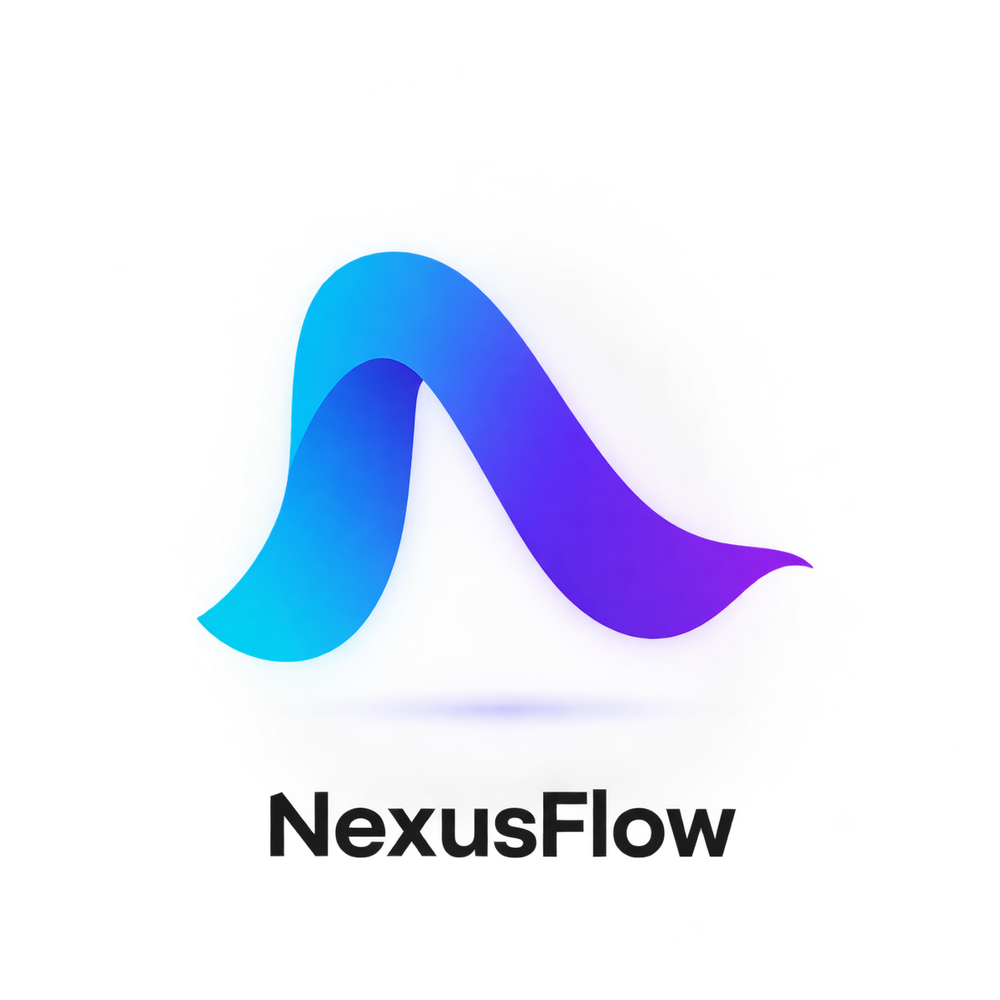
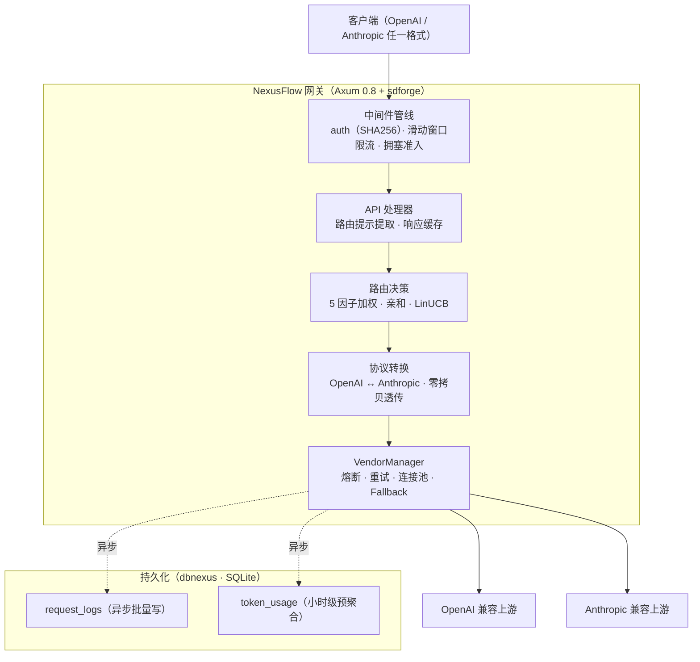

<div align="center">



[](https://github.com/Kirky-X/NexusFlow/actions/workflows/ci.yml) [](https://github.com/Kirky-X/NexusFlow/releases) [](LICENSE) [](https://www.rust-lang.org/)

**中文** | [English](README_EN.md)

**智能 LLM 路由网关 —— 多厂商统一接入 · 协议互转 · 弹性调度**

[✨ 功能特性](#-功能特性) • [🚀 快速开始](#-快速开始) • [📚 文档](#-文档) • [🐳 Docker 部署](#-docker-部署) • [🤝 参与贡献](#-参与贡献)

</div>

---

<div align="center">

### 🎯 一个接入点，多家上游

客户端用 OpenAI 或 Anthropic 任一格式请求，网关完成认证、限流、路由、协议转换与容错，把多个上游 LLM 供应商抽象为单一端点：

<table style="width:100%; border-collapse: collapse">
<tr>
<td align="center" width="25%">🔄<br><b>协议互转</b><br><span style="color:#64748B">OpenAI ↔ Anthropic · 零拷贝透传</span></td>
<td align="center" width="25%">🧭<br><b>智能路由</b><br><span style="color:#64748B">5 因子加权 · 会话亲和 · LinUCB</span></td>
<td align="center" width="25%">🛡️<br><b>弹性容错</b><br><span style="color:#64748B">熔断 · 重试 · Fallback 链</span></td>
<td align="center" width="25%">📊<br><b>可观测与成本</b><br><span style="color:#64748B">请求日志 · Token 预聚合 · 成本追踪</span></td>
</tr>
</table>

</div>

---

## 📋 目录

- [✨ 功能特性](#-功能特性)
- [🚀 快速开始](#-快速开始)
- [⚙️ 配置概览](#️-配置概览)
- [📚 文档](#-文档)
- [🏗️ 架构](#️-架构)
- [📚 作为库依赖](#-作为库依赖)
- [🧪 测试](#-测试)
- [⚡ 性能设计](#-性能设计)
- [🔒 安全](#-安全)
- [🗺️ 开发路线图](#️-开发路线图)
- [🐳 Docker 部署](#-docker-部署)
- [🤝 参与贡献](#-参与贡献)
- [📋 更新日志](#-更新日志)
- [📄 许可证](#-许可证)
- [🙏 致谢](#-致谢)
- [📞 联系与支持](#-联系与支持)
- [⭐ Star 历史](#-star-历史)

---

## ✨ 功能特性

<table style="width:100%; border-collapse: collapse">
<tr>
<td width="50%" style="vertical-align:top; padding: 12px">🔄 <b>协议互转</b><br><span style="color:#64748B">OpenAI Chat / Embeddings ↔ Anthropic Messages 双向转换，SSE 流式两端同支持；入站协议与目标厂商一致时零拷贝透传</span></td>
<td width="50%" style="vertical-align:top; padding: 12px">🧭 <b>智能路由</b><br><span style="color:#64748B">模型权重 × 队列 × 时间窗口（× 可选延迟 / 错误率）5 因子加权随机，温度平滑；可选 Power-of-Two-Choices、LinUCB 上下文老虎机、会话亲和、SLA 虚拟队列与 LPS 排队论前瞻</span></td>
</tr>
<tr>
<td width="50%" style="vertical-align:top; padding: 12px">🛡️ <b>弹性容错</b><br><span style="color:#64748B">limiteron 熔断器（5 次失败开 30s，慢调用 60s 阈值防误判）、按状态码分类重试（429 尊重 Retry-After 展宽、5xx 指数退避）、priority 驱动的 Fallback 换路链（总尝试预算默认 8）</span></td>
<td width="50%" style="vertical-align:top; padding: 12px">🚦 <b>入站限流与准入</b><br><span style="color:#64748B">limiteron 滑动窗口全局限流 + <code>[[rate_limit.rules]]</code> 路径规则；拥塞感知优先级准入（按 API Key 档位 dedicated/guaranteed/elastic/spot 分级 shed）</span></td>
</tr>
<tr>
<td width="50%" style="vertical-align:top; padding: 12px">🔐 <b>安全认证</b><br><span style="color:#64748B">API Key 仅存 SHA256 摘要、常量时间比较；上游密钥只存环境变量名；吊销/轮换经配置热更新立即生效</span></td>
<td width="50%" style="vertical-align:top; padding: 12px">⚡ <b>响应缓存</b><br><span style="color:#64748B">精确响应缓存（oxcache 存储），租户 + 厂商 + 请求体指纹键，TTL 分级乘数与负载联动，<code>X-No-Cache: 1</code> 强制回源</span></td>
</tr>
<tr>
<td width="50%" style="vertical-align:top; padding: 12px">📊 <b>请求日志与预聚合</b><br><span style="color:#64748B">异步批量写 SQLite（满载丢弃计数不阻塞响应），Token 用量按 (厂商, 模型, 日期, 小时) 预聚合 UPSERT</span></td>
<td width="50%" style="vertical-align:top; padding: 12px">💰 <b>成本追踪</b><br><span style="color:#64748B"><code>[[pricing]]</code> 配置输入/输出单价，微美元原子累积按厂商/模型分账，单价热更新立即生效</span></td>
</tr>
<tr>
<td width="50%" style="vertical-align:top; padding: 12px">🔥 <b>配置热更新</b><br><span style="color:#64748B">基于 confers DynamicField 的无锁热读；写路径事务语义（校验 → 原子落盘 → 切换内存态），自动快照备份到 <code>config-backups/</code>（保留 10 份、密钥打码）；需重启的段在响应 <code>restart_required</code> 中显式提示</span></td>
<td width="50%" style="vertical-align:top; padding: 12px">🌐 <b>管理端点与可观测</b><br><span style="color:#64748B">14 个方法端点：日志查询/搜索、Token 统计、全局指标（含亲和命中率、丢弃计数）、厂商状态、配置与模型管理、健康检查</span></td>
</tr>
<tr>
<td width="50%" style="vertical-align:top; padding: 12px">🗣️ <b>国际化</b><br><span style="color:#64748B">Fluent 双语束（en/zh）覆盖全部业务消息与错误文案，<code>NEXUSFLOW_LANG</code> → 系统环境 → 回退 en 检测链</span></td>
<td width="50%" style="vertical-align:top; padding: 12px">🧰 <b>生产就绪</b><br><span style="color:#64748B">Docker 多阶段构建 + 非 root 运行、docker-compose 资源限制与健康检查、GitHub Actions CI（fmt/clippy/test/coverage/audit）与自动发布流水线</span></td>
</tr>
</table>

---

## 🚀 快速开始

### 📦 环境要求

- Rust 1.92+（与 CI 锁定版本一致，edition 2021）
- SQLite（运行时通过 rustls 编译，无系统依赖要求）
- **7 个兄弟库源码需与本项目同级目录**（path 依赖）：`confers`、`dbnexus`、`inklog`、`limiteron`、`oxcache`、`sdforge`、`trait-kit`

### 🔨 编译运行

```bash
# 默认读取工作目录 config.toml（可参考 config.example.toml）
cargo run --release

# 指定配置文件
cargo run --release -- /path/to/config.toml
```

### 💡 首次请求

```bash
# 健康检查（无需认证；实际注册路径带 sdforge 版本前缀）
curl http://127.0.0.1:8080/api/v1/health

# OpenAI 兼容聊天补全
curl -X POST http://127.0.0.1:8080/v1/chat/completions \
  -H "Authorization: Bearer <your-api-key>" \
  -H "Content-Type: application/json" \
  -d '{"model": "gpt-4", "messages": [{"role": "user", "content": "Hello"}]}'

# Anthropic 兼容消息
curl -X POST http://127.0.0.1:8080/v1/messages \
  -H "Authorization: Bearer <your-api-key>" \
  -H "Content-Type: application/json" \
  -d '{"model": "claude-3-opus", "max_tokens": 1024, "messages": [{"role": "user", "content": "Hello"}]}'
```

> 提示：裸 `/health` 未注册路由（会 404），但已加入认证与限流白名单；完整端点清单见 [📘 API 参考](docs/API_REFERENCE.md)。

---

## ⚙️ 配置概览

运行时配置为单个 `config.toml`，共 13 个顶层段：

| 段 | 作用 | 热更新 |
|----|------|--------|
| `server` / `database` | 监听地址与 SQLite 路径/池大小 | ❌ 需重启 |
| `vendors` / `global_model` | 厂商、模型、权重、限流三形态 | ✅ enabled 与权重即时生效 |
| `auth` / `cors` | API Key 摘要与 CORS | auth ✅ / cors ❌ |
| `routing` / `retry` / `resilience` | 路由系数与选择算法、重试策略、韧性覆盖面 | ✅ |
| `cache` / `rate_limit` / `admission` | 响应缓存、入站限流、拥塞准入 | cache/admission ✅ / rate_limit ❌ |
| `pricing` | 输入/输出 token 单价（成本计算） | ✅ |

```toml
[[vendors]]
id = "openai"
type_ = "openai"
api_key_env = "OPENAI_API_KEY"     # 上游密钥从环境变量读取
api_base = "https://api.openai.com/v1"
enabled = true

[[vendors.models]]
model_id = "gpt-4"
weight = 1.0                        # 参与路由加权

[[pricing]]
vendor_id = "openai"
model_id = "gpt-4"
input_per_1k_tokens = 0.03
output_per_1k_tokens = 0.06
```

认证开启：将 API Key 的 SHA256 摘要填入 `[auth]` 段（`echo -n "your-key" | sha256sum`），完整字段说明、限流规则与准入配置见 [📖 用户指南](docs/USER_GUIDE.md)。

---

## 📚 文档

| 文档 | 说明 |
|------|------|
| [📖 用户指南](docs/USER_GUIDE.md) | 从配置、部署到运维的完整使用教程 |
| [📘 API 参考](docs/API_REFERENCE.md) | 全部 14 个方法端点的参数、响应与错误码 |
| [🏗️ 架构文档](docs/ARCHITECTURE.md) | 设计原则、路由决策体系、弹性与热更新机制 |
| [🔒 安全文档](docs/SECURITY.md) | 安全设计、供应链门禁与漏洞处理流程 |
| [❓ FAQ](docs/FAQ.md) | 常见问题与已知边界 |
| [📋 更新日志](docs/CHANGELOG.md) | 版本变更记录（Keep a Changelog 格式） |
| [🤝 贡献指南](docs/CONTRIBUTING.md) | 环境搭建、开发命令与提交规范 |

---

## 🏗️ 架构

NexusFlow 采用分层管线设计：入站请求经中间件管线（认证 → 限流 → 准入）进入 API 层，由路由决策器在合格厂商集合中选择目标（抽象模型 → `vendor.model` 直连 → `auto` 全局池三级决策），再经协议转换（或零拷贝透传）交由 VendorManager 携带熔断/重试执行出站调用；响应侧完成 SSE 分帧与协议回转，同时异步落日志、预聚合 Token、累积成本并回写亲和与 LinUCB 奖励。



路由决策体系、弹性层状态机、配置热更新事务语义、DI 组装与 i18n 架构的完整说明见 [🏗️ 架构文档](docs/ARCHITECTURE.md)。

NexusFlow 同时是**库优先**组件：服务器装配链承载于 `nexusflow::server`（可独立部署的 HTTP 服务器），Rust 客户端承载于 `nexusflow::sdk`（`sdk` feature 门控）——二进制 `main.rs` 只是薄启动入口。`grpc` feature（独立门控，不进 `full`）另提供 gRPC 服务器：sdforge `sdforge.v1.SdForgeService` 门面（GetInfo / Call / CallStream，JSON over gRPC）经 `take_grpc_server` 与 HTTP 同进程共存，认证复用 `[auth]` 段 SHA256 摘要，优雅停机与 HTTP 共享同一信号。

---

## 📚 作为库依赖

`nexusflow` 既是可执行网关，也是 Rust 库（`src/lib.rs` 导出公共 API）。默认 `full` feature 已含服务器组件；客户端 SDK 由 `sdk` feature 提供。

**嵌入式起服**（在自己的应用中托管网关）：

```rust
#[tokio::main]
async fn main() -> Result<(), nexusflow::error::NexusFlowError> {
    // 装配链（配置/数据库/厂商/路由）+ 起服 + 优雅停机 flush 全部由库承担
    nexusflow::server::run(Some("config.toml".into())).await
}
```

**HTTP 客户端 SDK**（调用已部署网关，需 `sdk` feature）：

```rust
use nexusflow::sdk::{ChatMessage, ChatRequest, ChatTool, ChatToolChoice, ChatToolDefinition, NexusFlowClientBuilder};

#[tokio::main]
async fn main() -> Result<(), Box<dyn std::error::Error>> {
    let client = NexusFlowClientBuilder::new()
        .base_url("http://127.0.0.1:8080")
        .api_key(std::env::var("NEXUSFLOW_API_KEY")?)
        .build()?;

    // 便捷构造 + 请求级配置（temperature / max_tokens / hints 等经 RequestConfig）
    let request = ChatRequest::new("gpt-4", "你好")
        .with_tools(
            vec![ChatTool {
                function: ChatToolDefinition {
                    name: "get_weather".into(),
                    description: Some("查询天气".into()),
                    parameters: serde_json::json!({"type": "object"}),
                },
            }],
            Some(ChatToolChoice::auto()),
        )
        .with_vendor_extension("thinking_mode", serde_json::json!("off"))?; // 保留键（model/messages 等）会被拒绝

    let resp = client.chat(&request).await?;
    println!("{}", resp.content);
    for call in &resp.tool_calls {
        println!("tool_call: {} {}", call.id, call.function.name);
    }
    println!(
        "finish_reason: {} | tokens: {} + {} (cache_read: {})",
        resp.finish_reason.as_wire(),
        resp.usage.prompt_tokens,
        resp.usage.completion_tokens,
        resp.usage.cache_read_tokens
    );
    Ok(())
}
```

> **T008 对齐**：`ChatMessage::content` 支持多模态内容件（`ChatContent::Parts`，图片 URL / base64 data URL）；tool 角色消息用 `ChatMessage::tool(tool_call_id, content)` 回填；admin 面走真实路由（目录 `GET/PUT/DELETE /admin/models`、健康 `GET /api/v1/health`、vendor 运行面状态）。

> SDK 是「HTTP 客户端」（调用网关 REST API，含 SSE 流式），不是进程内直连路由核心；嵌入式直用 `nexusflow::server` 与 `nexusflow::api` 即可。

---

## 🧪 测试

### 🎯 测试策略

单元测试内联于 `src/`（`#[cfg(test)]`），集成测试按功能域组织在 `tests/`（20 个文件：路由、协议转换、厂商、熔断、重试、准入、SSE、成本、装配冒烟等），Mock 使用 mockall / mockito，时间敏感测试注入 limiteron MockClock 假时钟。

### ▶️ 运行命令（与 CI 一致）

```bash
cargo fmt --all -- --check
cargo clippy --workspace --all-targets --all-features -- -D warnings
cargo test --workspace --all-features
```

### 📊 测试规模

截至当前版本：单元测试 235 个（`src/` 内联实测）、集成测试 700 个（`tests/` 30 个文件实测），合计 **935 个，0 ignored**。整体行覆盖率 97%+（`cargo llvm-cov --workspace --all-features`）。主要分布：

| 测试域 | 用例数 | 覆盖范围 |
|--------|--------|----------|
| vendor_test | 110 | 厂商管理 / 限流 / 流式超时 / 健康与指标 |
| protocol_test | 108 | OpenAI ↔ Anthropic 转换 / 流式全变体 / SSE 分帧 |
| api_test | 101 | 端点集成 / 缓存 / 换路 / 亲和 / admin |
| router_test | 92 | 加权选择 / 亲和 / 提示路由 / 边界 |
| retry / database / sse | 38 / 38 / 37 | 重试分类 / 落库查询与预聚合 / 流分帧与 SDK |
| config / utils_coverage / fallback / admission | 20 / 19 / 17 / 16 | 配置加载 / 指标与限流边界 / 换路链 / 准入 |
| bandit / config_coverage / circuit_breaker 等 | 其余 | 波段it 路由 / loader·manager 分支 / 熔断 / server·grpc 起服 / 装配冒烟 |

---

## ⚡ 性能设计

当前未发布官方基准数据（路线图已列入），以下为可复核的设计要点：同协议请求零拷贝透传（跳过转换开销）、配置经 arc-swap 无锁热读（读路径 O(1)）、日志与预聚合全异步（批量事务落库，满载丢弃计数不阻塞响应）、出站连接复用单 reqwest 客户端 + 信号量并发上限、会话亲和与响应缓存由 oxcache 内存后端承载。设计细节见 [🏗️ 架构文档 · 性能设计](docs/ARCHITECTURE.md)。

---

## 🔒 安全

### 🛡️ 安全设计

API Key 仅以 SHA256 摘要存储并常量时间比较、上游密钥只存环境变量名、错误响应仅暴露固定 `error.type` 代码、配置快照自动打码密钥、CORS 与限流封禁（403）分层防护、Docker 非 root 运行。逐项机制见 [🔒 安全文档](docs/SECURITY.md)。

### 🚨 报告安全漏洞

请勿通过公开 issue 报告安全漏洞。请使用 GitHub [Security Advisories](https://github.com/Kirky-X/NexusFlow/security/advisories/new) 私密披露通道提交报告。项目承诺 48 小时内确认、7 天内给出初步评估。

---

## 🗺️ 开发路线图

<table style="width:100%; border-collapse: collapse">
<tr><th style="text-align:center">状态</th><th style="text-align:left">方向</th><th style="text-align:left">条目</th></tr>
<tr><td align="center">✅</td><td>核心网关</td><td>OpenAI / Anthropic 协议互转、SSE 流式、零拷贝透传、14 个方法端点</td></tr>
<tr><td align="center">✅</td><td>智能路由</td><td>5 因子加权 + 温度平滑、会话亲和、LinUCB、Power-of-Two、SLA / LPS 可选层</td></tr>
<tr><td align="center">✅</td><td>弹性容错</td><td>limiteron 熔断 / 重试 / Fallback 换路链、拥塞感知准入、key 档位</td></tr>
<tr><td align="center">✅</td><td>可观测与成本</td><td>异步日志、Token 小时级预聚合、全局指标、pricing 成本追踪</td></tr>
<tr><td align="center">✅</td><td>配置热更新</td><td>confers DynamicField 无锁热读、事务写路径、快照备份与 restart_required 提示</td></tr>
<tr><td align="center">✅</td><td>国际化</td><td>Fluent en/zh 双语束覆盖全部业务消息</td></tr>
<tr><td align="center">🔜</td><td>成本查询 API</td><td>请求级 / 聚合级成本落库与 <code>/admin/cost</code> 查询端点（CostTracker 当前仅内存累积）</td></tr>
<tr><td align="center">✅</td><td>Rust SDK</td><td>sdk 并入 <code>src/sdk</code>（<code>sdk</code> feature 门控，原 workspace 继承断裂已消除）：chat / stream / embed / admin</td></tr>
<tr><td align="center">🔜</td><td>性能基准</td><td>建立 Criterion 基线（透传 / 转换 / 路由决策路径）</td></tr>
<tr><td align="center">🔜</td><td>日志查询补全</td><td><code>/admin/logs</code> 的 end_time 过滤落 SQL（当前已知未生效，见 <a href="docs/FAQ.md">FAQ</a>）</td></tr>
</table>

---

## 🐳 Docker 部署

```bash
# 构建镜像（多阶段：rust:1.92-alpine 构建 → alpine:3.21 运行，非 root）
# 注意：-f 指定 Dockerfile，构建上下文仍为仓库根（bind mount 与 .dockerignore 按根解析）
docker build -t nexusflow:latest -f docker/Dockerfile .

# 运行容器（配置只读挂载 + SQLite 数据持久化于 /app/data）
docker run -d -p 8080:8080 \
  -v $(pwd)/config.toml:/app/config.toml:ro \
  -v $(pwd)/data:/app/data nexusflow:latest

# 或使用 docker-compose 一键部署（含资源限制与健康检查；compose 文件位于 docker/ 下）
docker compose -f docker/docker-compose.yml up -d
```

> 健康检查：Dockerfile 与 docker-compose 的 HEALTHCHECK 均探测实际注册路径 `/api/v1/health`；docker-compose 自带资源限制（cpus 2 / 内存 512M）与非 root 运行时（详见 [📖 用户指南 · Docker 部署](docs/USER_GUIDE.md)）。

---

## 🤝 参与贡献

详细的贡献流程、开发命令与提交规范请参阅 [🤝 贡献指南](docs/CONTRIBUTING.md)。

### 🛠️ 开发环境

工具链为 Rust 1.92（与 CI 一致）；提交前运行 `cargo fmt --all -- --check` 与 `cargo clippy --workspace --all-targets --all-features -- -D warnings`；提交信息遵循 Conventional Commits（`feat(scope): ...` / `fix(scope): ...`）。7 个兄弟库（confers / dbnexus / inklog / limiteron / oxcache / sdforge / trait-kit）需与本项目同级目录。

### 💖 贡献方式

<table style="width:100%; border-collapse: collapse">
<tr>
<td width="33%" align="center" style="padding: 16px">

### 🐛 报告 Bug

发现问题？<br>
<a href="https://github.com/Kirky-X/NexusFlow/issues/new">创建 Issue</a>

</td>
<td width="33%" align="center" style="padding: 16px">

### 💡 功能建议

有好想法？<br>
<a href="https://github.com/Kirky-X/NexusFlow/discussions">开始讨论</a>

</td>
<td width="33%" align="center" style="padding: 16px">

### 🔧 提交 PR

想贡献代码？<br>
<a href="https://github.com/Kirky-X/NexusFlow/pulls">Fork 并提交 PR</a>

</td>
</tr>
</table>

---

## 📋 更新日志

完整版本历史见 [📋 更新日志](docs/CHANGELOG.md)（遵循 [Keep a Changelog](https://keepachangelog.com/en/1.0.0/) 格式，语义化版本）。

| 版本 | 日期 | 要点 |
|------|------|------|
| 0.1.0 | 2026-04-04 | 初始发布并持续迭代（63 commits）：协议互转网关、5 因子加权路由与可选智能层、limiteron 弹性体系、异步日志与预聚合、成本追踪、confers 热更新底座、i18n、35 项优化落地 |

---

## 📄 许可证

本项目采用 [MIT License](LICENSE)。

---

## 🙏 致谢

### 🌟 核心依赖（兄弟库）

NexusFlow 通过 Cargo path 依赖集成以下本地源码库（需同级目录，`[patch.crates-io]` 统一身份）：

| 库 | 用途 |
|----|------|
| [confers](https://github.com/Kirky-X/confers) | 配置加载防护与热更新底座（DynamicField / SnapshotManager） |
| [dbnexus](https://github.com/Kirky-X/dbnexus) | SQLite 持久化（连接池 / 批量事务 / kit 集成） |
| [inklog](https://github.com/Kirky-X/inklog) | 结构化日志（HTTP / CLI / SQLite） |
| [limiteron](https://github.com/Kirky-X/limiteron) | 限流 / 熔断 / 重试原语 |
| [oxcache](https://github.com/Kirky-X/oxcache) | 统一缓存 API（会话亲和与响应缓存存储层） |
| [sdforge](https://github.com/Kirky-X/sdforge) | HTTP 服务框架（`#[service_api]` / 路由注册） |
| [trait-kit](https://github.com/Kirky-X/trait-kit) | DI 容器（AsyncKit，4 module 拓扑组装） |

### 💝 特别感谢

感谢 Rust 社区与所有[贡献者](https://github.com/Kirky-X/NexusFlow/graphs/contributors)。

---

## 📞 联系与支持

<table style="width:100%; max-width: 600px">
<tr>
<td align="center" width="33%">
<a href="https://github.com/Kirky-X/NexusFlow/issues"><b style="color:#991B1B">Issues</b></a><br>
<span style="color:#64748B">报告问题和 Bug</span>
</td>
<td align="center" width="33%">
<a href="https://github.com/Kirky-X/NexusFlow/discussions"><b style="color:#1E40AF">讨论区</b></a><br>
<span style="color:#64748B">提问和分享想法</span>
</td>
<td align="center" width="33%">
<a href="https://github.com/Kirky-X/NexusFlow"><b style="color:#1E293B">GitHub</b></a><br>
<span style="color:#64748B">查看源代码</span>
</td>
</tr>
</table>

---

## ⭐ Star 历史

[](https://star-history.com/#Kirky-X/NexusFlow&Date)

如果这个项目对您有帮助，请考虑给它一个 ⭐️！

**由 Kirky.X 构建**

---

<sub>© 2026 Kirky.X. 保留所有权利。</sub>
