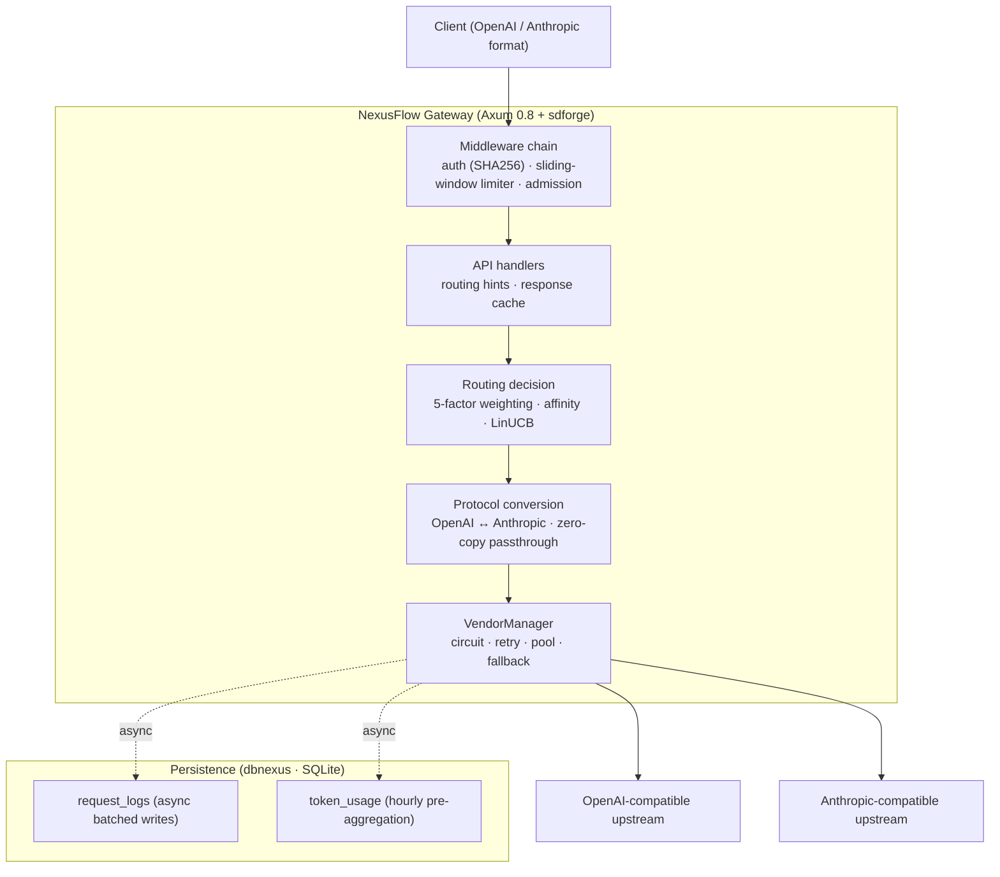

<div align="center">


[](https://github.com/Kirky-X/NexusFlow/actions/workflows/ci.yml) [](https://github.com/Kirky-X/NexusFlow/releases) [](LICENSE) [](https://www.rust-lang.org/)

[中文](README.md) | **English**

**Intelligent LLM routing gateway — unified multi-provider access · protocol conversion · resilient scheduling**

[✨ Features](#-features) • [🚀 Quick Start](#-quick-start) • [📚 Documentation](#-documentation) • [🐳 Docker Deployment](#-docker-deployment) • [🤝 Contributing](#-contributing)

</div>

---

<div align="center">

### 🎯 One endpoint, many providers

Clients call the gateway in either OpenAI or Anthropic format; the gateway handles auth, rate limiting, routing, protocol conversion and failover, abstracting multiple upstream LLM providers behind a single endpoint:

<table style="width:100%; border-collapse: collapse">
<tr>
<td align="center" width="25%">🔄<br><b>Protocol conversion</b><br><span style="color:#64748B">OpenAI ↔ Anthropic · zero-copy passthrough</span></td>
<td align="center" width="25%">🧭<br><b>Smart routing</b><br><span style="color:#64748B">5-factor weighting · session affinity · LinUCB</span></td>
<td align="center" width="25%">🛡️<br><b>Resilience</b><br><span style="color:#64748B">circuit breaker · retry · fallback chain</span></td>
<td align="center" width="25%">📊<br><b>Observability & cost</b><br><span style="color:#64748B">request logs · token pre-aggregation · cost tracking</span></td>
</tr>
</table>

</div>

---

## 📋 Table of Contents

- [✨ Features](#-features)
- [🚀 Quick Start](#-quick-start)
- [⚙️ Configuration Overview](#️-configuration-overview)
- [📚 Documentation](#-documentation)
- [🏗️ Architecture](#️-architecture)
- [📚 As a Library Dependency](#-as-a-library-dependency)
- [🧪 Testing](#-testing)
- [⚡ Performance Design](#-performance-design)
- [🔒 Security](#-security)
- [🗺️ Roadmap](#️-roadmap)
- [🐳 Docker Deployment](#-docker-deployment)
- [🤝 Contributing](#-contributing)
- [📋 Changelog](#-changelog)
- [📄 License](#-license)
- [🙏 Acknowledgments](#-acknowledgments)
- [📞 Contact & Support](#-contact--support)
- [⭐ Star History](#-star-history)

---

## ✨ Features

<table style="width:100%; border-collapse: collapse">
<tr>
<td width="50%" style="vertical-align:top; padding: 12px">🔄 <b>Protocol conversion</b><br><span style="color:#64748B">Bidirectional OpenAI Chat / Embeddings ↔ Anthropic Messages conversion with SSE streaming on both sides; zero-copy passthrough when the inbound protocol matches the target vendor</span></td>
<td width="50%" style="vertical-align:top; padding: 12px">🧭 <b>Smart routing</b><br><span style="color:#64748B">Weighted-random selection over 5 factors (model weight × queue × time window, plus optional latency / error rate) with temperature smoothing; optional Power-of-Two-Choices, LinUCB contextual bandit, session affinity, SLA virtual queue and LPS queueing lookahead</span></td>
</tr>
<tr>
<td width="50%" style="vertical-align:top; padding: 12px">🛡️ <b>Resilience</b><br><span style="color:#64748B">limiteron circuit breaker (opens after 5 failures for 30s, slow-call threshold 60s avoids false trips), status-classified retries (429 honors Retry-After with spread, 5xx exponential backoff), priority-driven fallback chain (total attempt budget defaults to 8)</span></td>
<td width="50%" style="vertical-align:top; padding: 12px">🚦 <b>Inbound rate limiting & admission</b><br><span style="color:#64748B">limiteron sliding-window global limiter plus <code>[[rate_limit.rules]]</code> path rules; congestion-aware priority admission (per-key tiers dedicated/guaranteed/elastic/spot)</span></td>
</tr>
<tr>
<td width="50%" style="vertical-align:top; padding: 12px">🔐 <b>Secure auth</b><br><span style="color:#64748B">API keys stored only as SHA256 digests with constant-time comparison; upstream credentials referenced by environment variable name only; revocation/rotation takes effect immediately via hot reload</span></td>
<td width="50%" style="vertical-align:top; padding: 12px">⚡ <b>Response cache</b><br><span style="color:#64748B">Exact-match response cache (oxcache-backed) keyed by tenant + vendor + body fingerprint, tiered TTL multipliers with load linking, <code>X-No-Cache: 1</code> to force origin fetch</span></td>
</tr>
<tr>
<td width="50%" style="vertical-align:top; padding: 12px">📊 <b>Request logs & pre-aggregation</b><br><span style="color:#64748B">Asynchronous batched SQLite writes (drop-counting under backpressure, never blocks responses), token usage UPSERT pre-aggregated by (vendor, model, date, hour)</span></td>
<td width="50%" style="vertical-align:top; padding: 12px">💰 <b>Cost tracking</b><br><span style="color:#64748B"><code>[[pricing]]</code> configures input/output unit prices; micro-USD atomic accumulation per vendor/model; price changes take effect immediately via hot reload</span></td>
</tr>
<tr>
<td width="50%" style="vertical-align:top; padding: 12px">🔥 <b>Hot config reload</b><br><span style="color:#64748B">Lock-free hot reads via confers DynamicField; transactional write path (validate → atomic persist → in-memory swap) with automatic snapshots in <code>config-backups/</code> (10 kept, secrets masked); restart-required sections are reported explicitly in the <code>restart_required</code> response field</span></td>
<td width="50%" style="vertical-align:top; padding: 12px">🌐 <b>Admin endpoints & observability</b><br><span style="color:#64748B">14 method endpoints: log query/search, token stats, global metrics (affinity hit rate, drop counts), vendor status, config & model management, health check</span></td>
</tr>
<tr>
<td width="50%" style="vertical-align:top; padding: 12px">🗣️ <b>Internationalization</b><br><span style="color:#64748B">Fluent dual bundles (en/zh) covering all business messages and error copy, with a <code>NEXUSFLOW_LANG</code> → system locale → en fallback chain</span></td>
<td width="50%" style="vertical-align:top; padding: 12px">🧰 <b>Production ready</b><br><span style="color:#64748B">Multi-stage Docker build with non-root runtime, docker-compose resource limits, GitHub Actions CI (fmt/clippy/test/audit/Trivy) and multi-platform cross compilation</span></td>
</tr>
</table>

---

## 🚀 Quick Start

### 📦 Requirements

- Rust 1.92+ (matches the CI-pinned toolchain, edition 2021)
- SQLite (compiled via rustls, no system dependency required)
- **7 sibling libraries must sit next to this project** (path dependencies): `confers`, `dbnexus`, `inklog`, `limiteron`, `oxcache`, `sdforge`, `trait-kit`

### 🔨 Build & run

```bash
# Reads config.toml from the working directory by default (see config.example.toml)
cargo run --release

# Or specify a config file
cargo run --release -- /path/to/config.toml
```

### 💡 First requests

```bash
# Health check (no auth; the registered path carries the sdforge version prefix)
curl http://127.0.0.1:8080/api/v1/health

# OpenAI-compatible chat completion
curl -X POST http://127.0.0.1:8080/v1/chat/completions \
  -H "Authorization: Bearer <your-api-key>" \
  -H "Content-Type: application/json" \
  -d '{"model": "gpt-4", "messages": [{"role": "user", "content": "Hello"}]}'

# Anthropic-compatible messages
curl -X POST http://127.0.0.1:8080/v1/messages \
  -H "Authorization: Bearer <your-api-key>" \
  -H "Content-Type: application/json" \
  -d '{"model": "claude-3-opus", "max_tokens": 1024, "messages": [{"role": "user", "content": "Hello"}]}'
```

> Note: the bare `/health` path is not a registered route (it 404s) but is included in the auth and rate-limit whitelists. See the [📘 API Reference](docs/API_REFERENCE.md) for the full endpoint list.

---

## ⚙️ Configuration Overview

Runtime configuration is a single `config.toml` with 13 top-level sections:

| Section | Purpose | Hot reload |
|---------|---------|------------|
| `server` / `database` | Listen address, SQLite path / pool size | ❌ restart required |
| `vendors` / `global_model` | Vendors, models, weights, rate-limit forms | ✅ enabled & weights apply immediately |
| `auth` / `cors` | API key digests, CORS | auth ✅ / cors ❌ |
| `routing` / `retry` / `resilience` | Routing coefficients & selection algorithm, retry policy, resilience coverage | ✅ |
| `cache` / `rate_limit` / `admission` | Response cache, inbound rate limiting, congestion admission | cache/admission ✅ / rate_limit ❌ |
| `pricing` | Input/output token unit prices (cost calculation) | ✅ |

```toml
[[vendors]]
id = "openai"
type_ = "openai"
api_key_env = "OPENAI_API_KEY"     # upstream key read from the environment
api_base = "https://api.openai.com/v1"
enabled = true

[[vendors.models]]
model_id = "gpt-4"
weight = 1.0                        # participates in routing weights

[[pricing]]
vendor_id = "openai"
model_id = "gpt-4"
input_per_1k_tokens = 0.03
output_per_1k_tokens = 0.06
```

To enable auth, put SHA256 digests of your API keys into the `[auth]` section (`echo -n "your-key" | sha256sum`). Full field reference, rate-limit rules and admission settings: [📖 User Guide](docs/USER_GUIDE.md).

---

## 📚 Documentation

| Document | Description |
|----------|-------------|
| [📖 User Guide](docs/USER_GUIDE.md) | End-to-end tutorial: configuration, deployment, operations |
| [📘 API Reference](docs/API_REFERENCE.md) | All 14 method endpoints: parameters, responses, error codes |
| [🏗️ Architecture](docs/ARCHITECTURE.md) | Design principles, routing decision system, resilience & hot reload |
| [🔒 Security](docs/SECURITY.md) | Security design, supply-chain gates, vulnerability handling |
| [❓ FAQ](docs/FAQ.md) | Common questions and known limitations |
| [📋 Changelog](docs/CHANGELOG.md) | Version history (Keep a Changelog format) |
| [🤝 Contributing](docs/CONTRIBUTING.md) | Environment setup, development commands, commit conventions |

---

## 🏗️ Architecture

NexusFlow uses a layered pipeline: inbound requests pass through the middleware chain (auth → rate limit → admission), then the router picks a target from the eligible vendor set (three-level decision: abstract model → `vendor.model` direct → `auto` global pool), and the request is executed by the VendorManager with circuit breaking and retries, after protocol conversion (or zero-copy passthrough). On the response side, SSE framing and protocol back-conversion complete while logs, token aggregation, cost accumulation, affinity binding and LinUCB rewards are recorded asynchronously.



The full routing decision system, resilience state machines, hot-reload transaction semantics, DI assembly and i18n design are documented in the [🏗️ Architecture guide](docs/ARCHITECTURE.md).

NexusFlow is also a **library-first** component set: the server assembly chain lives in `nexusflow::server` (an independently deployable HTTP server) and the Rust client lives in `nexusflow::sdk` (gated behind the `sdk` feature) — the binary `main.rs` is only a thin bootstrap. The `grpc` feature (independently gated, not part of `full`) additionally provides a gRPC server: the sdforge `sdforge.v1.SdForgeService` facade (GetInfo / Call / CallStream, JSON over gRPC) coexists with HTTP in the same process via `take_grpc_server`, authentication reuses the `[auth]` section SHA256 digests, and graceful shutdown shares the same signal as HTTP.

---

## 📚 As a Library Dependency

`nexusflow` is both an executable gateway and a Rust library (`src/lib.rs` exports the public API). The default `full` feature includes the server components; the client SDK is provided by the `sdk` feature.

**Embedded startup** (hosting the gateway inside your own app):

```rust
#[tokio::main]
async fn main() -> Result<(), nexusflow::error::NexusFlowError> {
    // Assembly (config/database/vendors/routing) + serving + graceful-shutdown
    // flush are all handled by the library
    nexusflow::server::run(Some("config.toml".into())).await
}
```

**HTTP client SDK** (talking to a deployed gateway, requires the `sdk` feature):

```rust
use nexusflow::sdk::{ChatMessage, ChatRequest, ChatRole, NexusFlowClientBuilder, RequestConfig};

#[tokio::main]
async fn main() -> Result<(), Box<dyn std::error::Error>> {
    let client = NexusFlowClientBuilder::new()
        .base_url("http://127.0.0.1:8080")
        .api_key(std::env::var("NEXUSFLOW_API_KEY")?)
        .build()?;

    let resp = client
        .chat(&ChatRequest {
            model: "gpt-4".into(),
            messages: vec![ChatMessage {
                role: ChatRole::User,
                content: "Hello".into(),
            }],
            config: RequestConfig::default(),
        })
        .await?;
    println!("{}", resp.content);
    Ok(())
}
```

> The SDK is an "HTTP client" (calling the gateway REST API, including SSE streaming), not an in-process route-core binding; for embedding use `nexusflow::server` and `nexusflow::api` directly.

---

## 🧪 Testing

### 🎯 Strategy

Unit tests live inline in `src/` (`#[cfg(test)]`); integration tests are organized by domain in `tests/` (20 files: routing, protocol conversion, vendors, circuit breaking, retries, admission, SSE, cost, assembly smoke, etc.). Mocks use mockall / mockito; time-sensitive tests inject the limiteron MockClock fake clock.

### ▶️ Commands (CI-consistent)

```bash
cargo fmt --all -- --check
cargo clippy --workspace --all-targets --all-features -- -D warnings
cargo test --workspace --all-features
```

### 📊 Scale

As of the current version: 235 unit tests (measured inline in `src/`) and 700 integration tests (measured across 30 files in `tests/`) — **935 total, 0 ignored**. Overall line coverage is 97%+ (`cargo llvm-cov --workspace --all-features`). Main distribution:

| Test domain | Cases | Coverage |
|-------------|-------|----------|
| vendor_test | 110 | vendor management / rate limits / stream timeouts / health & metrics |
| protocol_test | 108 | OpenAI ↔ Anthropic conversion / streaming variants / SSE framing |
| api_test | 101 | endpoint integration / caching / rerouting / affinity / admin |
| router_test | 92 | weighted selection / affinity / hint routing / edges |
| retry / database / sse | 38 / 38 / 37 | retry classes / persistence & pre-aggregation / stream framing & SDK |
| config / utils_coverage / fallback / admission | 20 / 19 / 17 / 16 | config loading / metrics & limiter edges / fallback chain / admission |
| bandit / config_coverage / circuit_breaker etc. | remainder | bandit routing / loader·manager branches / circuit / server·grpc serving / assembly smoke |

---

## ⚡ Performance Design

No official benchmarks have been published yet (tracked on the roadmap). Verified design points: zero-copy passthrough for same-protocol requests, lock-free O(1) config reads via arc-swap, fully asynchronous logging and pre-aggregation (batched transactions; backpressure drops are counted, never blocking), a single pooled reqwest client with a semaphore concurrency cap, and oxcache in-memory backends for session affinity and the response cache. Design details: [🏗️ Architecture · Performance design](docs/ARCHITECTURE.md).

---

## 🔒 Security

### 🛡️ Design

API keys stored as SHA256 digests with constant-time comparison, upstream credentials referenced by env var name only, error responses exposing fixed `error.type` codes only, secrets masked in config snapshots, layered CORS and rate-limit banning (403), non-root Docker runtime. See the [🔒 Security guide](docs/SECURITY.md) for details.

### 🚨 Reporting a vulnerability

Please do not report security vulnerabilities through public issues. Use the GitHub [Security Advisories](https://github.com/Kirky-X/NexusFlow/security/advisories/new) private disclosure channel instead. The project commits to acknowledging within 48 hours and providing an initial assessment within 7 days.

---

## 🗺️ Roadmap

<table style="width:100%; border-collapse: collapse">
<tr><th style="text-align:center">Status</th><th style="text-align:left">Area</th><th style="text-align:left">Items</th></tr>
<tr><td align="center">✅</td><td>Core gateway</td><td>OpenAI / Anthropic conversion, SSE streaming, zero-copy passthrough, 14 method endpoints</td></tr>
<tr><td align="center">✅</td><td>Smart routing</td><td>5-factor weighting + temperature smoothing, session affinity, LinUCB, Power-of-Two, optional SLA / LPS layers</td></tr>
<tr><td align="center">✅</td><td>Resilience</td><td>limiteron circuit / retry / fallback chain, congestion-aware admission, key tiers</td></tr>
<tr><td align="center">✅</td><td>Observability & cost</td><td>Async logging, hourly token pre-aggregation, global metrics, pricing-based cost tracking</td></tr>
<tr><td align="center">✅</td><td>Hot reload</td><td>confers DynamicField lock-free reads, transactional writes, snapshots with restart_required reporting</td></tr>
<tr><td align="center">✅</td><td>Internationalization</td><td>Fluent en/zh bundles covering all business messages</td></tr>
<tr><td align="center">🔜</td><td>Cost query API</td><td>Persist request-level / aggregated costs and expose a <code>/admin/cost</code> endpoint (CostTracker is in-memory only today)</td></tr>
<tr><td align="center">✅</td><td>Rust SDK</td><td>Merged into <code>src/sdk</code> (<code>sdk</code> feature gate; the broken workspace inheritance is gone): chat / stream / embed / admin</td></tr>
<tr><td align="center">🔜</td><td>Performance baselines</td><td>Establish Criterion baselines (passthrough / conversion / routing decision paths)</td></tr>
<tr><td align="center">🔜</td><td>Log query completion</td><td>Push <code>/admin/logs</code> end_time filtering into SQL (known gap, see the <a href="docs/FAQ.md">FAQ</a>)</td></tr>
</table>

---

## 🐳 Docker Deployment

```bash
# Build (multi-stage: rust:1.92-alpine build → alpine:3.21 runtime, non-root)
# Note: -f points at the Dockerfile while the build context stays at the repo
# root (bind mounts and .dockerignore resolve against the context root)
docker build -t nexusflow:latest -f docker/Dockerfile .

# Run (SQLite data persists under /app/data)
docker run -d -p 8080:8080 -v $(pwd)/data:/app/data nexusflow:latest

# Or one-command deployment with resource limits and health checks
# (the compose file lives under docker/)
docker compose -f docker/docker-compose.yml up -d
```

> Health check: the HEALTHCHECK in both the Dockerfile and docker-compose probes the registered path `/api/v1/health`; docker-compose ships with resource limits (2 CPUs / 512M) and a non-root runtime (see [📖 User Guide · Docker](docs/USER_GUIDE.md)).

---

## 🤝 Contributing

See the [🤝 Contributing guide](docs/CONTRIBUTING.md) for the full workflow, commands and commit conventions.

### 🛠️ Development environment

Toolchain is Rust 1.92 (CI-consistent); run `cargo fmt --all -- --check` and `cargo clippy --workspace --all-targets --all-features -- -D warnings` before committing; commit messages follow Conventional Commits (`feat(scope): ...` / `fix(scope): ...`). The 7 sibling libraries (confers / dbnexus / inklog / limiteron / oxcache / sdforge / trait-kit) must sit next to this project.

### 💖 Ways to contribute

<table style="width:100%; border-collapse: collapse">
<tr>
<td width="33%" align="center" style="padding: 16px">

### 🐛 Report a bug

Found an issue?<br>
<a href="https://github.com/Kirky-X/NexusFlow/issues/new">Open an issue</a>

</td>
<td width="33%" align="center" style="padding: 16px">

### 💡 Suggest a feature

Have an idea?<br>
<a href="https://github.com/Kirky-X/NexusFlow/discussions">Start a discussion</a>

</td>
<td width="33%" align="center" style="padding: 16px">

### 🔧 Submit a PR

Want to contribute code?<br>
<a href="https://github.com/Kirky-X/NexusFlow/pulls">Fork and open a PR</a>

</td>
</tr>
</table>

---

## 📋 Changelog

The full version history lives in the [📋 Changelog](docs/CHANGELOG.md) (following [Keep a Changelog](https://keepachangelog.com/en/1.0.0/), semantic versioning).

| Version | Date | Highlights |
|---------|------|------------|
| 0.1.0 | 2026-04-04 | Initial release, continuously iterated (63 commits): protocol-converting gateway, 5-factor weighted routing with optional smart layers, limiteron resilience system, async logging & pre-aggregation, cost tracking, confers hot-reload foundation, i18n, 35 optimization recommendations landed |

---

## 📄 License

This project is licensed under the [MIT License](LICENSE).

---

## 🙏 Acknowledgments

### 🌟 Core dependencies (sibling libraries)

NexusFlow integrates the following local libraries via Cargo path dependencies (placed next to this project; `[patch.crates-io]` keeps identities unified):

| Library | Purpose |
|---------|---------|
| [confers](https://github.com/Kirky-X/confers) | Config loading guards & hot-reload foundation (DynamicField / SnapshotManager) |
| [dbnexus](https://github.com/Kirky-X/dbnexus) | SQLite persistence (pooling / batched transactions / kit integration) |
| [inklog](https://github.com/Kirky-X/inklog) | Structured logging (HTTP / CLI / SQLite) |
| [limiteron](https://github.com/Kirky-X/limiteron) | Rate limiting / circuit breaking / retry primitives |
| [oxcache](https://github.com/Kirky-X/oxcache) | Unified cache API (storage for affinity & response cache) |
| [sdforge](https://github.com/Kirky-X/sdforge) | HTTP service framework (`#[service_api]` / route registration) |
| [trait-kit](https://github.com/Kirky-X/trait-kit) | DI container (AsyncKit, 4-module topology) |

### 💝 Special thanks

Thanks to the Rust community and all [contributors](https://github.com/Kirky-X/NexusFlow/graphs/contributors).

---

## 📞 Contact & Support

<table style="width:100%; max-width: 600px">
<tr>
<td align="center" width="33%">
<a href="https://github.com/Kirky-X/NexusFlow/issues"><b style="color:#991B1B">Issues</b></a><br>
<span style="color:#64748B">Report problems and bugs</span>
</td>
<td align="center" width="33%">
<a href="https://github.com/Kirky-X/NexusFlow/discussions"><b style="color:#1E40AF">Discussions</b></a><br>
<span style="color:#64748B">Ask questions and share ideas</span>
</td>
<td align="center" width="33%">
<a href="https://github.com/Kirky-X/NexusFlow"><b style="color:#1E293B">GitHub</b></a><br>
<span style="color:#64748B">Browse the source</span>
</td>
</tr>
</table>

---

## ⭐ Star History

[](https://star-history.com/#Kirky-X/NexusFlow&Date)

If this project helps you, please consider giving it a ⭐️!

**Built by Kirky.X**

---

<sub>© 2026 Kirky.X. All rights reserved.</sub>
