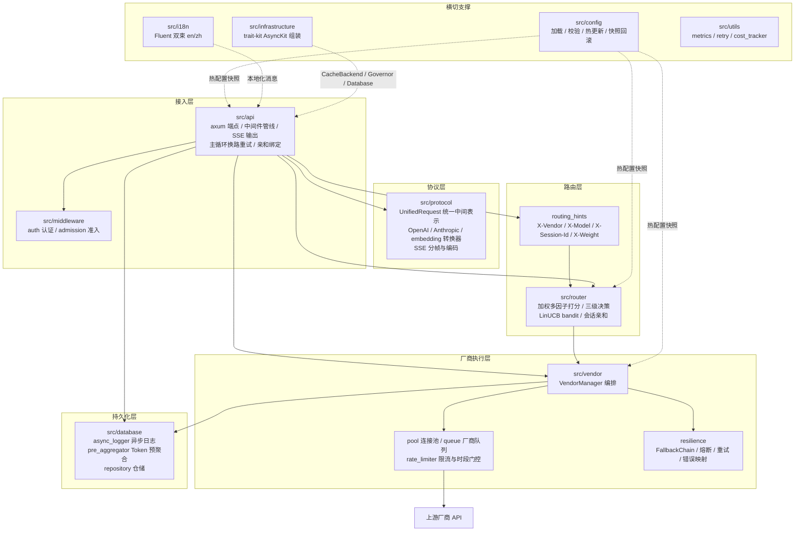
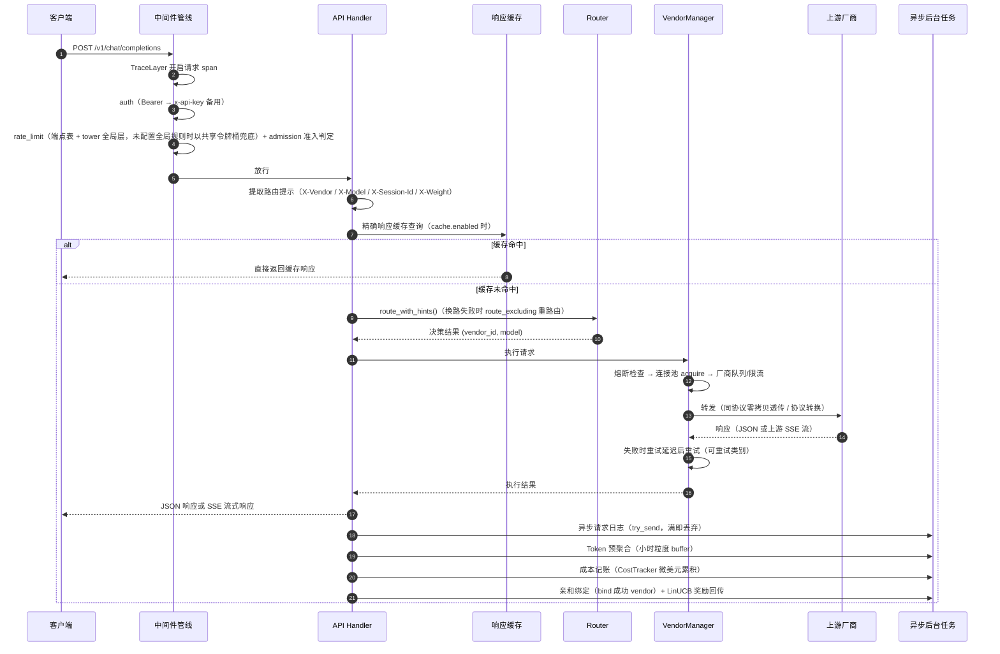
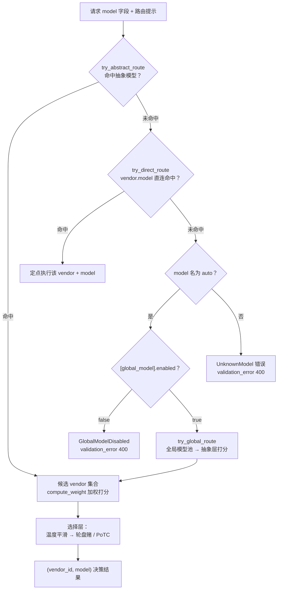
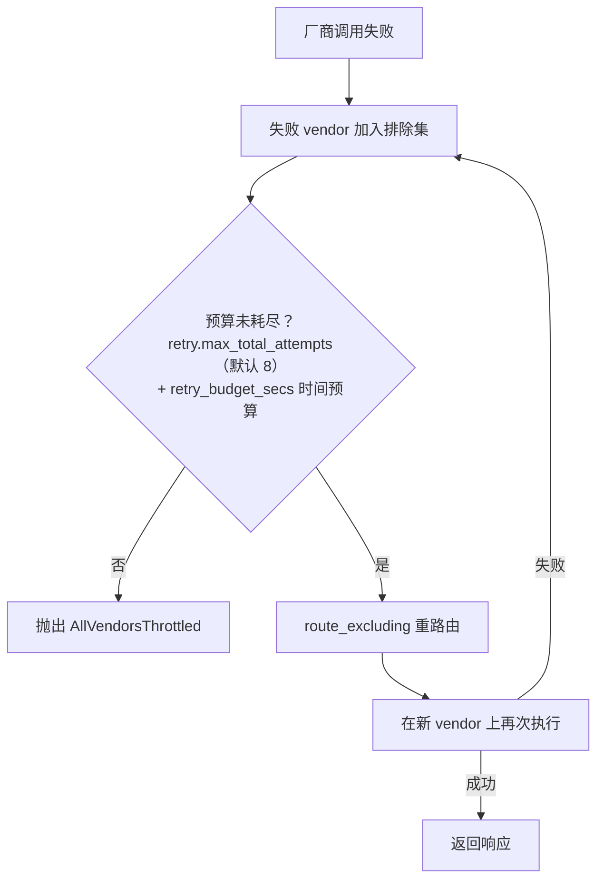
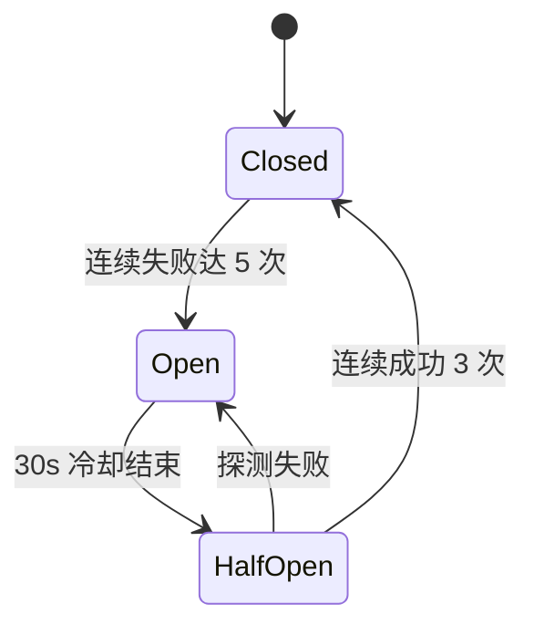
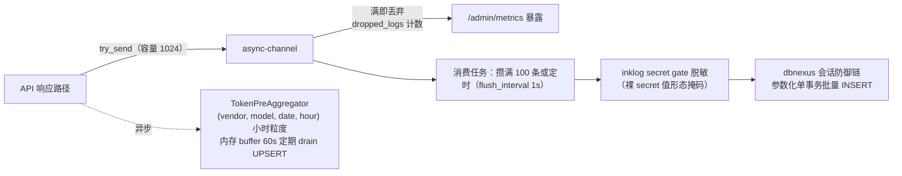
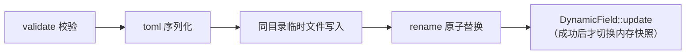
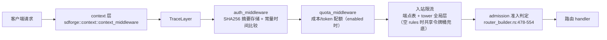
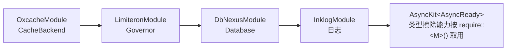

# Fluxgate 架构文档

Fluxgate 是一个用 Rust 编写的 LLM 路由网关：对外统一暴露 OpenAI 与 Anthropic 协议端点，对内在多个模型厂商之间做加权多因子路由决策，并通过熔断、重试、回退链与拥塞准入保证调用弹性；请求日志与 Token 用量经有界队列异步落库，全程不影响响应路径。本文档基于 `src/` 实际代码结构（原 `llm-gate` 纯路由核心库已并回单 crate，`fluxgate::config` 等公开路径不变），介绍 Fluxgate 的分层设计、模块划分、请求生命周期、路由决策算法以及配置、持久化与性能设计。

## 📋 目录

- [设计总览](#-设计总览)
- [模块地图](#-模块地图)
- [请求生命周期](#-请求生命周期)
- [路由决策](#-路由决策)
- [弹性与容错](#-弹性与容错)
- [成本追踪](#-成本追踪)
- [数据持久化](#-数据持久化)
- [配置系统与热更新](#-配置系统与热更新)
- [中间件管线](#-中间件管线)
- [响应缓存](#-响应缓存)
- [国际化](#-国际化)
- [依赖注入与兄弟库](#-依赖注入与兄弟库)
- [性能设计要点](#-性能设计要点)
- [文档导航](#-文档导航)

---

## 🎯 设计总览

Fluxgate 按职责分为五层：接入层（axum 端点 + 中间件管线）→ 协议层（OpenAI/Anthropic 统一中间表示与转换）→ 路由层（加权多因子决策 + 会话亲和 + LinUCB）→ 厂商执行层（连接池、队列、限流、熔断重试回退）→ 持久化层（异步日志 + 预聚合 + SQLite 仓储）。配置热更新（`confers::dynamic::DynamicField`，arc-swap 无锁读）与国际化为全部层提供横切支撑。



---

## 🗺️ 模块地图

### 顶层目录

| 目录 / 文件 | 职责 |
|---|---|
| `src/api/` | HTTP 接入层：协议端点、中间件编排、请求处理主循环、运维端点 |
| `src/config/` | 配置结构体定义、文件加载校验、热更新事务写与快照回滚 |
| `src/database/` | SQLite 持久化：异步批量日志、Token 小时预聚合、仓储与增量迁移 |
| `src/i18n/` | Fluent 国际化：编译期内嵌双束消息目录与语言检测链 |
| `src/infrastructure/` | 基于 trait-kit `AsyncKit` 的依赖注入组装 |
| `src/middleware/` | 认证中间件与拥塞感知准入中间件 |
| `src/protocol/` | OpenAI/Anthropic 统一中间表示、协议转换器、SSE 分帧编码 |
| `src/router/` | 路由决策核心：加权打分、LinUCB、会话亲和 |
| `src/utils/` | 横切工具：全局指标（含 EWMA）、重试延迟策略、成本累积器 |
| `src/vendor/` | 厂商执行层：VendorManager、连接池、队列、限流、弹性、定价 |
| `src/error/mod.rs` / `src/error/gate.rs` | `FluxgateError` / `GateError` 统一错误：Display 恒英文规范串（日志/错误链），HTTP 展示走 `user_message()`（FTL，随 locale） |
| `src/lib.rs` | 库入口：模块声明、feature 门控与公开 re-export（config/i18n/utils/protocol/storage/vendor/router 路由半边 + api/server/database 应用面） |
| `src/main.rs` | 二进制薄入口：仅解析 CLI 配置路径参数；装配链在 `src/server/bootstrap.rs`，建站与路由合并、serve 在 `src/server/http.rs` |

### src/api/

| 文件 | 职责 |
|---|---|
| `api/mod.rs` | 业务路由组装与请求处理主循环：换路重试循环、亲和 bind/clear 编排（`src/api/mod.rs:48-98`、`src/api/mod.rs:526-730`） |
| `api/router_builder.rs` | axum Router 构建、中间件管线与端点注册（`src/api/router_builder.rs:724-776`）；admission 准入判定挂载（`src/api/router_builder.rs:478-554`） |
| `api/openai.rs` | `POST /v1/chat/completions`、`POST /v1/embeddings` 端点 |
| `api/anthropic.rs` | `POST /v1/messages` 端点 |
| `api/health.rs` | `/health` 健康检查端点 |
| `api/admin.rs` | `/admin/*` 运维端点 handler（日志查询、指标、厂商状态、配置热更新、模型管理） |
| `api/state.rs` | `ApiState` 应用状态聚合；LinUCB 奖励回传（`src/api/state.rs:75-100`） |
| `api/global_state.rs` | sdforge 宏 handler 的全局状态持有（`OnceCell` 持有 `ApiState`，弥补宏不支持 axum State 提取器） |
| `api/routing_hints.rs` | 从请求头提取四个路由提示（X-Vendor / X-Model / X-Session-Id / X-Weight）；会话键缺失时兜底哈希 |
| `api/response_cache.rs` | recId=12 精确响应缓存，存储落地 oxcache（见[响应缓存](#-响应缓存)） |
| `api/sse.rs` | SSE 编码器与增量分帧器门面（实源 `src/protocol/sse_frame.rs`，此处 re-export 保持引用路径） |
| `api/models.rs` | `GET /v1/models` OpenAI 兼容模型列表（模型目录 ∪ vendor 模型去重，不进缓存） |
| `api/count_tokens.rs` | `POST /v1/messages/count_tokens` Anthropic 兼容 token 计数（近似估算，不引 tokenizer） |
| `api/readiness.rs` | 就绪探针：真实组件检查经 sdforge `AsyncReadinessCheck` 注册，`/readyz` 聚合（200/503） |
| `api/openapi_docs.rs` | OpenAPI 文档面：主 REST 端点经 sdforge inventory 注册进全局 spec；文档路由由 `[docs].enabled` 开关挂载（默认 false = 404） |
| `api/route_explain.rs` | `POST /admin/route/explain` 路由可解释性：逐候选 decision / reason_code（纯只读） |
| `api/route_difficulty_explain.rs` | `POST /admin/route/difficulty-explain` 难度定档解释端点（只读，零计量副作用） |
| `api/semantic_cache.rs` | 语义响应缓存（O4，`semantic-cache` feature 门控）：精确 miss 后按 api_key_hash 租户隔离的嵌入相似检索层 |
| `api/vault.rs` | 密钥保密柜管理面（key-vault）：`/admin/vault/keys*` 录入/掩码列表/删除，put/remove 后即时重注 inline key pool |

### src/router/

| 文件 | 职责 |
|---|---|
| `router/mod.rs` | 模块组织与 re-export |
| `router/router.rs` | 路由决策核心：三级决策顺序、`compute_weight` 加权打分、选择层（温度平滑/轮盘赌/PoTC）、SLA/LPS 增强因子、回退链构建 |
| `router/bandit.rs` | recId=15 LinUCB contextual bandit（selection 第三档） |
| `router/affinity.rs` | recId=11 会话/前缀亲和表，oxcache 承载存储 |

### src/vendor/

| 文件 | 职责 |
|---|---|
| `vendor/manager.rs` | `VendorManager` 请求执行编排：熔断包裹、重试循环、定价热读、厂商状态维护 |
| `vendor/pool.rs` | `ConnectionPool`：单 `reqwest::Client` + `tokio::sync::Semaphore` 并发上限，permit drop 自动释放 |
| `vendor/queue.rs` | `VendorQueue` 厂商请求队列（`PendingRequest`），queue_factor 负载信号的数据源 |
| `vendor/rate_limiter.rs` | `TokenBucket`/`ConcurrencyLimiter`（limiteron 包装器）+ 时段门控统一判定（recId=13，含跨午夜窗口） |
| `vendor/status.rs` | `VendorStatus`/`VendorState`：原子状态机与错误计数（Available/Unavailable 等） |
| `vendor/cost.rs` | `CostCalculator`：(vendor_id, model_id) 维度定价表查找与 USD 计算 |
| `vendor/key_pool.rs` | 多 key 池：逐 env 名解析、轮转游标与指纹观测 |
| `vendor/resilience/fallback.rs` | `FallbackChain`：按 priority 升序链式回退 |
| `vendor/resilience/error_map.rs` | `GateErrorClassifier`：实现 limiteron `FailureClassifier<GateError>`（业务错误直通熔断器，无损穿透） |

### src/database/

| 文件 | 职责 |
|---|---|
| `database/database.rs` | `Database`：连接建立（path + pool_size）与 repository 句柄 |
| `database/migration.rs` | 版本化迁移：V1 FROZEN + V2/V3 迁移（sqlite/postgres/mysql 三方言，当前 `CORE_SCHEMA_VERSION = 3`）经 dbnexus `MigrationExecutor` 执行（UP 建表 + DOWN 回滚）；`schema.*.sql` 退为可读文档，一致性由守卫测试锁定 |
| `database/repository.rs` | 仓储：dbnexus 会话防御链上的参数化批量 INSERT（`execute_with_params` + 单事务批量） |
| `database/async_logger.rs` | recId=9 背压语义异步日志写入器：`try_send` 满即丢弃计数，绝不阻塞响应路径；落库前经 inklog secret gate 脱敏 |
| `database/pre_aggregator.rs` | Token 使用预聚合器：按小时聚合，减少数据库查询压力 |

### 其余小模块

| 目录 | 文件与职责 |
|---|---|
| `src/config/` | `mod.rs`：`Config` 结构体（19 段）；`loader.rs`：`ConfigLoader`（confers 加载 + AnnotatedValue 剥壳为裸 serde_json）与 `validate_config`（按 section 拆分：vendor 条目 / env 告警 / model_catalog / resilience 熔断窗口 + 管理面密钥校验）；`manager.rs`：`ConfigManager` 热更新事务写 + `SnapshotManager` 快照；`model_catalog.rs`：`[[model_catalog]]` 模型能力目录 |
| `src/middleware/` | `auth.rs`：SHA256 摘要 + 常量时间比较认证；`admission.rs`：recId=16 拥塞感知优先级准入；`lexcompress.rs`：词法压缩（N2，`X-Compress: 1` 触发的确定性剪枝）；`mod.rs`：中间件组织 |
| `src/protocol/` | `unified.rs`：统一请求结构与流式 chunk；`openai_converter.rs`/`anthropic_converter.rs`：双向协议转换（含 Anthropic 流式编码器）；`embedding_converter.rs`：embedding 请求转换；`sse_frame.rs`：SSE 编码与上游增量分帧实源（recId=3） |
| `src/utils/` | `metrics.rs`：`GlobalMetrics` 原子指标 + EWMA 平滑（α=0.2）；`retry.rs`：按错误类别分类的重试延迟策略；`cost_tracker.rs`：`CostTracker` 微美元累积器 |
| `src/i18n/` | `catalog.rs`：Fluent 双束编译期内嵌（`OnceLock` 静态缓存）；`locale.rs`：语言检测链与全局 locale 上下文；`mod.rs`：`t()`/`t_args()` 查找门面 |
| `src/infrastructure/` | `di.rs`：`AsyncKit` 四模块拓扑序组装与 `verify_kit` |

---

## 🔄 请求生命周期

以一次 `POST /v1/chat/completions` 为例，完整链路如下（换路重试循环发生在 API handler 内部，`src/api/mod.rs` 的 `execute_request_with_fallback` / `execute_dispatch_with_fallback`）：



关键语义：

- **响应路径零阻塞**：日志经 `try_send` 入队，channel 满即丢弃并计数（`dropped_logs`，暴露于 `/admin/metrics`），绝不等待落库。
- **流式边界**：SSE 流式响应一旦开始向客户端输出，中途错误不再触发换路（见[弹性与容错](#-弹性与容错)）。
- **执行成功才记账**：成本记账、亲和绑定、LinUCB 奖励均挂在成功路径之后。

---

## 🧭 路由决策

路由决策是 Fluxgate 的核心，全部位于 `src/router/`。

### 三级决策顺序

`route_inner` 按以下顺序尝试（`src/router/router.rs:157`）。注意顺序是**先抽象模型、再直连**，最后才是全局池：



> `[global_model].enabled=false` 关闭 auto 档：全局池不参与选路，请求以
> `validation_error`(400) 拒绝（信息含「未找到」原句 + 开关来源，避免把
> 「管理员关闭」误报成「模型不存在」）。段缺省（`Config.global_model = None`）
> 沿用历史兜底语义 = 启用；显式模型名（抽象/直连路由）不受该开关影响。
> `ConfigManager::is_global_model_enabled` 是该判定的单一读取点。

### 加权打分公式

`compute_weight`（`src/router/router.rs:1828-1836`）：

```text
weight = w_model·model.weight + w_queue·queue_factor
       + w_window·window_factor + w_latency·latency_factor
       + w_error·error_factor
```

| 因子 | 含义 | 取值 |
|---|---|---|
| `model.weight` | 模型配置静态权重 | 配置值；非有限/≤0 归零保护 |
| `queue_factor` | 厂商队列空闲度 | 队列长度 0 → 1.0；≥100 → 0.0（`src/router/router.rs` 的 `queue_factor`） |
| `window_factor` | 时段预算健康度 | 无窗口 0.5（中性）；预算耗尽 0；剩余 <300s 减半（`src/router/router.rs` 的 `window_factor`） |
| `latency_factor` | EWMA 延迟得分 | `ref/(ref+ewma_ms)`；无数据 0.5（`src/router/router.rs` 的 `latency_factor`） |
| `error_factor` | 错误率得分 | `1−ewma_err`；无数据 1.0（`src/router/router.rs` 的 `error_factor`） |

默认系数（`src/config/mod.rs` 的 `RoutingSection` 默认值）：

| 系数 | 默认值 | 说明 |
|---|---|---|
| `w_model` | 0.4 | 静态权重主导 |
| `w_queue` | 0.3 | 队列负载 |
| `w_window` | 0.3 | 时段预算 |
| `w_latency` | 0 | 默认关闭 |
| `w_error` | 0 | 默认关闭 |

系数均带非有限/≤0 归零保护，异常配置不会污染打分。

### 权重回退链

候选权重的四级回退（`src/router/router.rs` 的权重回退链），高一级生效即停止：

1. **请求级 `X-Weight` 头**（受 `[routing].allow_request_weight` 门控）；
2. **`model.weight` 配置静态权重**；
3. **vendor 容量自动权重**（仅当 `model.weight ≤ 0` 时按容量推导）；
4. **均匀 1.0**（以上全部缺失时）。

### 选择层

打分之后的选择（`src/router/router.rs` 的选择层）：

| 机制 | 行为 | 开关 |
|---|---|---|
| 温度平滑 | `w^(1/T)` 压平/放大权重分布 | `[routing].temperature` |
| 轮盘赌 | 按平滑后权重随机；total ≤ 0 时均匀随机 | 默认路径 |
| Power-of-Two-Choices | 随机取两候选，按 EWMA 延迟择优 | `[routing].selection == "power_of_two"`（`src/router/router.rs` 的 `power_of_two_pick`） |
| min+buffer 候选集 | 仅保留最低延迟加 buffer 余量内的候选 | `[routing].latency_buffer > 0`（`src/router/router.rs` 的 `min_buffer_pick`） |

负载信号单选（`[routing].load_signal`，`src/router/router.rs`）：`"queue"`（默认）/ `"in_flight"` / `"in_flight_relative"` 三选一，决定 queue 维负载从哪个信号读取。

### 可选增强因子

| 机制 | recId | 开关 | 行为 |
|---|---|---|---|
| SLA 虚拟队列打分 | 14 | `sla_v > 0` | 惩罚因子乘权重，对偶变量随违约更新，以租户 hash（或 `"global"`）为键（`src/router/router.rs` 的 SLA 对偶变量更新） |
| LPS 排队论前瞻 | 17 | 默认关 | 软约束因子 + `x-deadline-ms` 头硬约束门控（超期候选直接排除）（`src/router/router.rs` 的 `lps_penalty_context` / `lps_deadline_filter`） |
| 失败率软降权 | — | `[resilience].failure_rate_gate` | 错误率超阈值的候选权重 ×0.1（`src/router/router.rs` 的失败率软降权） |

### 会话亲和（recId=11）

`src/router/affinity.rs`，存储走 oxcache `CacheBackend`，不手写 map：

- 键 `affinity:{session_key}`；`tenant_scoped` 开启时带 `api_key_hash` 前缀，与响应缓存的 `resp:` 命名空间隔离；
- TTL 默认 1 小时，命中即续期；
- **hard（默认）在合格集合内排他**：命中即选绑定 vendor；仅当绑定 vendor 不在本次合格集合中才回落加权选择（`soft` 模式全程为 boost）；
- 只记录"上次成功服务的 vendor"——bind/clear 由 API 层在执行成功后调用（`src/api/mod.rs:48-98`）；
- 命中率计入 `GlobalMetrics`。

### 路由提示

`src/api/routing_hints.rs` 提取四个请求头：`X-Vendor` / `X-Model` / `X-Session-Id` / `X-Weight`。`route_with_hints` 的优先级（`src/router/router.rs:529`）：

```text
preferred_vendor 定点直连  >  preferred_model 抽象模型  >  默认加权决策
```

会话键缺失时兜底：`sha256(messages[0] 前 2KB)` 截取 16 个 hex 字符，保证同前缀对话稳定亲和。

### LinUCB contextual bandit（recId=15）

`src/router/bandit.rs`，selection 的第三档（`[routing].selection`，默认 `"weighted"` 即关闭）：

- **臂**：`(abstract_model, vendor_id)` 组合，每臂一个独立线性模型；
- **打分**：闭式最小二乘 `θ̂ = A⁻¹b` + UCB 置信上界 `⟨x,θ̂⟩ + α√(xᵀA⁻¹x)`，argmax 选择，置信上界自动编码冷启动探索；
- **特征**：5 维 `[1, ln(1+消息数), ln(1+body 字符数), 有 tools, 流式]`（`src/router/bandit.rs` 的特征构造）；
- **奖励**：成功 1 / 失败 0（代理奖励），由 API 层执行后回传（`src/api/state.rs:75-100`），更新只动被选臂；
- **已知边界**：状态在内存，重启归零，不持久化。

---

## 🛡️ 弹性与容错

弹性机制分布在 `src/vendor/resilience/`、`src/utils/retry.rs` 与 API 层主循环。

### 回退链与换路循环

- `FallbackChain`（`src/vendor/resilience/fallback.rs`）：`FallbackTarget = vendor + model + priority`（数值越小优先级越高）。`Router::build_fallback_chain` 按配置中 vendors 的 priority 建链，trigger = All（`src/router/router.rs:243`）。
- 换路循环消费在 API 层（`src/api/mod.rs` 的 `execute_request_with_fallback` / `execute_dispatch_with_fallback`）：



- 双预算约束：总尝试次数（`retry.max_total_attempts`，默认 8）与时间预算（`retry_budget_secs`）任一耗尽即收尾；所有候选均 Throttled 时抛 `AllVendorsThrottled`。
- **流式边界**：SSE 响应开始输出后，中途错误不换路。

### 熔断器

`limiteron::circuit` 三态机（手写版本已删除，统一委托 limiteron）。生产配置 `gate_circuit_config()`（`src/vendor/manager.rs:135-145`）：

| 参数 | 值 | 设计理由 |
|---|---|---|
| `failure_threshold` | 5 | 连续失败 5 次打开 |
| half-open 恢复条件 | 成功 3 次 | 探测确认后闭合 |
| open 持续时间 | 30s | 常规冷却窗口 |
| slow_call 判定 | 60s / 100% | 防止 LLM 长调用被误判为失败 |



### 重试策略

延迟计算委托 `limiteron::retry::delay_for_attempt`，按错误类别分类（`src/utils/retry.rs:146` 的延迟选择函数、`src/vendor/manager.rs` 的错误分类消费）：

| 错误类别 | 延迟策略 |
|---|---|
| 429 + Retry-After 头 | 按头等待，全范围展宽 jitter（最高优先） |
| 429 无头 | 指数退避：1s × factor 2.0，封顶 16s，jitter 0.2 |
| 5xx | [1s, 1s + spread) 区间随机 |
| 网络错误 | 500ms × attempt |
| 400 / 401 / 403 / 404 | 不重试，标记厂商 Unavailable |

可重试状态码集合默认 `[429, 500, 502, 503]`。

### 错误映射层

`src/vendor/resilience/error_map.rs`：limiteron 熔断器签名锁定 `LimiteronError`，而 Fluxgate 执行路径使用 `FluxgateError`，映射层提供双向编码（`fluxgate:<variant>:<detail>` 前缀）；错误分类器（`FailureClassifier::is_counted_as_failure`）决定哪些错误计入熔断失败。

### 连接池

`src/vendor/pool.rs`：复用单个 `reqwest::Client`（其内部自带连接池），外层 `tokio::sync::Semaphore` 限制最大并发请求数；`acquire()` 返回的 permit 在 drop 时自动释放，流式场景 permit 随流存活，对长连接真实计数（也是 admission 拥塞信号的来源）。

---

## 💰 成本追踪

| 组件 | 文件 | 职责 |
|---|---|---|
| `CostCalculator` | `src/vendor/cost.rs` | 定价表来自热配置 `[[pricing]]`，按 `(prompt/1000)×in_price + (completion/1000)×out_price` 计算 USD；`(vendor_id, model_id)` 未命中计 0.0；每请求现读热配置，定价修改即时生效（`src/vendor/manager.rs` 的定价热读点） |
| `CostTracker` | `src/utils/cost_tracker.rs` | `total` 用 `AtomicU64` 微美元（USD ×1e6 转 u64，避免浮点累加误差）；`by_vendor` / `by_model` 两张 DashMap 分桶；记账点在 worker 成功路径 |

**成本落库与内存边界（如实标注）**：成本分账已落库——`token_usage` 表按 `(vendor, model, api_key_hash, date, hour)` UPSERT，写入 `input_cost` / `output_cost` / `cache_read_cost` / `cache_creation_cost` 四档成本列（`src/database/pre_aggregator.rs`，单价取 `[[model_catalog]]` 四档，未登记记 0），并可由 `GET /admin/cost` 按 vendor/model 分组聚合查询。仍留的内存/历史边界：进程内 `CostTracker`（`by_vendor`/`by_model`）仅在内存累积、重启清零；逐请求日志 `request_logs.cost_usd` 仍恒写 `None`（该列为历史库兼容保留）。

---

## 🗄️ 数据持久化

### 存储模型

SQLite，5 张表（迁移 V1↔V3 定义于 `src/database/migration.rs`（当前 `CORE_SCHEMA_VERSION = 3`），`schema.*.sql` 为同源可读文档）：

| 表 | 用途 | 状态 |
|---|---|---|
| `request_logs` | 请求日志（含 `cost_usd REAL DEFAULT 0.0` 列） | 读写 |
| `token_usage` | Token 用量小时聚合 | 读写 |
| `vendor_status` | 厂商状态持久化 | 仅有 schema，无读写路径 |
| `model_stats` | 模型统计 | 仅有 schema，无读写路径 |
| `vault_keys` | 密钥保密柜（cocoon 密文 + 掩码/指纹列，V3 迁移建表） | 读写 |

表结构经 dbnexus `MigrationExecutor` 版本化管理：启动装配链执行 V1/V2/V3 迁移（UP 建表 + 索引，DOWN 对应回滚），迁移历史记录于 dbnexus 默认历史表；存量库（表已存在、历史为空）由基线化检查兼容，不重复建表。三方言（sqlite/postgres/mysql）各有 FROZEN V1，与对应 `schema.*.sql` 文档的一致性由守卫测试锁定。

### 异步写入管线



- 队列容量 1024、flush_interval 1s 在启动装配时构造，预聚合器同期启动（`src/server/bootstrap.rs:170-173`，装配链自原 main.rs 平移，顺序逐位一致）。
- 背压语义（recId=9）：`log()` 永不阻塞响应路径，丢弃量显式计数并暴露，而非静默吞掉。
- 预聚合将小时级 Token 统计先行内存缓冲，定期 UPSERT，压平写放大。

---

## ⚙️ 配置系统与热更新

### 配置结构

`Config` 顶层 19 段（`src/config/mod.rs:1065-1126`）：

| 段 | 说明 | 段 | 说明 |
|---|---|---|---|
| `server` | 监听地址端口 | `routing` | 路由策略参数 |
| `database` | SQLite 路径与池大小 | `cache` | 响应缓存开关 |
| `vendors` | 厂商与模型清单 | `rate_limit` | 限流规则 |
| `global_model`（Option） | 全局模型池 | `resilience` | 熔断/回退/软降权 |
| `pricing` | `[[pricing]]` 定价表 | `admission` | 拥塞准入 |
| `auth`（Option） | API key 与档位 | `retry` | 重试与换路预算 |
| `cors`（Option） | 跨域 | `model_catalog` | `[[model_catalog]]` 模型能力/定价目录（空目录时序列化省略） |
| `health` | 主动健康探针（默认 off） | `quota` | 成本/token 维度配额（默认关） |
| `grpc`（Option） | gRPC 服务器（缺段/禁用 = 不监听） | `docs` | OpenAPI 文档面开关（默认关 = 路由不存在） |
| `lexcompress` | 词法压缩（X-Compress 触发，默认 off） | | |

**硬约束**：所有配置段必须进 `Config` 结构体——persist 是全量写回磁盘，结构体里没有的段会在写回时从文件中消失（`src/config/mod.rs` 的 `Config` 字段文档注释）。

### 加载

`confers::loader::load_file` 加载（自带 symlink 穿越与文件大小限制防护）→ serde 反序列化 → `validate_config`（vendor/model id 去重校验）。`src/config/loader.rs` 负责把 confers 的 `AnnotatedValue` 树剥壳为裸 serde_json 值（confers 当前版本未实现 Deserializer 的结构性缺口，非重复造轮子）。

### 热更新写路径（事务语义）

`ConfigManager.config` 是 `confers::dynamic::DynamicField<Config>`（arc-swap，读路径无锁）。写路径（`src/config/manager.rs` 的 `update_config` / `update_config_with`）：



- 临时文件 + rename 保证断电不写坏配置；磁盘成功后才更新内存快照；
- RMW（read-modify-write）场景使用 `update_config_with` 防丢失更新；
- `SnapshotManager`（`src/config/manager.rs`）：每次更新前把旧配置快照到 `config-backups/`，保留 10 份，`auth.api_keys` 打码后留痕。

### `/admin/config` 热更新边界

| 类别 | 段 |
|---|---|
| 热生效 | `routing`、`retry`、`resilience`、`admission`、`auth`、`cache`、`quota`、`health`、`pricing`、`vendors`（enabled 与权重） |
| 需重启 | `server`、`cors`（POST 响应以 `restart_required` 数组显式提示）、`rate_limit`（tower 层构造期构建）、vendor concurrency、`database` |

---

## 🚦 中间件管线

管线顺序（`src/api/router_builder.rs:793-822`）：



### 认证（auth）

- API key 以 SHA256 摘要存储，比较使用常量时间比较，防时序侧信道；
- 凭证提取：`Authorization: Bearer` 优先，`x-api-key` 备用；
- `/health`、`/api/v1/health`、`/`、`/readyz`、`/metrics`、`/api-docs` 与 `/api-docs/*`、`/swagger-ui` 与 `/swagger-ui/*` 共九条白名单放行（`src/middleware/auth.rs:159-168`）；业务面之外另有 sdforge 平面的 `/healthz` 与 `/readyz`（在全部中间件之后挂载，免认证免限流，仅建议内网暴露）；
- 每请求热读 `[auth]` 配置段，key 增删即时生效；
- key 档位（recId=16，`[[auth.keys]]` 的 `tier`）：`dedicated` / `guaranteed` / `elastic` / `spot`。

### 拥塞准入（admission，recId=16，默认关）

`src/middleware/admission.rs`——把 429 的决定权从"先到先得"交给"优先级"：

- **拥塞信号**：网关侧并发占用率 = Σ in_flight / Σ 并发上限（复用 `ConcurrencyLimiter::in_flight`，流式 permit 随流存活故对长流真实）；达到 `[admission].congestion_threshold`（默认 0.9）即视为拥塞；
- **裁决**：新请求档位优先级低于"当前在途最小档"时直接 429 + Retry-After 1s，不排队；
- **优先级公式**：`w_tier · (1+α_slo·ℓ*)⁻¹ · (1+α_burst·b)⁻¹ · (1+α_debt·d)⁻¹`，其中 burst/debt 为 per-key EWMA（表上限 1024）。

### 限流（rate_limit）

- limiteron 入站限流分两层：`path` 前缀的端点规则走中间件侧端点表（`ShardedSlidingWindowLimiter`，按租户 API key 的 SHA256 摘要分桶）；`path` 缺省的全局规则走 tower 全局层（`GlobalRateLimitLayer` + `QuotaLimiter`，按租户摘要分桶，G5 起真正按租户生效）；
- 超限一律返回 `429` + `Retry-After`；旧 `Decision::Banned → 403` 封禁分支已在 tower 化改造中删除（规则 ban 恒为 None），`rules` 为空时兜底为共享 `TokenBucket(100, 10/s)`；
- 限流豁免路径（`is_quota_exempt_path` 共十条）：`/health`、`/healthz`、`/ready`、`/api/v1/health`、`/readyz`、`/metrics`、`/api-docs` 与 `/api-docs/*`、`/swagger-ui` 与 `/swagger-ui/*`。

---

## ⚡ 响应缓存

`src/api/response_cache.rs`（recId=12），存储落地 oxcache 内存后端，不手写 HashMap 缓存：

- **键设计**：`resp:{api_key_sha256}:{vendor_id}:{model_id}:{sha256(canonical_body)}`；
- `vendor + model + 完整 canonical body` 入键，防止跨厂商/跨模型的错误命中；
- 调用方 API key 的 SHA256 摘要入键做**租户隔离**（防 LaCache 键碰撞投毒，明文 key 不入键）；
- 开关 `[cache].enabled`，每请求热读（`src/api/response_cache.rs` 的 `enabled()`）；
- 命中时在 handler 早期直接返回，跳过路由与厂商执行（见[请求生命周期](#-请求生命周期)时序）。

---

## 🌐 国际化

`src/i18n/` + `locales/`：

| 设计点 | 实现 |
|---|---|
| 消息格式 | Fluent（`.ftl`），en/zh 双束共 10 个文件 |
| 部署形态 | 编译期 `include_str!` 内嵌，产物无需携带磁盘 `locales/` 目录；新增 ftl 必须登记 `EMBEDDED_LOCALES`，守卫测试兜底 |
| 运行时结构 | `fluent_bundle::concurrent::FluentBundle` 双束，`OnceLock` 静态缓存，Send+Sync |
| 语言检测链 | `FLUXGATE_LANG` → `LC_ALL` → `LC_MESSAGES` → `LANG` → `sys-locale` → `"en"`（强制顺序，显式读取保证 Windows/边缘环境确定性） |
| 查找回退 | 当前语言 → en → 键名 |
| 覆盖范围 | 全部业务消息（错误 `user_message()` 与日志文案） |

错误展示走双轨（`src/error/mod.rs`）：`#[error]` Display 恒英文规范串（供日志与错误链），HTTP 响应体用 `user_message()` 返回随 locale 的 FTL 文案。

---

## 🧩 依赖注入与兄弟库

### DI 容器

`src/infrastructure/di.rs`：基于 trait-kit 的 `AsyncKit` 组装 4 个 infrastructure module（`build_kit_with_config` / `build_kit`），拓扑序解析 + `verify_kit` 校验：



### 兄弟库（crates.io registry）

根 `Cargo.toml` 以 registry 版本集成 7 个兄弟库（版本号在 `[dependencies]`、校验和锁在 `Cargo.lock`）。迁移期曾以 path 依赖 + `[patch.crates-io]` 统一身份（保证传递依赖收敛到同一份源码），该形态随全量切 registry 移除：

| 兄弟库 | 在 Fluxgate 中的角色 |
|---|---|
| `confers` | 配置加载（loader）与热更新（`DynamicField`） |
| `dbnexus` | 数据库基础层 |
| `inklog` | 日志（`LoggerManager`） |
| `limiteron` | 熔断（circuit）、重试（retry）、限流（Governor/limiters） |
| `oxcache` | 缓存后端（响应缓存、会话亲和表） |
| `sdforge` | HTTP 服务宏框架（`#[forge]` handler） |
| `trait-kit` | `AsyncKit` 依赖注入容器 |

### Feature 门控

`default = ["full", "db-sqlite"]`，`full` 预设含 11 个 feature：`web-server` / `database` / `vendor-management` / `router` / `protocol` / `infrastructure` / `sdforge-integration` / `logging` / `resilience` / `cost-tracking` / `sdk`；另有隐藏宏门控 `http` 与独立门控（不进 `full`）的 `grpc`。主要依赖方向：

```text
web-server → router → vendor-management
web-server → database（→ protocol + url + logging）＋ infrastructure（→ oxcache + trait-kit）＋ sdforge-integration
web-server 面直用：limiteron（入站限流）+ hex / sha2 / subtle / once_cell
router → oxcache（CacheBackend：会话亲和表 / 响应缓存）
sdk → reqwest + eventsource-stream + url（HTTP 客户端，独立于 web-server）
database → logging：async_logger（DB sink）无条件消费 inklog；inklog kit 需任一 db-* 后端组
```

按需裁剪 feature 可缩小编译产物（如仅库形态使用时去掉 `web-server`）。

---

## 🚀 性能设计要点

以下为设计事实（无基准数据，数据类结论以实测为准）：

1. **零拷贝透传**：客户端协议与上游厂商协议一致时，请求体直接转发，不经中间表示转换；只有跨协议（如 OpenAI 入 → Anthropic 出）才走 converter。
2. **arc-swap 无锁热读**：全部热配置经 `DynamicField` 快照读取，读路径无锁无争用，热更新只做指针换入。
3. **异步批量落库**：请求日志经有界 channel `try_send` 入队，攒批单事务 INSERT；预聚合内存缓冲 60s 定期 drain，响应路径零磁盘 I/O。
4. **信号量连接池**：单 `reqwest::Client` 复用底层连接，Semaphore 只控制并发上限，permit drop 即释放。
5. **oxcache 承载缓存与亲和**：响应缓存与会话亲和表共用内存缓存后端的 TTL/续期语义，避免自研缓存的淘汰与过期 bug。
6. **特性门控裁剪**：11 个 feature 精确门控，未启用的代码不参与编译，按部署形态控制二进制体积。

---

## 📚 文档导航

| 文档 | 说明 |
|:-----|:-----|
| [用户指南](./USER_GUIDE.md) | 安装、配置与日常使用 |
| [API 参考](./API_REFERENCE.md) | HTTP 端点与请求/响应格式 |
| [安全文档](./SECURITY.md) | 认证、隔离与安全设计 |
| [FAQ](./FAQ.md) | 常见问题解答 |
| [更新日志](./CHANGELOG.md) | 版本变更记录 |
