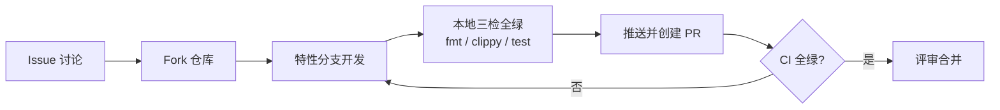

# NexusFlow 贡献指南

[🔒 安全文档](./SECURITY.md) · [📜 更新日志](./CHANGELOG.md) · [📖 用户指南](./USER_GUIDE.md) · [🏗️ 架构文档](./ARCHITECTURE.md) · [📖 README](../README.md)

感谢您关注 **NexusFlow**！无论您是在修复缺陷、添加新特性、改进文档还是帮助他人，您的贡献都弥足珍贵。

## 📋 目录

- [环境准备](#-环境准备)
- [项目结构](#-项目结构)
- [开发命令](#-开发命令)
- [测试约定](#-测试约定)
- [Feature 纪律](#-feature-纪律)
- [提交规范](#-提交规范)
- [文档纪律](#-文档纪律)
- [PR 流程](#-pr-流程)
- [License](#-license)

---

## 🧰 环境准备

### 前置条件

| 依赖 | 版本要求 | 说明 |
|:-----|:---------|:-----|
| Rust | **1.97.1+**（MSRV） | 下限声明在根 `Cargo.toml` 的 `rust-version`（与 7 个兄弟库一致）。ci.yml 按 MSRV 安装工具链（`dtolnay/rust-toolchain@e2a55d2f # v1` + `toolchain: 1.97`），既守住下限也让 clippy lint 集合可复现；`docker/Dockerfile` 与 release.yml 用当前受支持 stable（1.99）。**clippy 的 MSRV 只取各包自己的 `rust-version`**：`clippy.toml` 不重复 `msrv` 键（曾写 1.75，与下限冲突——clippy 告警令 `-D warnings` 必红，且 MSRV 门控 lint 按旧基线静默抑制），成员 crate `examples` 也显式声明同值 `rust-version`，否则其 lint 基线会回落到运行时 stable 而漂移。改 MSRV 后验证 clippy 需先 `cargo clean -p nexusflow -p nexusflow-examples`：cargo 不把 `clippy.toml` 纳入 fingerprint，不清理则复用缓存诊断 |
| Git | 任意近期版本 | 版本控制 |

安装 Rust 工具链：

```bash
curl --proto '=https' --tlsv1.2 -sSf https://sh.rustup.rs | sh
rustup component add rustfmt clippy
```

### 🧩 自研库依赖（crates.io registry）

NexusFlow 深度依赖 7 个自研库，经 **crates.io registry** 集成——版本声明在根 `Cargo.toml` 的 `[dependencies]`、校验和锁定在 `Cargo.lock`，cargo 自动拉取。**克隆本仓库即可 `cargo build`，无需把 7 个库放到同级目录**；CI 各作业同理，无兄弟库克隆步骤。Docker 构建不在 CI 内，在本机执行 `docker build -f docker/Dockerfile .`（镜像同为纯 registry 依赖，不取兄弟库源码）。

（历史形态：迁移期以 `path = "../<lib>"` + `[patch.crates-io]` 统一身份以保证 trait 身份一致，该形态与配套的 CI 克隆步骤、Dockerfile `SIBLING_PINS` 机制已随全量切 registry 一并移除。）

| 库 | 在 NexusFlow 中的职责 |
|:---|:----------------------|
| [confers](https://github.com/Kirky-X/confers) | 配置解析（TOML）、`DynamicField` 热读、配置快照（SnapshotManager） |
| [dbnexus](https://github.com/Kirky-X/dbnexus) | SQLite 数据库层（rustls + 连接池 + 权限） |
| [inklog](https://github.com/Kirky-X/inklog) | 结构化日志 |
| [limiteron](https://github.com/Kirky-X/limiteron) | 限流 / 熔断 / 重试原语 |
| [oxcache](https://github.com/Kirky-X/oxcache) | 统一缓存 API（会话亲和表 / 响应缓存存储层） |
| [sdforge](https://github.com/Kirky-X/sdforge) | HTTP 服务框架（`#[forge]` 宏 + CORS） |
| [trait-kit](https://github.com/Kirky-X/trait-kit) | DI 容器（AsyncKit，启动期统一组装上述模块） |

### Fork 与 Clone

| 步骤 | 操作 |
|:----:|:-----|
| **1. Fork 仓库** | 在 [github.com/Kirky-X/NexusFlow](https://github.com/Kirky-X/NexusFlow) 点击 "Fork" |
| **2. Clone 本体** | 只需克隆 NexusFlow 本体；7 个自研库由 cargo 从 crates.io 拉取 |
| **3. 安装 Git 钩子** | `pip install pre-commit && pre-commit install --install-hooks`（见下节） |
| **4. 构建验证** | `cargo build`（default = full + db-sqlite；首次构建同时编译 7 个自研库依赖，耗时较长） |

### 🪝 Git 钩子（pre-commit）

7 仓库统一基线（与 confers lefthook.yml 功能等价）。钩子装在本地 `.git/hooks/`，新克隆必须重新 install。

| 钩子 | 作用 |
|------|------|
| 通用修复器 | 尾随空白、文件末尾换行（命中即自动改写并拦截提交，`git add` 后重提即可） |
| `detect-private-key` | 私钥字节级检测（本仓上游凭证只存 `api_key_env` 环境变量名，无夹具排除） |
| `detect-secrets` | 密钥扫描，基线 `.secrets.baseline` 内为已人工核实的误报（`api_key_env` 变量名、测试夹具、SHA256 摘要），基线外新发现会阻断 |
| `typos` | 拼写检查（带自动改写），白名单在 `typos.toml`（测试夹具词 `abd`/`ot`/`ded`/`Hel`、mermaid 节点 `THR`、`out/` 产物目录） |
| `cargo-fmt` / `cargo-check` / `cargo-clippy` | 与 CI 完全同口径（`--workspace` / `-D warnings`） |
| `no-commit-to-branch` | 保护 `master`（本仓工作流在 `main` 上提交） |

误报处理路径：typos 命中 → 核实语义后加入 `typos.toml` 词表；detect-secrets 新发现 → 人工核实为误报后 `detect-secrets scan --update .secrets.baseline` 更新基线并在 PR 说明。可选的 post-commit 编译产物清理阶段默认不启用（`pre-commit install -t post-commit` 自行开启）。

---

## 🏗️ 项目结构

`src/` 共 92 个 `.rs` 文件（原 `crates/llm-gate/` 纯路由核心库已并回单 crate，`nexusflow::config` 等公开路径不变），按目录职责划分：

| 目录 | 职责 | 关键文件 |
|:-----|:-----|:---------|
| `src/api/` | REST 端点与路由构建 | `router_builder.rs`（中间件挂载）、`admin.rs`、`openai.rs`、`anthropic.rs`、`sse.rs`、`response_cache.rs` |
| `src/config/` | TOML 配置加载 / 校验 / 热更新 | `mod.rs`（Config 结构与默认值）、`manager.rs`、`loader.rs`、`model_catalog.rs` |
| `src/database/` | SQLite 持久化 | `repository.rs`、`async_logger.rs`（异步批量写）、`pre_aggregator.rs`（Token 预聚合） |
| `src/i18n/` | Fluent 双语目录（en/zh）与 locale 检测 | `catalog.rs`、`locale.rs` |
| `src/infrastructure/` | trait-kit AsyncKit DI 组装 | `di.rs` |
| `src/middleware/` | 认证 / 拥塞准入中间件 | `auth.rs`、`admission.rs` |
| `src/protocol/` | OpenAI ↔ Anthropic 协议转换 | `unified.rs`、`openai_converter.rs`、`anthropic_converter.rs`、`sse_frame.rs` |
| `src/router/` | 路由调度 | `router.rs`（5 因子加权）、`affinity.rs`、`bandit.rs` |
| `src/vendor/` | 厂商管理 | `manager.rs`、`rate_limiter.rs`、`pool.rs`、`queue.rs`、`key_pool.rs`、`resilience/`（FallbackChain + 错误映射） |
| `src/utils/` | 成本追踪 / 全局指标 / 重试工具 | `cost_tracker.rs`、`metrics.rs`、`retry.rs` |
| `src/error/mod.rs` / `src/error/gate.rs` | `NexusFlowError` / `GateError` 统一错误（含 HTTP 映射） | — |
| `src/lib.rs` / `src/main.rs` | lib 公共 API 与薄启动入口（装配链在 `src/server`） | — |

两个辅助位置：

| 位置 | 说明 |
|:-----|:-----|
| `src/server` | **服务器装配链**库模块（`all(web-server, logging)` 门控）：bootstrap / http / handle / shutdown，`run()` 起服、`build_app()` 返回 `(Router, ServerHandle)`（停机 flush 收尾，幂等；同进程二次装配 panic，见 `# Panics` 文档） |
| `src/sdk` | **Rust 客户端 SDK** 模块（`sdk` feature 门控）：chat / embed / models / vendors / health，含 SSE 流式（原顶层 `sdk/` 独立 crate 已并入） |
| `tests/` | **集成测试**（按功能域目录化，48 个 `.rs` 文件 = 47 个测试二进制 + `common/mod.rs` helper：HTTP 全链路 / 路由 / 协议转换 / 厂商 / 熔断 / 重试 / 成本 / 配置示例断言 / feature 组合矩阵 / 死代码守卫等） |

> 架构惯例：`mod.rs` 只保留接口与 re-export，具体实现放独立文件（如 `router/router.rs`、`config/manager.rs`）。新增代码请遵循同一惯例。

---

## 🔨 开发命令

与 CI（`.github/workflows/ci.yml`）完全一致的本地检查命令：

```bash
# 格式检查（CI 同款）
cargo fmt --all -- --check

# Clippy 静态检查（必须零告警）
cargo clippy --workspace --all-targets -- -D warnings

# 全量测试（启用全部特性）
cargo test --workspace
```

生产构建启用 LTO 与单 codegen unit（`[profile.release]`：`lto = true`、`codegen-units = 1`、`opt-level = 3`）：

```bash
cargo build --release
```

**提交前三条检查必须全绿**——CI 会以相同命令复检。

---

## 🧪 测试约定

本项目测试基线（`cargo test --workspace` 实测）：

| 类型 | 数量 | 位置 | 写法 |
|:-----|:-----|:-----|:-----|
| 单元测试 | **426 个** | `src/` 各模块内 | `#[cfg(test)] mod tests { ... }` 内联 |
| 集成测试 | **868 个** | `tests/`（48 个 `.rs` 文件 = 47 个测试二进制 + `common/mod.rs`） | HTTP 全链路 / 跨模块行为 |

约定与工具：

| 项 | 约定 |
|:---|:-----|
| Mock 框架 | `mockall`（trait mock）、`mockito`（HTTP 上游 mock，SDK 测试同款） |
| 假时钟 | limiteron `MockClock` **需 `test-clock` feature**（已在 `[dev-dependencies]` 注明）——驱动熔断超时 / 限流窗口重置等时间相关测试 |
| 异步测试 | `#[tokio::test]`；涉及连接池与多任务协调时使用 `flavor = "multi_thread"` |
| 确定性 | 时间敏感断言优先注入时钟/时间戳（如 `admit(&self, tier, key_hash, now_ms)`），避免真实 `sleep` |
| 配置示例 | `tests/config/config_toml_example_test.rs` 对 `config.example.toml` 做结构性断言——**改配置结构必须同步改该测试** |

运行测试：

```bash
cargo test --workspace                         # 全量（default 口径）
cargo test --test gate_router_test             # 单个集成测试二进制（名字 = 文件 stem）
```

集成测试按功能域目录化存放（`tests/<domain>/<name>.rs`），根 `Cargo.toml` 关闭自动发现（`autotests = false`）并逐文件显式登记 `[[test]]`：**新增测试文件必须同步登记**（name 取文件 stem、path 指向实际位置），否则 cargo 静默不编译不运行。

---

## 🚩 Feature 纪律

`Cargo.toml` 定义 **18 条 feature 声明**（含 `default`，即 17 个非 default；其中 `full` 预设内含下表 11 个 feature），`default = ["full", "db-sqlite"]`（全启用 + sqlite 后端）：

| Feature | 门控内容 |
|:--------|:---------|
| `web-server` | axum / tower / tower-http HTTP 服务 |
| `database` | dbnexus + sea-orm + 异步队列持久化 |
| `vendor-management` | reqwest + limiteron + rand + async-channel 厂商管理 |
| `router` | 路由调度（依赖 vendor-management + oxcache） |
| `protocol` | 协议转换 |
| `infrastructure` | oxcache + trait-kit |
| `sdforge-integration` | sdforge HTTP 框架集成 |
| `logging` | inklog |
| `resilience` | FallbackChain + 错误映射层（熔断/重试已迁 limiteron） |
| `cost-tracking` | dashmap + CostTracker 成本追踪 |
| `sdk` | Rust 客户端 SDK（reqwest + eventsource-stream + url） |

纪律要求：

1. **新增能力必须 feature 门控**，并挂入 `full` 的依赖链；`tests/matrix/feature_matrix.rs` 会验证 feature 组合
2. `--no-default-features` 必须可编译；`--all-features` 因 db-* 后端三组互斥必然编译失败（预期行为，非缺陷）
3. 特殊例子 `http`：这是一个**宏门控空 feature**（无实现体）。原因见 `Cargo.toml` 注释：sdforge 的 `#[forge]` 宏按**目标 crate** 的 feature 求值 `cfg(feature = "http")`——无同名 feature 时 `RouteRegistration` 整体被 cfg 掉，`#[forge]` 站点路由（/health）会静默丢失。它仅作为宏门控开关随 `web-server` 启用

---

## 💬 提交规范

遵循 [Conventional Commits](https://www.conventionalcommits.org/)：`<type>(<scope>): <subject>`。

仓库中的真实示例：

```text
feat(cost): add CostTracker with dashmap sharding and atomic accumulation
fix(security): fix critical security issues from security review
refactor(database): 用 dbnexus 替换 sqlx 数据库层
```

| 类型 | 用途 |
|:-----|:-----|
| `feat` | 新特性 |
| `fix` | 缺陷修复 |
| `refactor` | 重构（不改行为） |
| `test` | 测试补充 |
| `docs` | 文档变更 |
| `chore` | 构建 / 仓库维护 |
| `style` | 格式化（如 `cargo fmt` 全量格式化） |
| `perf` | 性能优化 |

红线：

- **禁止 `git commit --no-verify`** 跳过任何本地检查钩子
- 一个 commit 一个逻辑变更；任务编号等追踪信息写进 commit message，不写进源码注释

---

## 📚 文档纪律

代码变更必须同步更新文档，**文档与代码不一致时以代码为准，但必须尽快修复文档**：

| 变更类型 | 需同步更新的文档 |
|:---------|:-----------------|
| API / 端点变更 | `docs/API_REFERENCE.md` |
| 配置项变更 | `docs/USER_GUIDE.md`（并同步 `config.example.toml` 与 `tests/config/config_toml_example_test.rs`） |
| 架构 / 模块变更 | `docs/ARCHITECTURE.md` |
| 用户可感知的新能力 / 修复 | `docs/CHANGELOG.md` |

**文档禁止编造数据**：测试数量、性能数字、审查结论等必须来自真实运行结果。

---

## 🔄 PR 流程



| 步骤 | 说明 |
|:-----|:-----|
| **1. Issue** | 先在 [Issues](https://github.com/Kirky-X/NexusFlow/issues) 描述问题或提案，重大改动先讨论达成一致（[Discussions](https://github.com/Kirky-X/NexusFlow/discussions) 适合开放性话题） |
| **2. Fork** | Fork 本仓库即可；7 个自研库由 cargo 从 crates.io 拉取，无需额外准备 |
| **3. 开发** | 新分支开发，保持 commit 原子性；新能力记得 feature 门控与测试 |
| **4. 本地验证** | `cargo fmt --all -- --check` + `cargo clippy --workspace --all-targets -- -D warnings` + `cargo test --workspace` 全绿（非默认后端另跑 `cargo check -p nexusflow --no-default-features --features "full,db-postgres"`） |
| **5. PR** | 描述变更动机与影响面，关联 Issue；等待 CI 全绿与评审 |
| **6. 发布** | 维护者推送 `v*.*.*` tag 触发 `.github/workflows/release.yml`（工具链 1.99，与 Dockerfile base 对齐）：自动创建 GitHub Release（rc/beta/alpha 后缀自动标记预发布），产出 gnu 动态链接二进制（链接系统 `libsqlite3`）；tag 已推送但流水线失败时，可在 Actions 手动触发同一 workflow 并填版本号（x.y.z，不带 v）重发；musl 静态产物不再在 CI 借道 Docker 构建，需要时在本机执行 `docker build -f docker/Dockerfile .` 从镜像提取；删除 tag 时 `tag-deleted.yml` 自动清理对应 Release |

安全相关修复请勿通过公开 PR 披露细节，走 [Security Advisories](https://github.com/Kirky-X/NexusFlow/security/advisories/new)（见 [安全文档](./SECURITY.md#-漏洞报告流程)）。

---

## 📄 License

NexusFlow 以 **MIT License** 发布（见根目录 [LICENSE](../LICENSE)），版权所有 `Copyright (c) 2026 Kirky.X🌠`。提交贡献即表示您同意以同一许可授权您的贡献。

---

### 💝 感谢您为 NexusFlow 做出贡献！

[🔒 安全文档](./SECURITY.md) • [📜 更新日志](./CHANGELOG.md) • [📖 用户指南](./USER_GUIDE.md) • [🏗️ 架构文档](./ARCHITECTURE.md) • [🐛 报告问题](https://github.com/Kirky-X/NexusFlow/issues)
