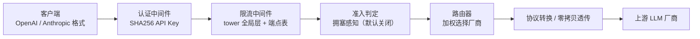
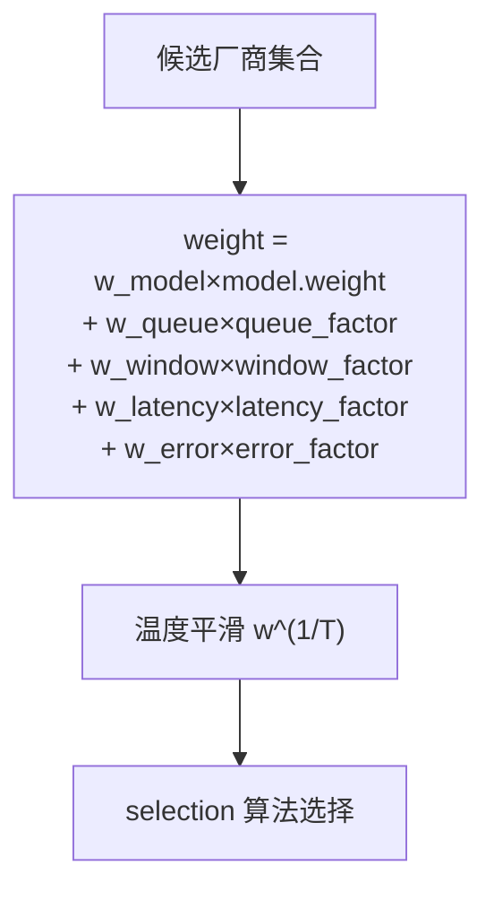
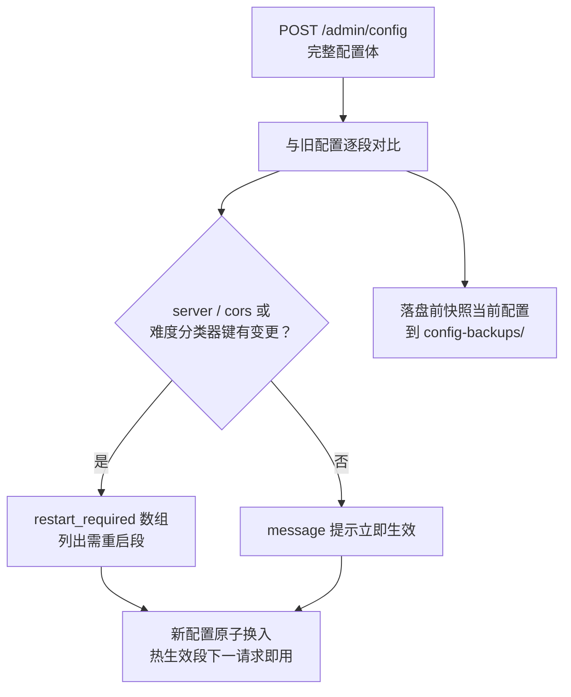
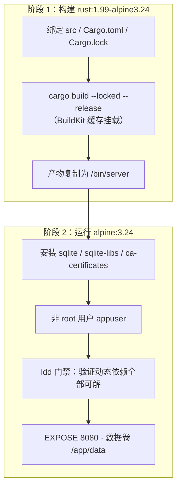

# Fluxgate 用户指南

**Fluxgate** 是一个智能 LLM 路由代理系统：多厂商统一管理、格式转换、智能调度。基于 Rust + Axum 0.8 + sdforge 构建，把多个上游 LLM 供应商抽象为单一接入点，提供加权路由、限流熔断、请求日志、Token 统计等生产级能力。本指南覆盖从编译启动到部署运维的完整操作路径。

> 相关文档：[FAQ](./FAQ.md) · [API 参考](./API_REFERENCE.md) · [README](../README.md)

## 📋 目录

- [快速开始](#-快速开始)
- [认证配置](#-认证配置)
- [厂商与模型配置](#-厂商与模型配置)
- [路由调优 routing](#-路由调优-routing)
- [Responses API responses](#-responses-api-responses)
- [Gemini 原生端点 gemini](#-gemini-原生端点-gemini)
- [重试与韧性 retryresilience](#-重试与韧性-retry--resilience)
- [响应缓存 cache](#-响应缓存-cache)
- [入站限流与准入 ratelimitadmission](#-入站限流与准入-ratelimit--admission)
- [定价与成本 pricing](#-定价与成本-pricing)
- [配置热更新操作指南](#-配置热更新操作指南)
- [Docker 部署](#-docker-部署)
- [运维手册](#-运维手册)
- [gRPC 服务器 grpc](#-grpc-服务器-grpc)
- [Rust SDK 一览](#-rust-sdk-一览)
- [延伸阅读](#-延伸阅读)

---

## 🚀 快速开始

### 环境要求

| 项目 | 要求 | 说明 |
|:-----|:-----|:-----|
| Rust | 1.97.1+（MSRV） | 下限由根 `Cargo.toml` 的 `rust-version` 声明（与 7 个兄弟库一致）；`.github/workflows/ci.yml` 按 MSRV（`RUST_VERSION: '1.97'`）跑 build/clippy，`docker/Dockerfile` 用当前受支持 stable（1.99） |
| 自研库 | 7 个，由 cargo 自动拉取 | `confers` / `dbnexus` / `inklog` / `limiteron` / `oxcache` / `sdforge` / `trait-kit`（crates.io registry 版本声明在根 `Cargo.toml`，校验和锁定在 `Cargo.lock`；无需同级目录） |
| 上游密钥 | 按厂商注入环境变量 | 各 `[[vendors]]` 条目的 `api_key_env` 指定的环境变量（如 `OPENAI_API_KEY`） |

### 编译与启动

```bash
# 运行时配置为 config.toml——该文件不入库（部署私有物在本地维护），先 cp config.example.toml config.toml 起步
cp config.example.toml config.toml

# 默认读取当前目录 config.toml
cargo run --release

# 指定配置文件路径（第一个命令行参数）
cargo run --release -- /path/to/config.toml
```

配置路径参数解析见 `src/main.rs`（`std::env::args().nth(1)`，缺省 `config.toml`）。服务器默认监听 `0.0.0.0:8080`（`[server]` 段默认值，见 `src/config/mod.rs`）。**`config.example.toml` 是随仓的带注释全量参考**：`Config` 结构体的每个段、每个字段都在那里并标注默认值与热更新可用性（可选段如 `[[model_catalog]]` 以注释模板给出，按需取消注释），显式值与 serde default 逐位一致（复制即得默认行为）；`config.toml` 本身不入库（`.gitignore` 已列），干净检出必须自行复制。新增配置项须同步该文件与 `tests/config/config_toml_example_test.rs`。

### 验证服务

```bash
curl http://127.0.0.1:8080/api/v1/health
```

> ⚠️ **注意**：健康检查的注册路径是 **`/api/v1/health`**——`src/api/health.rs` 的 `#[forge(version = "v1")]` 宏会给 `path = "/health"` 自动加 `/api/v1` 版本前缀。裸 `/health` 未注册路由（直接访问返回 404），它只出现在认证与限流的放行白名单里。

正常响应：

```json
{"status": "ok", "version": "0.1.0", "timestamp": "..."}
```

数据面端点可用性（需认证；模型列表始终现算、不缓存）：

```bash
curl http://127.0.0.1:8080/v1/models -H "Authorization: Bearer $API_KEY"
```

### 一次请求的完整路径



---

## 🔐 认证配置

### 密钥存储形态

API Key 以 **SHA256 hex 摘要** 存储，明文密钥不落盘、不进内存。生成摘要：

```bash
echo -n "your-key" | sha256sum
```

认证时对请求携带的 key 现场计算摘要做常量时间比较（`src/middleware/auth.rs`）。

### [auth] 段

| 字段 | 默认值 | 说明 |
|:-----|:-------|:-----|
| `enabled` | `true`（段存在时） | 认证开关；**整个 `[auth]` 段缺省 = 认证禁用**（`auth: Option<AuthSection>`，`None` 直接放行） |
| `api_keys` | 空 | 合法 key 的 SHA256 hex 摘要列表 |
| `[[auth.keys]]` | 空 | key 档位表（配合 `[admission]` 拥塞准入） |
| `[auth.header]` | `name = "Authorization"` / `prefix = "Bearer"` | 保留段结构，防热更写回时抹段 |

### [[auth.keys]] 档位

| 字段 | 说明 |
|:-----|:-----|
| `hash` | key 的 SHA256 hex 摘要（与 `api_keys` 同形态） |
| `tier` | `dedicated` / `guaranteed` / `elastic` / `spot`，**默认 `elastic`** |

未在 `keys` 中声明的 key（含 `api_keys` 列表全部）一律落 `elastic` 档。档位仅在 `[admission]` 拥塞准入开启时参与优先级判定（见[入站限流与准入](#-入站限流与准入-ratelimit--admission)）。

```toml
[auth]
enabled = true
api_keys = ["<sha256-hex-of-your-key>"]

[[auth.keys]]
hash = "<sha256-hex>"
tier = "dedicated"
```

### 请求头与热读

- 客户端携带 **`Authorization: Bearer <key>`**（优先）或 **`x-api-key: <key>`**（备用），提取逻辑见 `src/utils/tenant.rs`（`auth.rs` 仅 re-export）。
- 认证状态**每请求从热配置现读**：吊销 / 轮换 key、切换 `enabled`，`POST /admin/config` 后立即生效，无需重启。
- 认证豁免路径（`/health`、`/api/v1/health`、`/`、`/readyz`、`/metrics`、`/api-docs`与`/api-docs/*`、`/swagger-ui`与`/swagger-ui/*`，见 `src/middleware/auth.rs:159-168`）无需 key；`/healthz` 与 `/readyz` 另由 sdforge 在认证层之后挂载，**免认证免限流**（实测无 key 返回 200），`/ready` 未注册（404）。

---

## 🏭 厂商与模型配置

### [[vendors]] 全字段

| 字段 | 类型 | 默认值 | 说明 |
|:-----|:-----|:-------|:-----|
| `id` | String | 必填 | 厂商唯一标识；**不得为空白**；**跨条目去重校验**（按 ASCII 大小写不敏感），重复导致配置加载失败（`src/config/loader.rs`） |
| `name` | String | 必填 | 显示名 |
| `type_` | String | 必填（TOML 键名 `type`） | 协议方向：`"anthropic"` 走 Anthropic 面，`"gemini"` 走 Gemini 原生面（`/v1beta/models/{model}:{action}` + `x-goog-api-key`），`"rerank"` 走重排面，其余值按 OpenAI 兼容面处理（代码不校验取值；模型能力档对未知类型回落 ollama 保守档） |
| `api_key_env` | String | 必填 | 存放上游密钥的环境变量名 |
| `api_key_envs` | 数组 | 空 | 多 key 池的额外环境变量名（与 `api_key_env` 合并去重，本列表在前；缺名 env 跳过并告警，池上限见 `key_pool::MAX_KEY_POOL`） |
| `extra_headers` | 表 | 空 | 出站自定义头（静态值，热生效；与网关已设头冲突时跳过并记 warn） |
| `api_base` | String | `""` | 上游 API 基地址 |
| `api_style` | String | 缺省（`chat`） | 端点风格：`chat`（`chat/completions`）或 `responses`（OpenAI Responses `/responses`，仅 `type_ = "openai"` 合法）；与 `chat_path` 互斥 |
| `enabled` | bool | `true` | 厂商开关 |
| `priority` | u8 | `1` | fallback 优先级，**数值越小优先级越高**（1 = primary） |
| `models` | 数组 | 空 | 模型列表，见下 |
| `rate_limit` | 表 | 必填 | 厂商级配额，三形态，见下 |
| `concurrency` | 表 | 见下 | 并发控制 |
| `timeout_ms` | u64 | `60000` | 出站单次尝试总超时（毫秒），`0` = 不限时 |
| `stream_ttft_ms` | u64 | `60000` | 流式首包（响应头）超时（毫秒），`0` = 不限时 |
| `stream_idle_ms` | u64 | `30000` | 流式相邻 chunk 间 idle 超时（毫秒），`0` = 不限时 |

配置定义见 `src/config/mod.rs`（`VendorConfig`）。

### models 子项

| 字段 | 默认值 | 说明 |
|:-----|:-------|:-----|
| `model_id` | 必填 | 上游真实模型名（同 vendor 内去重校验，按 ASCII 大小写不敏感；不得为空白） |
| `abstract_id` | 无 | 抽象模型名（路由的逻辑标识，可多厂商映射同一抽象名；客户端按此请求，`GET /v1/models` 亦列此名——声明后裸 `model_id` 不再是请求名，限定形式 `vendor.model_id` 仍可路由；ID 匹配大小写不敏感；声明后不得为空白） |
| `weight` | `1.0` | 路由权重（通常 0.0–2.0） |
| `enabled` | `true` | 模型开关 |
| `dimensions` | 无 | 嵌入向量维度（声明该字段 = 嵌入条目）。仅用于同 `compat_group` 内一致性校验与响应维度守门基准，不影响路由选择 |
| `compat_group` | 无 | 嵌入兼容组名（声明任一嵌入字段 = 嵌入条目）。同组条目 = 同一向量空间、故障时允许组内迁移；未声明 = 单例组（不与其他厂商互换） |

#### 嵌入兼容组路由（`POST /v1/embeddings`）

嵌入请求不参与 chat 的多厂商加权轮换：首次请求加权选中某厂商后即「粘着」（进程内 pin，按抽象模型记忆，首写者胜），后续请求恒走同组厂商。未声明 `compat_group` 时组 = 单厂商（**安全默认**：故障显式报错而非静默换到向量空间可能不同的厂商）。声明同名 `compat_group` 即向网关承诺「同组同模型同维度、向量可互换」，组内故障自动迁移。

三道配置校验（加载与热载共用，违反即拒绝）：同组 `model_id` 必须一致（大小写不敏感）、同组已声明的 `dimensions` 必须相等、组名不得跨 `abstract_id`。两道运行期守门：pin 组全部不可用 → 显式报错（附恢复指引）；同 (vendor, model) 响应维度与首见基准不一致 → 502 拦截（防上游静默换模型）。

pin 可经 `POST /admin/embedding-pins/{abstract_id}/reset` 重置；配置热更成功后自动全部重置。**行为变更**：存量「多厂商同名嵌入模型」配置从「每请求随机分担」变为「粘着单厂商」；需要跨厂商分担请显式声明同名 `compat_group`。

### rate_limit 三形态（tagged enum，键 `type`）

| 形态 | 字段 | 说明 |
|:-----|:-----|:-----|
| `time_window` | `start` / `end` | 固定时间段放行 |
| `interval` | `hours`、`sliding`（默认 `false`） | 每 N 小时一个窗口；`sliding = true` 切换滑动窗口（消除固定窗口翻越点的瞬时双花） |
| `token` | `max_tokens`、`window_hours`（默认 `24`）、`sliding`（默认 `false`） | token 配额窗口 |

### concurrency 子项

| 字段 | 默认值 | 说明 |
|:-----|:-------|:-----|
| `requests_per_second` | `1` | 出站令牌桶速率 |
| `max_concurrent_requests` | 无（`None`） | 最大并发在途数（含流式）；缺省用队列容量（100） |
| `token_weighted` | `false` | token 加权并发票据开关（agentic 长会话按预估 token 占票） |
| `token_ticket_min` | `1` | 单请求票据下限 |
| `token_ticket_max` | `16384` | 单请求票据上限（逃逸阀） |
| `token_ticket_default` | `4096` | 请求未声明 `max_tokens` 时的计费兜底 |

> ⚠️ `concurrency` 在 vendor 实例构造期消费，属**需重启生效**段（见[配置热更新](#-配置热更新操作指南)）。

### [global_model] 全局模型

全局池是 `model = "auto"` 的选路目标（抽象/直连两级都未命中时才尝试）。池成员 = 全部启用 vendor 的启用模型，按候选加权打分选择。

| 字段 | 默认值 | 说明 |
|:-----|:-------|:-----|
| `enabled` | `true` | auto 档开关（每请求热读）。`false` 时 `model = "auto"` 以 `validation_error`(400) 拒绝，全局池不参与选路；显式模型名与 `X-Vendor`/`X-Model` 提示（均为显式指定）不受影响。缺 `[global_model]` 段 = 启用（沿用历史兜底） |
| `strategy` | `"weighted"` | 全局池策略档位声明；当前选路统一由 `[routing]`（加权 / `selection` 档）决定，该字段暂无独立消费者，保留档位语义 |

> ⚠️ `global_model` 段无热重载点：直接改 `config.toml` 被结构门拒绝（旧快照继续服务），需重启进程；`POST /admin/models/global` 的写入在当前进程内即时生效（开关每请求热读）。

---

## 🎯 路由调优 routing

### 权重公式



默认三维系数 `0.4 / 0.3 / 0.3` 与历史行为逐位一致；`w_latency` / `w_error` 默认 `0`（关闭），显式开启才生效。定义见 `src/config/mod.rs`（`RoutingSection`），消费见 `src/router/router.rs`。

### [routing] 字段与默认值

| 字段 | 默认值 | 说明 |
|:-----|:-------|:-----|
| `w_model` | `0.4` | 配置权重维系数 |
| `w_queue` | `0.3` | 负载维系数（输入由 `load_signal` 决定） |
| `w_window` | `0.3` | Token 预算 / 窗口维系数 |
| `w_latency` | `0.0` | EWMA 延迟因子系数（`0` = 关闭） |
| `w_error` | `0.0` | EWMA 错误率因子系数（`0` = 关闭） |
| `price_factor_enabled` | `true` | 价格因子开关：开启时对合格集中每个候选按「最低单价 / 该候选单价」乘性修正权重（weight ×= min_p/p，压低高价候选），默认开启 |
| `price_factor_mode` | `"nominal"` | 价格因子单价口径：`nominal`（(input+output)/2，与历史一致）/ `cache_expected`（`cache_read_price > 0` 的条目改用 (cache_read+output)/2，配合前缀亲和表达缓存友好偏好）；未知值按 `nominal` |
| `latency_ref_ms` | `1000.0` | 延迟因子参考值：厂商 EWMA 等于该值时因子 0.5 |
| `temperature` | `1.0` | 温度平滑指数；`>1` 压平差距，`<1` 放大差距，必须 `>0` |
| `selection` | `"weighted"` | 选择算法：`weighted`（轮盘赌）/ `power_of_two`（Po2C 实验）/ `linucb`（bandit 档，未接线时回退 weighted）；未知值按 `weighted` |
| `load_signal` | `"queue"` | 负载维输入档：`queue`（队列深度）/ `in_flight`（在途请求数）/ `in_flight_relative`（在途相对化）；单选不叠加，未知值按 `queue` |
| `ewma_tau_ms` | `10000` | Peak-EWMA 时间常数 τ（毫秒） |
| `latency_buffer` | `0.0` | min+buffer 候选集缓冲（`>0` 时先取 EWMA ≤ 最低×(1+buffer) 的集合再均匀随机）；`0` = 关闭 |
| `allow_request_weight` | `false` | `X-Weight` 请求级权重开关（默认忽略该头） |
| `fail_open_when_all_cooling` | `false` | 全候选冷却时回落「忽略状态但 enabled」的候选集（有意冒险，仅建议有兜底容量的部署开启） |
| `retry_after_hint` | `false` | 换路耗尽且全部原因为 Throttled 时返回 `429 + Retry-After` 头 |
| `affinity_mode` | `"hard"` | 会话亲和：`hard`（命中即返回）/ `soft`（命中软化为权重乘子）；未知值按 `hard` |
| `affinity_boost_factor` | `1.0` | soft 模式命中权重乘子基准（权重 ×(1+该值)） |
| `affinity_tenant_scoped` | `false` | 亲和键租户隔离（`affinity:{api_key_hash}:{session_key}`，防跨租户劫持） |
| `sla_v` | `0.0` | SLA/满意度虚拟队列打分强度（`0` = 关闭） |
| `sla_alpha` | `0.95` | 目标服务水平 α（[0,1]） |
| `lps_delta` | `0.0` | LPS 排队论延迟前瞻软约束强度（`0` = 关闭） |
| `lps_deadline_gate` | `false` | LPS 硬约束门控（按 `x-deadline-ms` 头筛可行集） |
| `default_deadline_ms` | `10000.0` | 未携带 deadline 头时的默认截止（毫秒） |
| `ucb_alpha` | `1.0` | LinUCB 探索参数（仅 `selection = "linucb"` 时被咨询） |
| `prefix_affinity` | 子段 `[routing.prefix_affinity]`：`enabled = false`、`prefix_chars = 512` | 前缀亲和 PoTC（默认关）：开启后稳定前缀哈希出 2 个带内候选、按平滑权重择优；`prefix_chars` 为前缀键截取的首条 user content 头部字符数 |
| `difficulty` | 子段 `[routing.difficulty]`：`enabled = false` 完全旁路（其余默认 `w_clf = 0.6`、`w_rule = 0.4`、`score_low = 0.35`、`score_high = 0.65`、`mid_band_policy = "strong"`） | 难度定档（默认关）：`groups` 命中的请求按规则计分 + 分类概率融合切 low/mid/high 三档并改写目标抽象模型名；`w_clf > 0` 需 `difficulty-classifier` feature；`lexicon` 子段可整体覆盖 hard/easy 词表、数学符号、问号与代码围栏标记（缺省 = 内置默认），`scoring` 子段为规则计分权重/封顶（缺省 = 历史常量）；`classifier` 子段为 vecboost laya 运行参数 |

### 会话亲和

- 客户端经 **`X-Session-Id`** 头声明会话键；缺失时兜底 `sha256(messages[0] 序列化前 2KB)` 截断 hex（`src/api/routing_hints.rs`）。
- `affinity_mode = "hard"`（默认）时命中绑定厂商必选；`"soft"` 时命中厂商权重乘 `(1 + affinity_boost_factor)` 后与其余候选照常竞争。

### 命名预设

三套开箱即用的系数组合（`RoutingSection::preset`）：

| 预设 | w_model | w_queue | w_window | 特点 |
|:-----|:-------:|:-------:|:--------:|:-----|
| `quality` | 0.7 | 0.2 | 0.1 | 偏模型配置权重 |
| `latency` | 0.2 | 0.2 | 0.2 | 额外开 `w_latency = 0.4`、`latency_ref_ms = 500` |
| `cost` | 0.2 | 0.2 | 0.6 | 偏窗口预算（Token 余额 ≈ 成本预算代理） |

---

## ♊ Gemini 原生端点 gemini

`type_ = "gemini"` 厂商既能承接本网关其它入口（`/v1/chat/completions`、`/v1/messages`、`/v1/responses`）的流量，也提供 Gemini 原生入站端点（Google 官方 SDK 可直接把 base URL 指向网关根地址）。

### 厂商配置

```toml
[[vendors]]
id = "google"
name = "Google Gemini"
type_ = "gemini"
api_base = "https://generativelanguage.googleapis.com"   # 可省略（缺省即官方 host）
api_key_env = "GEMINI_API_KEY"                           # pragma: allowlist secret（示例环境变量名）；出站以 x-goog-api-key 发送
rate_limit = { type = "time_window", start = "00:00", end = "24:00" }
concurrency = { requests_per_second = 20 }

[[vendors.models]]
model_id = "gemini-2.5-pro"
abstract_id = "gemini-pro"
enabled = true
weight = 1.0
```

`type_ = "gemini"` 不允许声明 `chat_path`（端点由 model + action 动态拼接），`api_style` 仅允许缺省或 `chat`。健康探针：`free` 策略 GET `models`，`minimal_call` 发 1 token 的 `generateContent`。

### 入站端点

| 端点 | 说明 |
|---|---|
| `POST /v1beta/models/{model}:generateContent` | 非流式对话 |
| `POST /v1beta/models/{model}:streamGenerateContent` | 流式 SSE（无 `[DONE]`） |
| `POST /v1beta/models/{model}:countTokens` | 本地估算 |
| `POST /v1beta/models/{model}:embedContent` | 单条嵌入（转 OpenAI 形状） |
| `POST /v1beta/models/{model}:batchEmbedContents` | 批量嵌入 |
| `GET /v1beta/models` / `GET /v1beta/models/{model}` | 模型清单/详情 |

认证：Google SDK 默认发送 `x-goog-api-key`；网关也接受 `/v1beta/` 路径上的 `?key=`（建议仅在 SDK 无法定制请求头时使用，并确保反向代理不记录 query）。

### 路由与直通

- 默认转统一 chat IR，命中任意厂商（含 OpenAI/Anthropic/Responses/Gemini），享受加权/亲和/难度/熔断/配额。
- `safetySettings`、`cachedContent`、内置工具（`googleSearch` 等）无法等价降级 → 仅路由 `type_ = "gemini"` 厂商，body 原样直通；无候选时 400 并提示补配置。
- 思考摘要：`thinkingConfig.includeThoughts` 进入 IR 请求级开关，仅 Gemini 出站生效；其它厂商忽略。
- `generationConfig.responseSchema` 支持 OpenAI JSON Schema 的 `$defs/$ref` 内联（深度上限 32、环引用拒绝）。

### 限制

- 不做 Gemini 原生 Embeddings 出站（`/v1/embeddings` 仍只路由 OpenAI 型厂商；Gemini embeddings 可走其 OpenAI 兼容端点）。
- 不支持 Live API、Files API、cachedContents CRUD、Batches API。
- 普通 http(s) 图片 URL 以 `fileData.fileUri` 透传，上游只接受 Files API / `gs://` URI；网关不做服务端抓取。

---

## 📝 Responses API responses

`POST /v1/responses` 接受 OpenAI Responses 格式（`input` 字符串或 item 数组、`instructions`、flat function tools、`text.format` 结构化输出），默认转成统一 chat IR 后进入现有路由池（OpenAI chat / Anthropic messages 厂商均可命中）；`stream: true` 返回语义化 SSE 事件（`response.created` → `response.output_text.delta` → `response.completed`）。

### [responses] 字段与默认值

| 字段 | 默认值 | 说明 |
|:-----|:-------|:-----|
| `enabled` | `true` | 端点总开关（热读）；`false` 时四个端点一律 404 |
| `store_enabled` | `true` | 是否允许落库；`false` 时 `store=true` 请求按 `store=false` 降级并回显 |
| `retention_hours` | `720` | 存储保留时长（1–8760 小时） |
| `max_response_bytes` | `1048576` | 单列 JSON 上限（1 KiB–16 MiB），超限拒绝写入 |
| `background_enabled` | `true` | 后台任务开关 |
| `max_background_jobs` | `16` | 后台并发上限（1–256，热读）；超限 429 |

### 有状态语义

- `store` 缺省 `true`：响应写入 `response_store` 表（迁移 V4），`GET /v1/responses/{id}` 可检索、`DELETE` 可删除；`store=false` 不落库。
- `previous_response_id`：网关按链回溯（深度 ≤100）把祖先 input/output items 回放到当前请求；`conversation` 按会话回放全部历史；两者互斥。上游永远看不到这两个字段（统一 `store=false`），因此跨厂商可用。
- `background: true`：网关侧异步执行，入队返回 `status: "queued"`，`GET` 轮询结果，`POST /v1/responses/{id}/cancel` 取消；要求 `store=true` 且不支持 `stream`。

### 原生直通与 `api_style`

内置工具（`web_search`/`file_search`/`code_interpreter`/`image_generation`/`mcp`）、`prompt` 模板、`input_file`/音频输入无法等价降级，只路由到 `api_style = "responses"` 的厂商（请求体改写后原样打 `{api_base}/responses`）：

```toml
[[vendors]]
id = "openai-native"
type_ = "openai"
api_style = "responses"
api_key_env = "OPENAI_API_KEY"  # pragma: allowlist secret（示例环境变量名，非凭证）
api_base = "https://api.openai.com/v1"
```

未声明 `api_style` 的 `type_ = "openai"` 厂商行为与历史逐位一致（chat/completions）；`/v1/chat/completions` 客户端命中 `api_style="responses"` 厂商时自动转成 `/responses` 出站。

---

## 🛡️ 重试与韧性 retry · resilience

### [retry] 出站重试

| 字段 | 默认值 | 说明 |
|:-----|:-------|:-----|
| `max_retries` | `3` | 单 vendor 内最大重试次数（不含首次调用） |
| `retryable_status_codes` | `[429, 500, 502, 503]` | 触发重试的状态码集合（429 指数退避，5xx 固定间隔） |
| `initial_delay_ms` | `1000` | 首次重试前延迟（毫秒） |
| `factor` | `2.0` | 指数退避乘数 |
| `max_delay_ms` | `16000` | 单次等待上限（毫秒） |
| `jitter` | `0.2` | 退避抖动比例（0.0–1.0） |
| `spread_jitter` | `1.0` | Retry-After / 5xx 固定间隔的同步惊群展宽：延迟 = base + U(0, spread_jitter)×base；`0.0` 回滚旧行为 |
| `max_total_attempts` | `8` | 跨 vendor 总尝试预算（防 vendor 数 × 重试数爆炸） |
| `retry_budget_secs` | `0` | 单请求重试总时间预算（秒）；`0` = 不限时 |
| `amplification_gate` | `false` | 重试放大守门器（失败率逼近临界时收紧总尝试为 1） |

重试策略每请求从热配置现读，热更立即生效。

### [resilience] 韧性覆盖面

| 字段 | 默认值 | 说明 |
|:-----|:-------|:-----|
| `cover_all_paths` | `false` | 熔断 / 重试 / 换路是否覆盖透传与流式路径（关闭时仅转换非流式有换路 fallback） |
| `failure_rate_gate` | `false` | 失败率软降权开关（超阈厂商权重打折不剔除） |
| `failure_rate_min_samples` | `5` | 触发软降权的最小窗口样本数（防小样本误杀） |
| `failure_rate_threshold` | `0.5` | 失败率阈值（(0,1]） |
| `failure_rate_penalty` | `0.1` | 软降权乘子（权重 ×penalty） |

### 熔断器行为

per-vendor 熔断器（limiteron CircuitBreaker）：**连续 5 次失败打开，打开 30 秒后进入 half-open，连续 3 次成功恢复**。慢调用判定线抬高到 60 秒 / 100%（防止 LLM 常态长调用被误判为慢），生产配置单点见 `src/vendor/manager.rs:135-145`。

---

## 💾 响应缓存 cache

精确响应缓存基于 oxcache memory 后端，缓存键形 `resp:{api_key_sha256}:{vendor_id}:{model_id}:{sha256(canonical_body)}`（key 哈希入键做租户隔离）。定义见 `src/config/mod.rs`（`CacheSection`），实现见 `src/api/response_cache.rs`。

### [cache] 字段与默认值

| 字段 | 默认值 | 说明 |
|:-----|:-------|:-----|
| `enabled` | `false` | 默认关闭（TTL 内响应陈旧是产品语义，上线由运维显式打开） |
| `ttl_secs` | `300` | 基础 TTL（秒） |
| `ttl_load_linked` | `false` | TTL 负载联动开关（开启后 TTL 随延迟 / 流量放大） |
| `w_l` | `0.0` | 负载联动延迟项权重 |
| `w_q` | `0.0` | 负载联动流量份额项权重 |
| `beta_max` | `1.5` | 负载放大上限（配置 <1 按 1 处理，只放大不缩短） |
| `l_target` | `1000.0` | 延迟目标（毫秒，ewma_e2e_ms 口径） |
| `q_target` | `0.5` | 流量份额目标（0..1） |
| `[[cache.categories]]` | 空 | 按模型前缀的 TTL 类别乘数表 |
| `ttl_jitter` | `0.0` | TTL 抖动系数（>0 时写入 TTL 按 `ttl×(1±factor)` 对称抖动，同批键过期不齐峰） |
| `null_cache_ttl_secs` | `60` | 空响应负缓存窗口秒数（Null 响应写哨兵，窗口内直接命中不再穿透上游） |

### 缓存门控与跳过

- **只有确定性请求会查/写缓存**：`stream == false` 且 `tools` 为空 且 `temperature == 0`（或缺省）。
- 请求携带 **`X-No-Cache: 1`** 强制回源（不读不写；兼容别名 `X-Skip-Cache`）。
- `[[cache.categories]]` 单条字段：`model_id_prefix`（模型名前缀）+ `multiplier`（TTL 乘数）；无命中的模型乘数 1.0。
- **并发防击穿**：同 key 并发 Miss 只放行一次上游（leader），其余等待回写后复用；leader 失败时 30s 超时后由等待者接管，不永久挂起。
- **空响应负缓存**：上游 Null 结果写哨兵（`null_cache_ttl_secs` 窗口），窗口内直接命中空值不再穿透，过期后允许再穿透。

```toml
[cache]
enabled = true
ttl_secs = 300

[[cache.categories]]
model_id_prefix = "gpt-4o-mini"
multiplier = 2.0
```

---

## 🚦 入站限流与准入 ratelimit · admission

### [rate_limit] 入站限流

限流规则经 `[[rate_limit.rules]]` 声明，Router 构造期消费（**restart-required**，见 `src/api/router_builder.rs`）：

| 字段 | 默认值 | 说明 |
|:-----|:-------|:-----|
| `id` | 必填 | 规则标识（观测 / 日志维度） |
| `path` | 无 | 端点路径前缀（前缀匹配，如 `/v1/chat/completions`）；**缺省 = 全局规则**（tower 全局层 `GlobalRateLimitLayer` + `QuotaLimiter`，按已验证 API key 的 SHA256 摘要分桶） |
| `per_tenant` | `true` | 按租户（调用方 API key 摘要）分桶；`false` 退化为规则级单桶 |
| `window_secs` | 必填 | 滑动窗口时长（秒，`0` 按 1s 兜底） |
| `max_requests` | 必填 | 窗口内最大请求数 |

```toml
[[rate_limit.rules]]
id = "chat-cap"
path = "/v1/chat/completions"
per_tenant = true
window_secs = 60
max_requests = 30

[[rate_limit.rules]]
id = "global-cap"
window_secs = 1
max_requests = 100
```

行为要点：

- `rules` 为空（缺省）= 单层共享 `TokenBucket(100, 10/s)` 兜底（与旧 `Governor::new()` 默认逐位一致），无端点表。
- 超限返回 `429 + Retry-After`（取窗口重置剩余秒数）；限流器内部故障放行（fail-open）。
- 限流豁免路径（`is_quota_exempt_path` 十条：`/health`、`/healthz`、`/ready`、`/api/v1/health`、`/readyz`、`/metrics`、`/api-docs`与`/api-docs/*`、`/swagger-ui`与`/swagger-ui/*`，见 `src/api/router_builder.rs:55-64`）。
- 端点表条目有硬上限（1024），auth 关闭时达到上限后新租户退化到共享桶，内存有界。

### [admission] 拥塞感知优先级准入

网关并发占用率（Σ 在途 / Σ 并发上限）达到阈值时，新请求按档位优先级与「当前在途最小档」比较，低者直接 `429 + Retry-After`（不排队）。判定在限流之后、handler 之前（`src/middleware/admission.rs`）。

| 字段 | 默认值 | 说明 |
|:-----|:-------|:-----|
| `enabled` | `false` | 默认完全关闭（判定旁路）；热读开关，热更立即生效 |
| `congestion_threshold` | `0.9` | 拥塞阈值（占用率 ≥ 该值视为拥塞） |
| `alpha_slo` | `2.0` | SLO 缺口系数（预留，当前无数据源） |
| `alpha_burst` | `1.0` | burst EWMA（到达速率）压制系数 |
| `alpha_debt` | `4.0` | debt EWMA（被 shed 频度）压制系数 |

准入优先级基准来自 **`[[auth.keys]]` 的 `tier` 档位**（`dedicated` > `guaranteed` > `elastic` > `spot`，见 `src/config/mod.rs` 的 `AuthTier`），未声明的 key 落 `elastic` 档。

---

## 💰 定价与成本 pricing

### 定价与成本（`[[model_catalog]]` 为计价正源，`[[pricing]]` 为辅助档）

| 字段 | 说明 |
|:-----|:-----|
| `vendor_id` | 厂商 ID（须与 `[[vendors]].id` 匹配） |
| `model_id` | 模型 ID |
| `input_per_1k_tokens` | 输入单价（USD / 1k tokens） |
| `output_per_1k_tokens` | 输出单价（USD / 1k tokens） |

成本公式：`(prompt/1000)×input + (completion/1000)×output`，按 `(vendor_id, model_id)` 精确匹配查找（`src/vendor/cost.rs`）。

> **档源优先级**：`[[model_catalog]]` 登记模型的四档价（每 1M tokens）为计价正源——成本分账（`token_usage`）、
> CostTracker 记账与**配额成本窗**均走 `estimate_cost_from_catalog`；`[[pricing]]` 仅用于路由 SLA 因子（`sla_v`）
> 与未登记目录模型的配额回退档（无 cache 两档）。同一请求的「分账成本」与「配额扣减」由同一函数产出，
> 仅余向上取整的 ≤1 millicent 尾差。

### 已知边界（如实声明）

- **`[[model_catalog]]` 未登记该 (vendor, model) 时成本按 `0` 计**，不会阻塞响应。
- 目录与定价热更立即生效（下一次请求即用新值）。
- 逐请求日志表 `request_logs.cost_usd` 恒为 `None`（`src/api/completions.rs` / `src/api/anthropic.rs` 构造日志条目时固定填 `None`）——它是历史兼容列，成本不写在这里，而走下方 token_usage 预聚合落库与进程内 `CostTracker`。

### 成本分账落库与查询

每次成功响应经预聚合落 `token_usage` 表：聚合键 `(vendor, model, api_key_hash, date, hour)`（`api_key_hash` 为请求方 key 的 SHA-256 摘要，跨重启稳定；`[[model_catalog]]` 未登记模型成本记 0），四类 token（input/output/cache_read/cache_creation）与分项成本各自累加。rerank 请求成本归入 `input_cost` 分项、token 列恒 0（`/admin/cost` 的 total 覆盖重排）。

数据库升级：`token_usage` 分账形态经 **V2 版本化迁移**落地（V1 冻结不动）——全新库自动应用
V1+V2；存量 V1 库启动时原地升级（旧行保留：prompt/completion 映射 input/output、组合成本
整额记入 `input_cost`、`api_key_hash` 回填空串），升级失败启动即 fail-fast。

```bash
# 按厂商分组查询（空窗口返回 []）
curl "http://127.0.0.1:8080/admin/cost?group_by=vendor&from=2026-10-01&to=2026-10-09" \
  -H "Authorization: Bearer $API_KEY"

# 按 key 过滤（明文 key 经请求头传递，服务端哈希后比对——
# 不进 URL：查询串会落入反代/访问日志）
curl "http://127.0.0.1:8080/admin/cost?group_by=vendor" \
  -H "Authorization: Bearer $API_KEY" \
  -H "x-fluxgate-cost-key: <调用方 key 原文>"
```

### [quota] 成本与 token 配额（预扣-回补）

按调用方 API key 的固定窗口配额，与 `[rate_limit]`（请求数）、`[admission]`（拥塞 shed）**相互独立、叠加生效**：
执行序 `auth → quota → rate_limit → admission`，任一触发即拒（`429 + Retry-After`），三方文案可区分触发闸门。

| 字段 | 默认值 | 说明 |
|:-----|:-------|:-----|
| `enabled` | `false` | 默认零判限；热读 |
| `window_secs` | `3600` | 固定窗口长度（`0` 非法，validate 拒绝）；热读 |
| `est_chars_per_token` | `4` | 预扣输入 token 估算常数（与 `count_tokens` 同口径）；热读 |

> 配额余量的响应头暴露（`X-RateLimit-*` 形态）为本特性规格的明文 Out of Scope，
> 不提供配置位（余量可经 `POST /admin/cost` 侧查询对账）。
>
> ⚠️ `quota.enabled = true` 而 `[auth]` 关闭/缺段时：配额租户键取自客户端自报的
> key 头（无认证校验），任意伪造头即可无限开新窗口——计费控制退化为尽力而为。
> 该组合加载/热更时会产生启动警告（日志 `config-quota-without-auth`）。

per-key 限额放 `[[auth.keys]]`：`token_quota`（input+output 合计，`0` = 不限）与
`cost_quota_millicents`（1 millicent = 1e-5 USD，`0` = 不限）。

**预扣-回补**：入口按 `预估输入 token×输入单价 + max_tokens×输出单价` 预扣（cache 两档不参与预估），
响应/流结束后按实际 usage 回补差额（低于预估返还、超预估追扣）。结算覆盖面：

| 形态 | 是否回补 |
|:-----|:---------|
| 非流式（透传与转换） | ✅ 响应后 |
| 转换流式（入站协议 ≠ 出站协议） | ✅ 流结束后（取 `usage` 尾帧，含 cache 两档） |
| **透传流式**（入站协议 = 出站协议） | ✅ 正常收束后（逐帧观测 `message_start`/`message_delta` 或 OpenAI `usage` 尾帧） |
| 透传流断流 / `event: error` 终止 | ❌ 不回补（保持预扣） |
| OpenAI 透传流不带 `stream_options.include_usage` | ❌ 无 usage 可解析 → 不回补 |
| 入口被拒（配额超限 / 限流 / 准入 shed）与上游失败 | ❌ 预扣不返还 |

> 未受限的形态（`enabled = false`、或该 key 双限额均为 `0`）**不挂帧观测包装**，透传响应字节与
> 未引入本特性时逐字节一致。

一件易误读事项：被内层 `rate_limit`/`admission` 拒绝的 `429` 也已消耗本次预扣
（quota 在外层，拒收不返还）——不要读成“被限流就没花钱”。缓存命中的重复请求
（`X-Cache: HIT`）无上游用量，按 **0 结算全额回补**入口预扣，不虚耗配额。

```toml
[quota]
enabled = true
window_secs = 3600
est_chars_per_token = 4

[[auth.keys]]
hash = "<sha256(调用方 key)>"
tier = "elastic"
token_quota = 200_000            # 每小时 20 万 token
cost_quota_millicents = 500_000  # 每小时 5 USD
```

---

## 🔄 配置热更新操作指南

### 操作入口

| 端点 | 说明 |
|:-----|:-----|
| `GET /admin/config` | 读取当前生效配置 |
| `POST /admin/config` | **全量覆盖**更新（body 为完整 Config JSON/TOML 结构，不是增量 patch） |
| `POST /admin/models/global` | 原子 RMW 更新全局模型策略（路径 id 约定为 `global`） |
| `POST /admin/route/explain` | 路由解释（只读）：`{model, session_id?}` → 逐候选 `{decision, reason_code}` + 入选者 5 因子权重分解与 selection 档位；不发上游请求、不改状态 |

RMW（读-改-写）端点在 `ConfigManager` 写锁内完成读-改-校验-落盘，并发互斥不丢更新（`src/api/admin.rs`）。

### 热生效段 vs 需重启段

| 类别 | 段 | 生效方式 |
|:-----|:---|:---------|
| 热生效 | `auth`（每请求热读）、`retry`（每请求热读）、`routing`（每次路由热读）、`cache`（精确缓存，每次操作热读）、`resilience`、`admission`、`quota`、`health`、`pricing`、`global_model`、`lexcompress`（每请求热读） | `POST /admin/config` 后下一请求即用新值 |
| 需重启 | `server` / `cors`（建站期被 sdforge 固化）、`rate_limit`（Router 构造期消费）、vendor `concurrency`（vendor 实例构造期消费）、`database`（启动期建池）、`docs`（文档路由建站期挂载）、`vendors`（实例拓扑）、`cache.semantic`（语义层 bootstrap 装配一次） | 修改后须重启进程 |

> ⚠️ `POST /admin/config` 的响应含 **`restart_required` 数组**；该数组检测 `server` / `cors` / `rate_limit` / `database` / `grpc` / `global_model` / `cache.semantic` / `docs.enabled` / `routing.difficulty.enabled`（`src/api/admin.rs:333-395`），另在 `routing.difficulty.classifier` 的 `model_path` / `engine` / `cache_ttl_secs` 三个键变更时加入对应键名（分类器 bootstrap 装配一次，热更后惰性直到重启）。数组之外仍有两类需重启面：vendor `concurrency` 与 `vendors` 拓扑——改这些段后请自行安排重启。



### 自动快照与回滚锚点

- 每次更新落盘前，把当前配置快照到 **`config-backups/`**，**保留最近 10 份**（超出自动清理）。
- 快照经 Redacted 序列化，`auth.api_keys` 路径打码（双保险——存储本身已是 SHA256 摘要）。见 `src/config/manager.rs`。

### 全量写回语义（重要）

`persist` 以 `toml::to_string_pretty` **全量写回 config.toml**：所有段必须进入 `Config` 结构体，**未进结构体的自定义段会在 TOML 反序列化时被丢弃**，首次热更写回后即从磁盘消失（`src/config/mod.rs` 的 `Config` 字段文档注释）。不要在 config.toml 里放 Fluxgate 不认识的自定义段。

### 文件监听热重载

除 `POST /admin/config` 外，网关启动时若配置来自文件，会旁挂文件监听（去抖 500ms，按配置文件路径监听——库内部改挂父目录 + 精确路径过滤，兼容原子 rename 写盘；同目录其他文件与子目录的写盘不触发重载）：

- **热生效段**：`retry` / `routing` / `cache` / `resilience` / `admission` / `auth` / `pricing` / `model_catalog` / `lexcompress`——文件改动后下一请求即用新值（只切内存，不落盘；与 admin 写盘内容一致时跳过，不成环）。
- **结构变更拒绝**：`vendors`（实例拓扑）、`server`、`database`、`grpc`、`cors`、`rate_limit`、`docs`、`global_model` 改动触发 `ReloadRejected`——旧快照继续服务，失败计数 + 日志留痕，改后须重启。
- `docs` 段改动同样拒绝（路由建站期固化，见上表需重启段）。

---

## 🐳 Docker 部署

### 镜像构建

Docker 相关文件位于 `docker/` 目录：`docker/Dockerfile`（构建定义）与 `docker/docker-compose.yml`（部署编排）；`.dockerignore` 留在仓库根——构建上下文是仓库根，忽略规则按上下文根解析。构建命令见 [README](../README.md#-docker-部署)。

两阶段构建：`rust:1.99-alpine3.24`（编译）→ `alpine:3.24`（运行），运行态 apk 清单为 sqlite / sqlite-libs / ca-certificates（仅供容器内用 sqlite3 CLI 查库与读根证书：产物 musl 静态链接，本身不需要任何额外库；TLS 栈为纯 rustls，不再显式声明 libssl3/libcrypto3—该两包由 alpine 基础镜像自带），以非 root 用户 `appuser`（UID/GID 10001）运行，`EXPOSE 8080`，数据目录 `/app/data`。实测镜像 78.9 MB。

两个阶段的 alpine 后缀建议同一分支升级：产物为 musl 静态链接（实测 `ldd /bin/server` 只留 `ld-musl` 一条，sqlite 已静态内嵌），因此不存在 sqlite 符号跨版本风险；对齐两侧是为了运行期 loader 与 apk 包不跳分支。运行阶段的 `ldd /bin/server` 门禁作回验：一旦基座或依赖图改为动态链接（如引入 glibc 基座或 OpenSSL 绑定）而运行阶段没装对应包，构建直接失败而不是到容器启动时才暴露。



### docker-compose 要点

| 项 | 值 |
|:---|:---|
| 服务名 / 镜像 | `app` / `fluxgate:${FLUXGATE_IMAGE_TAG:-0.1.0}`（不再用 `:latest`，tag 同时透传为 `APP_VERSION` 标签） |
| 端口 | `8080:8080` |
| 数据挂载 | `../data:/app/data`（相对 compose 文件目录解析，仍为仓库 `data/`；SQLite 持久化。宿主机侧 `config.toml` 不入库（`.gitignore` 已列），compose 启动前必须先 `cp config.example.toml config.toml`，否则挂载缺文件） |
| 资源限制 | `cpus: '2.00'` / `memory: 512M`（预留 `0.50` / `128M`） |
| 重启策略 | `unless-stopped` |
| 密钥注入 | 环境变量（如 `OPENAI_API_KEY=${OPENAI_API_KEY}`） |

### ✅ 健康检查路径

健康检查**只有镜像层一处定义**（`Dockerfile` 的 `HEALTHCHECK`，`--start-period=10s`）：`docker run` 直接继承，compose 不再重复声明（原先两处 `start-period` 5s/10s 不一致且 compose 会静默覆盖镜像值）。已对齐实际注册路径 **`/api/v1/health`**（裸 `/health` 未注册路由，仅存在于 auth 与限流白名单中）。自建部署如需自定义探针（如改调度间隔或换 k8s 探针），保持探测该路径：

```yaml
healthcheck:
  test: ["CMD", "wget", "--no-verbose", "--tries=1", "--spider", "http://localhost:8080/api/v1/health"]
  interval: 30s
  timeout: 10s
  retries: 3
  start_period: 10s
```

就绪与指标：`/readyz` 聚合 DB 池/`oxcache`/vendor 三项真实检查（全绿 200，任一失败 503），`/metrics` 为 Prometheus 文本（RED 维度）。两者均免认证免限流——**仅建议内网抓取**，公网绑定即信息披露。

---

## 📟 运维手册

### 管理端点一览

| 端点 | 说明 |
|:-----|:-----|
| `GET /admin/logs?start_time=&end_time=&vendor=&model=&limit=` | 请求日志查询（默认 `limit=100`，上限 1000——超限夹断）。时间过滤为闭区间 `[start_time, end_time]`，两端含边界（Unix 秒，`src/database/repository.rs`） |
| `GET /admin/logs/search?vendor=<关键词>&limit=` | 关键词搜索：**`vendor` 参数即搜索关键词**（历史设计，对 `messages` / `error_message` 做 LIKE 匹配，`src/api/admin.rs:54`） |
| `GET /admin/stats/tokens?vendor=` | 小时级 Token 用量统计（`token_usage` 预聚合表） |
| `GET /admin/metrics` | 全局指标快照：请求计数、错误率、平均延迟、各厂商细分，含 `dropped_logs`（日志通道背压丢弃计数） |
| `GET /admin/vendors` | 全部厂商状态与队列长度 |
| `GET /admin/vendors/{id}/status` | 单厂商状态 |
| `POST /admin/vendors/{id}/reset` | 清空该厂商 key 池黑名单、轮换游标与冷却状态；未知 vendor 400 `validation_error`（`src/api/admin.rs:241-256` → `reset_key_pool_state`） |

### 日志语言

管理端点与错误消息支持中英双语，由环境变量 **`FLUXGATE_LANG=en|zh`** 控制；未设置时按 `LC_ALL` → `LC_MESSAGES` → `LANG` → 系统区域设置检测，无法识别回退 `en`（`src/i18n/locale.rs`）。

### 故障排查速查

| 现象 | 处置 |
|:-----|:-----|
| 容器 unhealthy | 检查 healthcheck 是否指向 `/api/v1/health`（见 Docker 一节） |
| 配置改了没生效 | 对照热生效段表；`rate_limit` / `concurrency` / `database` 需重启 |
| 成本统计恒 0 | 核对 `[[model_catalog]]` 是否登记了实际路由到的 (vendor_id, model_id) |
| 更多怪癖 | 见 [FAQ](./FAQ.md) |

---

## 🌐 gRPC 服务器 grpc

`grpc` feature（独立门控，**不进** `full`——sdforge 的 grpc 编译期需要 `protoc`）提供 gRPC 服务器，与 HTTP 同进程共存：

```toml
# config.toml
[grpc]
enabled = true        # 默认 false，显式启用
host = "0.0.0.0"
port = 50051          # gRPC 惯例端口
timeout_seconds = 30  # per-call 超时，0 = 不限
max_connections = 1000
# http2_keepalive_interval_secs = 30
# http2_keepalive_timeout_secs = 10
```

| 项 | 说明 |
|:---|:-----|
| 启用方式 | `cargo build --features grpc`（或在 `full` 之上追加）；本段缺席或 `enabled = false` 时完全不监听，行为与历史版本逐位一致 |
| 服务面 | sdforge `sdforge.v1.SdForgeService` 门面：`GetInfo`（免认证）/ `Call` / `CallStream`（JSON over gRPC，`#[forge(grpc_method = "...")]` 声明的 handler 经 inventory 自动注册） |
| 认证 | Call/CallStream 逐调用校验 `[auth]` 段 SHA256 摘要（`x-api-key` metadata 或 `authorization: Bearer <key>`，常量时间比较）；`[auth]` 缺段或禁用时放行。**与 HTTP 的差异**：gRPC 无 `/health` 式 method 白名单（GetInfo 免认证是 sdforge 门面现状，其余一律要求 key） |
| 优雅停机 | Ctrl+C/SIGTERM 一次触发：HTTP 与 gRPC 并行排空 in-flight（gRPC 排空上限 30s），完成后统一 flush 日志管道 |
| TLS | 不经 sdforge 终结（明文监听），与 `[server]` 同策略——由外部反代承担 |
| 热更新 | `[grpc]` 段为**建站期消费**（固化于服务器构造），更新后需重启进程 |

**gRPC 客户端调用示例**（任意 tonic 客户端，以 sdforge 生成的门面 client 为例）：

```rust
use sdforge::grpc::sdforge_v1::{CallRequest, sd_forge_service_client::SdForgeServiceClient};

let mut client = SdForgeServiceClient::connect("http://127.0.0.1:50051").await?;
let mut request = tonic::Request::new(CallRequest {
    method: "fluxgate.health".into(),   // 任意 #[forge(grpc_method)] 注册的方法名
    parameters: Default::default(),
    data: r#"{"prompt":"hi"}"#.into(),   // JSON 载荷经门面分发到 handler
});
request.metadata_mut().insert("x-api-key", "<your-key>".parse()?);
let response = client.call(request).await?;   // CallResponse.data 为 handler JSON 输出
```

> 嵌入式用法：`build_app` 后经 `ServerHandle::take_grpc_server()` 取出 `GrpcServer`，自行 `tokio::spawn(server.serve(signal))`——装配不等于启动。

---

## 🧰 Rust SDK 一览

SDK 已并入主 crate 的 `src/sdk` 模块（`sdk` feature 门控，默认 `full` 已含），通过 Rust 接口与已部署网关交互（HTTP 客户端，非进程内直连）：

| 项 | 内容 |
|:---|:-----|
| 启用方式 | `fluxgate = { features = ["sdk"] }`（`reqwest` + `eventsource-stream` + `url` 随该 feature 引入） |
| 模块 | `chat` / `embed` / `stream` / `client`（`FluxgateClient` 及 Builder）/ `config`（`RequestConfig`）/ `admin` / `error` |
| 类型导出 | `ChatMessage`（多模态 `ChatContent::Parts` / tool_calls）/ `ChatRequest`（tools / tool_choice / vendor_extensions / penalties）/ `ChatResponse`（结构化 finish_reason + 含 cache_read 的 usage + tool_calls）/ `EmbedRequest` / `EmbedResponse` / `ChatStream`（tool_calls 增量片段 + usage 尾帧）/ 目录 CRUD（`ModelCatalogInfo` / `ModelCatalogUpsert`）等 |
| 示例 | 见 [README「作为库依赖」](../README.md#-作为库依赖) |

> **SDK 对齐说明**（SDK ↔ 网关零失配，路径/形状以路由表为准）：admin 面
> `models()` 走 `GET /admin/models`（模型能力目录）、`health()` 走
> `GET /api/v1/health`（旧 `admin/health` 不存在）、`vendors()` 返回运行面状态；
> 数据面另有 OpenAI 兼容的 `GET /v1/models`（`src/api/router_builder.rs` 已注册）
> `{id,status,queue_length,key_pool}`（非配置面 `{name,enabled}`）；
> 新增 `upsert_model` / `delete_model`（目录 CRUD）。chat 响应**无
> vendor 字段**（网关不注入，已移除恒空字段）；`finish_reason` 为结构化
> 四变体枚举 + 自定义词透传。

> `FluxgateSdkError` 的 `Network` 变体与 `ChatStream::from_bytes_stream` 在 `sdk` feature 下恒可用。超时模型：非流式请求（chat / embed）总超时缺省 30s（`FluxgateClientBuilder::timeout`），可被 `RequestConfig.timeout` 逐请求覆盖；`chat_stream` 流式**不设总超时**（SSE 长流不被切断），连接停滞由 read_timeout（缺省 30s，按读重置）看护。

---

## 🎯 延伸阅读

| 文档 | 说明 |
|:-----|:-----|
| [FAQ](./FAQ.md) | 常见问题与真实怪癖解答 |
| [API 参考](./API_REFERENCE.md) | 端点与请求/响应格式 |
| [架构文档](./ARCHITECTURE.md) | 内部机制与模块设计 |
| [安全文档](./SECURITY.md) | 安全策略 |
| [README](../README.md) | 项目总览与特性清单 |
