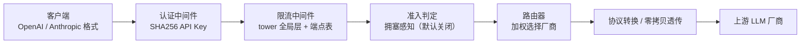
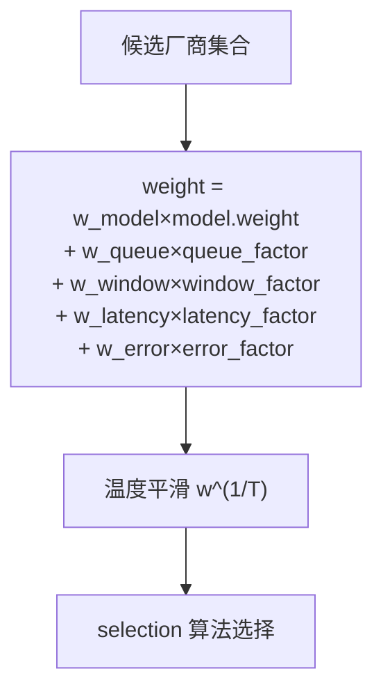
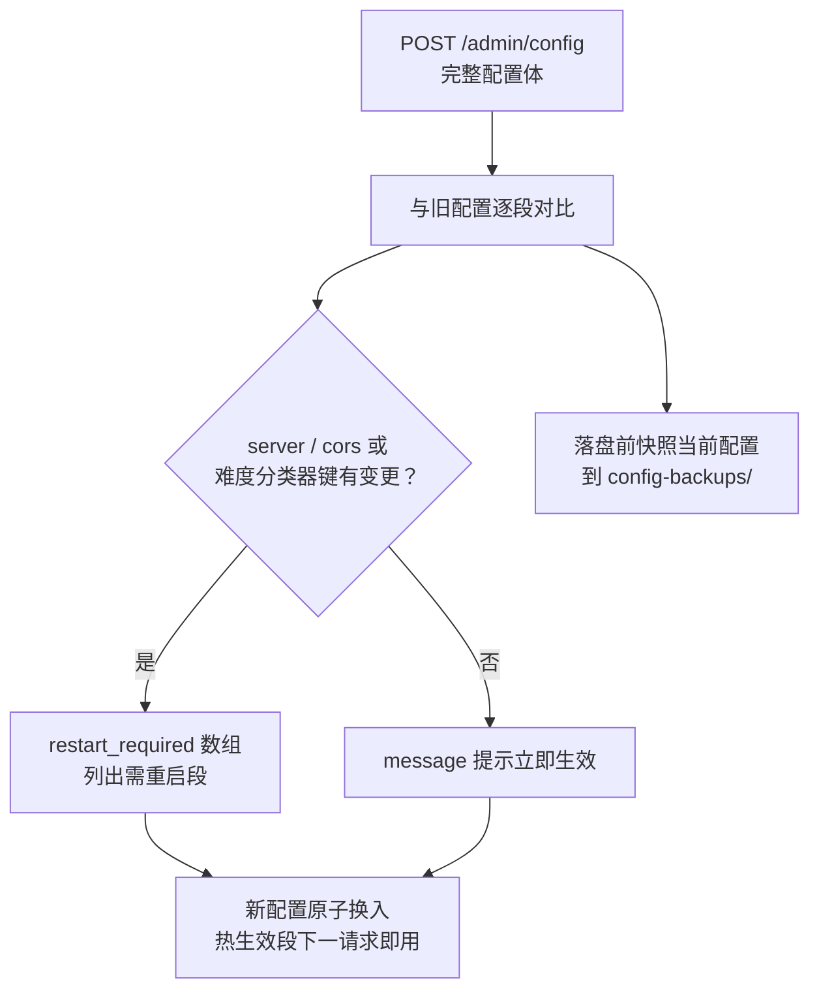
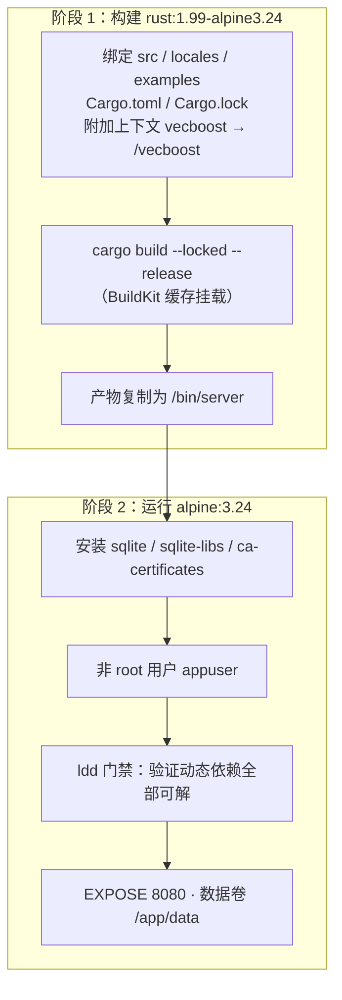

# Fluxweir 用户指南

**Fluxweir** 是一个智能 LLM 路由代理系统：多厂商统一管理、格式转换、智能调度。基于 Rust + Axum 0.8 + sdforge 构建，把多个上游 LLM 供应商抽象为单一接入点，提供加权路由、限流熔断、请求日志、Token 统计等生产级能力。本指南覆盖从编译启动到部署运维的完整操作路径。

> 相关文档：[FAQ](./FAQ.md) · [API 参考](./API_REFERENCE.md) · [README](../README.md)

## 📋 目录

- [快速开始](#-快速开始)
- [认证配置](#-认证配置)
- [厂商与模型配置](#-厂商与模型配置)
- [路由调优 routing](#-路由调优-routing)
- [Responses API responses](#-responses-api-responses)
- [Gemini 原生端点 gemini](#-gemini-原生端点-gemini)
- [重试与韧性 retryresilience](#️-重试与韧性-retry--resilience)
- [响应缓存 cache](#-响应缓存-cache)
- [入站限流与准入 ratelimitadmission](#-入站限流与准入-ratelimit--admission)
- [定价与成本 pricing](#-定价与成本-pricing)
- [离线成本回放 cost-replay](#-离线成本回放-cost-replay)
- [订阅账号上游 subscription](#-订阅账号上游-subscription)
- [配置热更新操作指南](#-配置热更新操作指南)
- [Docker 部署](#-docker-部署)
- [运维手册](#-运维手册)
- [gRPC 服务器 grpc](#-grpc-服务器-grpc)
- [Rust SDK 一览](#-rust-sdk-一览)
- [延伸阅读](#-延伸阅读)

---

## 🚀 快速开始

### 环境要求

| 项目     | 要求                    | 说明                                                                                                                                                                                            |
| :------- | :---------------------- | :---------------------------------------------------------------------------------------------------------------------------------------------------------------------------------------------- |
| Rust     | 1.97.1+（MSRV）         | 下限由根 `Cargo.toml` 的 `rust-version` 声明（与 7 个兄弟库一致）；`.github/workflows/ci.yml` 按 MSRV（`RUST_VERSION: '1.97'`）跑 build/clippy，`docker/Dockerfile` 用当前受支持 stable（1.99） |
| 自研库   | 7 个，由 cargo 自动拉取 | `confers` / `dbnexus` / `inklog` / `limiteron` / `oxcache` / `sdforge` / `trait-kit`（crates.io registry 版本声明在根 `Cargo.toml`，校验和锁定在 `Cargo.lock`；无需同级目录）                   |
| 上游密钥 | 按厂商注入环境变量      | 各 `[[vendors]]` 条目的 `api_key_env` 指定的环境变量（如 `OPENAI_API_KEY`）                                                                                                                     |

### 编译与启动

```bash
# 运行时配置为 config.toml——该文件不入库（部署私有物在本地维护），先 cp config.example.toml config.toml 起步
cp config.example.toml config.toml

# 默认读取当前目录 config.toml
cargo run --release

# 指定配置文件路径（第一个命令行参数）
cargo run --release -- /path/to/config.toml
```

配置路径参数解析见 `src/main.rs`（`std::env::args().nth(1)`，缺省 `config.toml`）。服务器默认监听 `0.0.0.0:8080`（`[server]` 段默认值，见 `src/config/mod.rs`）。**`config.example.toml` 是随仓的带注释全量参考**：`Config` 结构体的每个段、每个字段都在那里并标注默认值与热更新可用性（可选段如 `[[model_catalog]]` 以注释模板给出，按需取消注释），除注明「演示值（非默认）」的条目外，显式值与 serde default 一致（复制即得默认行为）；`config.toml` 本身不入库（`.gitignore` 已列），干净检出必须自行复制。新增配置项须同步该文件与 `tests/config/config_toml_example_test.rs`。

### 验证服务

```bash
curl http://127.0.0.1:8080/api/v1/health
```

> ⚠️ **注意**：健康检查的注册路径是 **`/api/v1/health`**——`src/api/health.rs` 的 `#[forge(version = "v1")]` 宏会给 `path = "/health"` 自动加 `/api/v1` 版本前缀。裸 `/health` 未注册路由（直接访问返回 404），它只出现在认证与限流的放行白名单里。

正常响应：

```json
{ "status": "ok", "version": "0.1.0", "timestamp": "..." }
```

数据面端点可用性（需认证；模型列表始终现算、不缓存）：

```bash
curl http://127.0.0.1:8080/v1/models -H "Authorization: Bearer $API_KEY"
```

### 一次请求的完整路径



---

## 🔐 认证配置

### 密钥存储形态

API Key 以 **SHA256 hex 摘要** 存储，明文密钥不落盘、不进内存。生成摘要：

```bash
echo -n "your-key" | sha256sum
```

认证时对请求携带的 key 现场计算摘要做常量时间比较（`src/middleware/auth.rs`）。

### [auth] 段

| 字段            | 默认值                                         | 说明                                                                                          |
| :-------------- | :--------------------------------------------- | :-------------------------------------------------------------------------------------------- |
| `enabled`       | `true`（段存在时）                             | 认证开关；**整个 `[auth]` 段缺省 = 认证禁用**（`auth: Option<AuthSection>`，`None` 直接放行） |
| `api_keys`      | 空                                             | 合法 key 的 SHA256 hex 摘要列表                                                               |
| `[[auth.keys]]` | 空                                             | key 档位表（配合 `[admission]` 拥塞准入）                                                     |
| `[auth.header]` | `name = "Authorization"` / `prefix = "Bearer"` | 保留段结构，防热更写回时抹段                                                                  |

### [[auth.keys]] 档位

| 字段   | 说明                                                                |
| :----- | :------------------------------------------------------------------ |
| `hash` | key 的 SHA256 hex 摘要（与 `api_keys` 同形态）                      |
| `tier` | `dedicated` / `guaranteed` / `elastic` / `spot`，**默认 `elastic`** |

未在 `keys` 中声明的 key（含 `api_keys` 列表全部）一律落 `elastic` 档。档位仅在 `[admission]` 拥塞准入开启时参与优先级判定（见[入站限流与准入](#-入站限流与准入-ratelimit--admission)）。

```toml
[auth]
enabled = true
api_keys = ["<sha256-hex-of-your-key>"]

[[auth.keys]]
hash = "<sha256-hex>"
tier = "dedicated"
```

### OIDC 换短时网关键 `[auth.oidc_rules]`（`oidc` feature）

OIDC ID Token 换网关短时键：Bearer JWT 命中规则 → JWKS 按 kid 验签（RS256/ES256，缓存 TTL 10 分钟、失败沿用旧缓存至 24h）→ `sub`+`issuer` 派生进程内 TTL 短时键（默认 1h，上限 86400s；**内存表、不落盘、重启失效**），继承绑定母键的 tier 与全部限制。**默认无规则 = 整体关闭**，auth 中间件行为逐字节不变；母键删除/禁用即规则失效。

```toml
[auth.oidc_rules.rules]         # 每条规则 = issuer+audience+claims 精确匹配 + 绑定母键
issuer = "https://token.actions.githubusercontent.com"
audience = "my-gateway-client"
claims = { repository = "org/repo", ref = "refs/heads/main" }   # 精确匹配，禁通配/前缀（校验层硬拦）
bind_key_hash = "<64 位 hex，必须存在于 api_keys>"
# ttl_secs = 3600               # 短时键 TTL（默认 3600，上限 86400）
```

**安全红线**：claims 只做**精确匹配**——任何含 `*`/`?` 的键值加载即拒绝（通配会让任意发行方 token 换到母键）。`issuer` 仅 https（loopback 放行 http）。feature 不进 `full`（新增出站 JWKS 拉取，opt-in：`--features oidc`）。

### 请求头与热读

- 客户端携带 **`Authorization: Bearer <key>`**（优先）或 **`x-api-key: <key>`**（备用），提取逻辑见 `src/utils/tenant.rs`（`auth.rs` 仅 re-export）。
- 认证状态**每请求从热配置现读**：吊销 / 轮换 key、切换 `enabled`，`POST /admin/config` 后立即生效，无需重启。
- 认证豁免路径（`/health`、`/api/v1/health`、`/`、`/readyz`、`/metrics`、`/admin/subscription/callback`、`/api-docs`与`/api-docs/*`、`/swagger-ui`与`/swagger-ui/*`，见 `src/middleware/auth.rs` 认证白名单判定）无需 key；`/healthz` 与 `/readyz` 另由 sdforge 在认证层之后挂载，**免认证免限流**（实测无 key 返回 200），`/ready` 未注册（404）。

---

## 🏭 厂商与模型配置

### [[vendors]] 全字段

| 字段             | 类型   | 默认值                   | 说明                                                                                                                                                                                                                                    |
| :--------------- | :----- | :----------------------- | :-------------------------------------------------------------------------------------------------------------------------------------------------------------------------------------------------------------------------------------- |
| `id`             | String | 必填                     | 厂商唯一标识；**不得为空白**；**跨条目去重校验**（按 ASCII 大小写不敏感），重复导致配置加载失败（`src/config/loader.rs`）                                                                                                               |
| `name`           | String | 必填                     | 显示名                                                                                                                                                                                                                                  |
| `type_`          | String | 必填（TOML 键名 `type`） | 协议方向：`"anthropic"` 走 Anthropic 面，`"gemini"` 走 Gemini 原生面（`/v1beta/models/{model}:{action}` + `x-goog-api-key`），`"rerank"` 走重排面，其余值按 OpenAI 兼容面处理（代码不校验取值；模型能力档对未知类型回落 ollama 保守档） |
| `api_key_env`    | String | 必填                     | 存放上游密钥的环境变量名                                                                                                                                                                                                                |
| `api_key_envs`   | 数组   | 空                       | 多 key 池的额外环境变量名（与 `api_key_env` 合并去重，本列表在前；缺名 env 跳过并告警，池上限见 `key_pool::MAX_KEY_POOL`）                                                                                                              |
| `extra_headers`  | 表     | 空                       | 出站自定义头（静态值，热生效；与网关已设头冲突时跳过并记 warn）                                                                                                                                                                         |
| `api_base`       | String | `""`                     | 上游 API 基地址                                                                                                                                                                                                                         |
| `api_style`      | String | 缺省（`chat`）           | 端点风格：`chat`（`chat/completions`）或 `responses`（OpenAI Responses `/responses`，仅 `type_ = "openai"` 合法）；与 `chat_path` 互斥                                                                                                  |
| `enabled`        | bool   | `true`                   | 厂商开关                                                                                                                                                                                                                                |
| `priority`       | u8     | `1`                      | fallback 优先级，**数值越小优先级越高**（1 = primary）                                                                                                                                                                                  |
| `models`         | 数组   | 空                       | 模型列表，见下                                                                                                                                                                                                                          |
| `rate_limit`     | 表     | 必填                     | 厂商级配额，三形态，见下                                                                                                                                                                                                                |
| `concurrency`    | 表     | 见下                     | 并发控制                                                                                                                                                                                                                                |
| `timeout_ms`     | u64    | `60000`                  | 出站单次尝试总超时（毫秒），`0` = 不限时                                                                                                                                                                                                |
| `stream_ttft_ms` | u64    | `60000`                  | 流式首包（响应头）超时（毫秒），`0` = 不限时                                                                                                                                                                                            |
| `stream_idle_ms` | u64    | `30000`                  | 流式相邻 chunk 间 idle 超时（毫秒），`0` = 不限时                                                                                                                                                                                       |
| `cache_ttl_secs` | u64    | `300`                    | 上游前缀缓存存活时长（秒，合法范围 1–86400）：`[routing.affinity] mode = "auto"` 判定值得粘时以此作为粘持 TTL；1h 缓存部署配 `3600`                                                                                                     |
| `silent_cache`   | bool   | `false`                  | 沉默缓存厂商标记：usage 不报 cache 列的上游（OpenAI 前缀缓存、Gemini 隐式缓存）置 `true`，auto 模式把 `prompt_tokens` 当写入值计入缓存价值，否则这类厂商 worth 恒 0、永不粘                                                             |
| `supports_batch` | bool   | `false`                  | batch 端点支持标记（`X-Batch: 1` 路由的过滤标记）                                                                                                                                                                                        |
| `chat_path`      | 无     | 缺省走历史规则           | 跳过 `/v1` 自动拼接规则、直用该路径（None/缺省走历史拼接；与 `api_style` 路径语义歧义时拒绝加载）                                                                                                                                         |
| `anthropic_version` | 无  | 缺省 → `"2023-06-01"`    | Anthropic 面 version 头覆写；缺省用内置默认值                                                                                                                                                                                            |
| `forward_beta_headers` | bool | `false`              | 将客户端 beta 头透传到上游（默认关闭）                                                                                                                                                                                                   |
| `send_nonstandard_params` | bool | `false`            | 非标参数原样发送上游（透传路径恒不触碰请求体，仅转换路径消费该开关）                                                                                                                                                                      |

配置定义见 `src/config/mod.rs`（`VendorConfig`）。

### models 子项

| 字段           | 默认值 | 说明                                                                                                                                                                                                          |
| :------------- | :----- | :------------------------------------------------------------------------------------------------------------------------------------------------------------------------------------------------------------ |
| `model_id`     | 必填   | 上游真实模型名（同 vendor 内去重校验，按 ASCII 大小写不敏感；不得为空白）                                                                                                                                     |
| `abstract_id`  | 无     | 抽象模型名（路由的逻辑标识，可多厂商映射同一抽象名；客户端按此请求，`GET /v1/models` 亦列此名——声明后裸 `model_id` 不再是请求名，限定形式 `vendor.model_id` 仍可路由；ID 匹配大小写不敏感；声明后不得为空白） |
| `weight`       | `1.0`  | 路由权重（通常 0.0–2.0）                                                                                                                                                                                      |
| `enabled`      | `true` | 模型开关                                                                                                                                                                                                      |
| `dimensions`   | 无     | 嵌入向量维度（声明该字段 = 嵌入条目）。仅用于同 `compat_group` 内一致性校验与响应维度守门基准，不影响路由选择                                                                                                 |
| `compat_group` | 无     | 嵌入兼容组名（声明任一嵌入字段 = 嵌入条目）。同组条目 = 同一向量空间、故障时允许组内迁移；未声明 = 单例组（不与其他厂商互换）                                                                                 |
| `model_type`   | 无     | 任务类型闭集：`chat` / `embedding` / `rerank`（与 `api_style` 同构、历史 `matches!` 严格小写口径；`type_ = "rerank"` 厂商的路由依赖该声明）                                                                    |

#### 嵌入兼容组路由（`POST /v1/embeddings`）

嵌入请求不参与 chat 的多厂商加权轮换：首次请求加权选中某厂商后即「粘着」（进程内 pin，按抽象模型记忆，首写者胜），后续请求恒走同组厂商。未声明 `compat_group` 时组 = 单厂商（**安全默认**：故障显式报错而非静默换到向量空间可能不同的厂商）。声明同名 `compat_group` 即向网关承诺「同组同模型同维度、向量可互换」，组内故障自动迁移。

三道配置校验（加载与热载共用，违反即拒绝）：同组 `model_id` 必须一致（大小写不敏感）、同组已声明的 `dimensions` 必须相等、组名不得跨 `abstract_id`。两道运行期守门：pin 组全部不可用 → 显式报错（附恢复指引）；同 (vendor, model) 响应维度与首见基准不一致 → 502 拦截（防上游静默换模型）。

pin 可经 `POST /admin/embedding-pins/{abstract_id}/reset` 重置；配置热更成功后自动全部重置。**行为变更**：存量「多厂商同名嵌入模型」配置从「每请求随机分担」变为「粘着单厂商」；需要跨厂商分担请显式声明同名 `compat_group`。

### rate_limit 三形态（tagged enum，键 `type`）

| 形态          | 字段                                                                 | 说明                                                                             |
| :------------ | :------------------------------------------------------------------- | :------------------------------------------------------------------------------- |
| `time_window` | `start` / `end`                                                      | 固定时间段放行                                                                   |
| `interval`    | `hours`、`sliding`（默认 `false`）                                   | 每 N 小时一个窗口；`sliding = true` 切换滑动窗口（消除固定窗口翻越点的瞬时双花） |
| `token`       | `max_tokens`、`window_hours`（默认 `24`）、`sliding`（默认 `false`） | token 配额窗口                                                                   |

### concurrency 子项

| 字段                      | 默认值       | 说明                                                      |
| :------------------------ | :----------- | :-------------------------------------------------------- |
| `requests_per_second`     | `1`          | 出站令牌桶速率                                            |
| `max_concurrent_requests` | 无（`None`） | 最大并发在途数（含流式）；缺省用队列容量（100）           |
| `token_weighted`          | `false`      | token 加权并发票据开关（agentic 长会话按预估 token 占票） |
| `token_ticket_min`        | `1`          | 单请求票据下限                                            |
| `token_ticket_max`        | `16384`      | 单请求票据上限（逃逸阀）                                  |
| `token_ticket_default`    | `4096`       | 请求未声明 `max_tokens` 时的计费兜底                      |

> ⚠️ `concurrency` 在 vendor 实例构造期消费，属**需重启生效**段（见[配置热更新](#-配置热更新操作指南)）。

### [global_model] 全局模型

全局池是 `model = "auto"` 的选路目标（抽象/直连两级都未命中时才尝试）。池成员 = 全部启用 vendor 的启用模型，按候选加权打分选择。

| 字段       | 默认值       | 说明                                                                                                                                                                                                                    |
| :--------- | :----------- | :---------------------------------------------------------------------------------------------------------------------------------------------------------------------------------------------------------------------- |
| `enabled`  | `true`       | auto 档开关（每请求热读）。`false` 时 `model = "auto"` 以 `validation_error`(400) 拒绝，全局池不参与选路；显式模型名与 `X-Vendor`/`X-Model` 提示（均为显式指定）不受影响。缺 `[global_model]` 段 = 启用（沿用历史兜底） |
| `strategy` | `"weighted"` | 全局池策略档位声明；当前选路统一由 `[routing]`（加权 / `selection` 档）决定，该字段暂无独立消费者，保留档位语义                                                                                                         |

> ⚠️ `global_model` 段的**文件热重载被结构门拒绝**（直接改 `config.toml` 不生效，旧快照继续服务，需重启进程）；`POST /admin/config` 写入在内存切换后下一请求生效（`enabled` 经 `ConfigManager::is_global_model_enabled` 每请求热读，路由决策时消费），但响应会附 `restart_required` 保守提示。另注意 `POST /admin/models/global` 是模型目录路由（更新 `[[model_catalog]]` 的 global 策略条目，热生效），与本段配置是两回事。

---

## 🎯 路由调优 routing

### 权重公式



默认三维系数 `0.4 / 0.3 / 0.3` 与历史行为逐位一致；`w_latency` / `w_error` 默认 `0`（关闭），显式开启才生效。定义见 `src/config/mod.rs`（`RoutingSection`），消费见 `src/router/router.rs`。

### [routing] 字段与默认值

| 字段                         | 默认值                                                                                                                                                                   | 说明                                                                                                                                                                                                                                                                                                                                                                                                                                                |
| :--------------------------- | :----------------------------------------------------------------------------------------------------------------------------------------------------------------------- | :-------------------------------------------------------------------------------------------------------------------------------------------------------------------------------------------------------------------------------------------------------------------------------------------------------------------------------------------------------------------------------------------------------------------------------------------------- |
| `rerank_score_normalization` | `"none"`                                                                                                                                                                 | rerank 分数归一化：`none`（原样透传）/ `sigmoid` / `minmax`；仅影响 `/v1/rerank` 响应分数，不改排序与 index                                                                                                                                                                                                                                                                                                                                          |
| `w_model`                    | `0.4`                                                                                                                                                                    | 配置权重维系数                                                                                                                                                                                                                                                                                                                                                                                                                                      |
| `w_queue`                    | `0.3`                                                                                                                                                                    | 负载维系数（输入由 `load_signal` 决定）                                                                                                                                                                                                                                                                                                                                                                                                             |
| `w_window`                   | `0.3`                                                                                                                                                                    | Token 预算 / 窗口维系数                                                                                                                                                                                                                                                                                                                                                                                                                             |
| `w_latency`                  | `0.0`                                                                                                                                                                    | EWMA 延迟因子系数（`0` = 关闭）                                                                                                                                                                                                                                                                                                                                                                                                                     |
| `w_error`                    | `0.0`                                                                                                                                                                    | EWMA 错误率因子系数（`0` = 关闭）                                                                                                                                                                                                                                                                                                                                                                                                                   |
| `price_factor_enabled`       | `true`                                                                                                                                                                   | 价格因子开关：开启时对合格集中每个候选按「最低单价 / 该候选单价」乘性修正权重（weight ×= min_p/p，压低高价候选），默认开启                                                                                                                                                                                                                                                                                                                          |
| `price_factor_mode`          | `"nominal"`                                                                                                                                                              | 价格因子单价口径：`nominal`（(input+output)/2，与历史一致）/ `cache_expected`（`cache_read_price > 0` 的条目改用 (cache_read+output)/2，配合前缀亲和表达缓存友好偏好）；未知值按 `nominal`                                                                                                                                                                                                                                                          |
| `latency_ref_ms`             | `1000.0`                                                                                                                                                                 | 延迟因子参考值：厂商 EWMA 等于该值时因子 0.5                                                                                                                                                                                                                                                                                                                                                                                                        |
| `temperature`                | `1.0`                                                                                                                                                                    | 温度平滑指数；`>1` 压平差距，`<1` 放大差距，必须 `>0`                                                                                                                                                                                                                                                                                                                                                                                               |
| `selection`                  | `"weighted"`                                                                                                                                                             | 选择算法：`weighted`（轮盘赌）/ `power_of_two`（Po2C 实验）/ `linucb`（bandit 档，未接线时回退 weighted）；未知值按 `weighted`                                                                                                                                                                                                                                                                                                                      |
| `load_signal`                | `"queue"`                                                                                                                                                                | 负载维输入档：`queue`（队列深度）/ `in_flight`（在途请求数）/ `in_flight_relative`（在途相对化）；单选不叠加，未知值按 `queue`                                                                                                                                                                                                                                                                                                                      |
| `ewma_tau_ms`                | `10000`                                                                                                                                                                  | Peak-EWMA 时间常数 τ（毫秒）                                                                                                                                                                                                                                                                                                                                                                                                                        |
| `latency_buffer`             | `0.0`                                                                                                                                                                    | min+buffer 候选集缓冲（`>0` 时先取 EWMA ≤ 最低×(1+buffer) 的集合再均匀随机）；`0` = 关闭                                                                                                                                                                                                                                                                                                                                                            |
| `allow_request_weight`       | `false`                                                                                                                                                                  | `X-Weight` 请求级权重开关（默认忽略该头）                                                                                                                                                                                                                                                                                                                                                                                                           |
| `fail_open_when_all_cooling` | `false`                                                                                                                                                                  | 全候选冷却时回落「忽略状态但 enabled」的候选集（有意冒险，仅建议有兜底容量的部署开启）                                                                                                                                                                                                                                                                                                                                                              |
| `retry_after_hint`           | `false`                                                                                                                                                                  | 换路耗尽且全部原因为 Throttled 时返回 `429 + Retry-After` 头                                                                                                                                                                                                                                                                                                                                                                                        |
| `affinity_mode`              | `"hard"`                                                                                                                                                                 | 会话亲和：`hard`（命中即返回）/ `soft`（命中软化为权重乘子）；未知值按 `hard`                                                                                                                                                                                                                                                                                                                                                                       |
| `affinity_boost_factor`      | `1.0`                                                                                                                                                                    | soft 模式命中权重乘子基准（权重 ×(1+该值)）                                                                                                                                                                                                                                                                                                                                                                                                         |
| `affinity_tenant_scoped`     | `false`                                                                                                                                                                  | 亲和键租户隔离（`affinity:{api_key_hash}:{session_key}`，防跨租户劫持）                                                                                                                                                                                                                                                                                                                                                                             |
| `sla_v`                      | `0.0`                                                                                                                                                                    | SLA/满意度虚拟队列打分强度（`0` = 关闭）                                                                                                                                                                                                                                                                                                                                                                                                            |
| `sla_alpha`                  | `0.95`                                                                                                                                                                   | 目标服务水平 α（[0,1]）                                                                                                                                                                                                                                                                                                                                                                                                                             |
| `lps_delta`                  | `0.0`                                                                                                                                                                    | LPS 排队论延迟前瞻软约束强度（`0` = 关闭）                                                                                                                                                                                                                                                                                                                                                                                                          |
| `lps_deadline_gate`          | `false`                                                                                                                                                                  | LPS 硬约束门控（按 `x-deadline-ms` 头筛可行集）                                                                                                                                                                                                                                                                                                                                                                                                     |
| `default_deadline_ms`        | `10000.0`                                                                                                                                                                | 未携带 deadline 头时的默认截止（毫秒）                                                                                                                                                                                                                                                                                                                                                                                                              |
| `ucb_alpha`                  | `1.0`                                                                                                                                                                    | LinUCB 探索参数（仅 `selection = "linucb"` 时被咨询）                                                                                                                                                                                                                                                                                                                                                                                               |
| `prefix_affinity`            | 子段 `[routing.prefix_affinity]`：`enabled = false`、`prefix_chars = 512`                                                                                                | 前缀亲和 PoTC（默认关）：开启后稳定前缀哈希出 2 个带内候选、按平滑权重择优；`prefix_chars` 为前缀键截取的首条 user content 头部字符数                                                                                                                                                                                                                                                                                                               |
| `affinity`                   | 子段 `[routing.affinity]`：`mode = "legacy"`、`cache_worth_tokens = 1024`、`turn_gap_secs = 120`                                                                         | 缓存经济学亲和（默认 legacy = 现行为逐位不变）：`legacy` 成功即粘 1h；`auto` 按响应缓存价值判定（`worth = cache_read + cache_creation +（vendor silent_cache 时加 prompt_tokens）≥ cache_worth_tokens` 才粘，TTL 取该 vendor `cache_ttl_secs`；低于阈值不写也不删既有记录）；`turn` 会话内连续请求粘 `turn_gap_secs`；`off` 不写 + 查询短路（存量绑定立即不再生效、也不被删除）。仅 auto/turn 落 `affinity_sticks` 表并在启动恢复（未过期 top 512） |
| `difficulty`                 | 子段 `[routing.difficulty]`：`enabled = false` 完全旁路（其余默认 `w_clf = 0.6`、`w_rule = 0.4`、`score_low = 0.35`、`score_high = 0.65`、`mid_band_policy = "strong"`） | 难度定档（默认关）：`groups` 命中的请求按规则计分 + 分类概率融合切 low/mid/high 三档并改写目标抽象模型名；`w_clf > 0` 需 `difficulty-classifier` feature；`lexicon` 子段可整体覆盖 hard/easy 词表、数学符号、问号与代码围栏标记（缺省 = 内置默认），`scoring` 子段为规则计分权重/封顶（缺省 = 历史常量）；`classifier` 子段为 vecboost laya 运行参数                                                                                                |

### 会话亲和

- 客户端经 **`X-Session-Id`** 头声明会话键；缺失时兜底 `sha256(messages[0] 序列化前 2KB)` 截断 hex（`src/api/routing_hints.rs`）。
- **会话头别名**（`[routing.affinity].session_headers`，默认 `["x-session-id"]`）：按序取**第一个存在且非空**的头作为亲和键源，字节上限沿用——纳各 agent 原生会话头（如 `x-conversation-id`）：

  ```toml
  [routing.affinity]
  session_headers = ["x-session-id", "x-conversation-id"]
  ```

  元素加载时统一小写化；全缺失回退 messages 前缀哈希兜底（零配置行为与今日一致）。
- `affinity_mode = "hard"`（默认）时命中绑定厂商必选；`"soft"` 时命中厂商权重乘 `(1 + affinity_boost_factor)` 后与其余候选照常竞争。
- 缓存经济学亲和（`[routing.affinity]`，默认 `legacy` 零回归）：`auto` 模式在响应 usage 结算时判定值不值得粘——把「只写入 200 token 缓存的会话也粘 1h、锁死在次优厂商」的问题交给缓存价值阈值（默认 1024 token，对齐 magpie 实测）；`turn` 模式以 `turn_gap_secs`（默认 120s）近似 tool result 回传窗口。沉默缓存厂商（OpenAI 前缀缓存 / Gemini 隐式缓存，usage 不报 cache 列）配 `silent_cache = true`，把 `prompt_tokens` 当写入值计入缓存价值；TTL 经 `cache_ttl_secs` 对齐上游缓存部署（默认 300s，1h 缓存部署配 3600）。
- **TTL 只由写入方设定，读路径不续期**（`auto`/`turn`）：settle 写入该 vendor 的 `cache_ttl_secs`（或 `turn_gap_secs`）后，后续路由命中不再把它刷长——上游缓存失效后会话可自然回到路由池，这正是 `auto` 的意义。`legacy` 保持历史语义（表级 1h、命中续期）。低于阈值（`worth < cache_worth_tokens`）的结算既不写也不删：既有记录按它自己写入时的 TTL 过期。
- 首绑定收敛只适用于 `legacy` + `affinity_tenant_scoped = true`（并发首请求经 SETNX 收敛到唯一胜出者，后续 settle 不覆盖）；`auto`/`turn` 每次结算是一份新的粘持判定，后一次覆盖前一次。
- 写入侧的模式门同样覆盖 `/v1/rerank`：该端点无 usage 语义，回写与 chat 的 legacy 路径同源（`bind_session_affinity`）——`off` 不写、`auto`/`turn` 也不写（不引入 1h 无条件 set）。
- `off` 是止损阀：不写且查询短路——存量绑定立即不再生效（也不被删除，切回原模式即可恢复）。
- auto/turn 模式的粘性 write-behind 落 `affinity_sticks` 表，重启按剩余 TTL 恢复未过期 top 512。

### 命名预设

三套开箱即用的系数组合（`RoutingSection::preset`）：

| 预设      | w_model | w_queue | w_window | 特点                                             |
| :-------- | :-----: | :-----: | :------: | :----------------------------------------------- |
| `quality` |   0.7   |   0.2   |   0.1    | 偏模型配置权重                                   |
| `latency` |   0.2   |   0.2   |   0.2    | 额外开 `w_latency = 0.4`、`latency_ref_ms = 500` |
| `cost`    |   0.2   |   0.2   |   0.6    | 偏窗口预算（Token 余额 ≈ 成本预算代理）          |

---

## ♊ Gemini 原生端点 gemini

`type_ = "gemini"` 厂商既能承接本网关其它入口（`/v1/chat/completions`、`/v1/messages`、`/v1/responses`）的流量，也提供 Gemini 原生入站端点（Google 官方 SDK 可直接把 base URL 指向网关根地址）。

### 厂商配置

```toml
[[vendors]]
id = "google"
name = "Google Gemini"
type_ = "gemini"
api_base = "https://generativelanguage.googleapis.com"   # 可省略（缺省即官方 host）
api_key_env = "GEMINI_API_KEY"                           # pragma: allowlist secret（示例环境变量名）；出站以 x-goog-api-key 发送
rate_limit = { type = "time_window", start = "00:00", end = "24:00" }
concurrency = { requests_per_second = 20 }

[[vendors.models]]
model_id = "gemini-2.5-pro"
abstract_id = "gemini-pro"
enabled = true
weight = 1.0
```

`type_ = "gemini"` 不允许声明 `chat_path`（端点由 model + action 动态拼接），`api_style` 仅允许缺省或 `chat`。健康探针：`free` 策略 GET `models`，`minimal_call` 发 1 token 的 `generateContent`。

### 入站端点

| 端点                                                | 说明                       |
| --------------------------------------------------- | -------------------------- |
| `POST /v1beta/models/{model}:generateContent`       | 非流式对话                 |
| `POST /v1beta/models/{model}:streamGenerateContent` | 流式 SSE（无 `[DONE]`）    |
| `POST /v1beta/models/{model}:countTokens`           | 本地估算                   |
| `POST /v1beta/models/{model}:embedContent`          | 单条嵌入（转 OpenAI 形状） |
| `POST /v1beta/models/{model}:batchEmbedContents`    | 批量嵌入                   |
| `GET /v1beta/models` / `GET /v1beta/models/{model}` | 模型清单/详情              |

认证：Google SDK 默认发送 `x-goog-api-key`；网关也接受 `/v1beta/` 路径上的 `?key=`（建议仅在 SDK 无法定制请求头时使用，并确保反向代理不记录 query）。

### 路由与直通

- 默认转统一 chat IR，命中任意厂商（含 OpenAI/Anthropic/Responses/Gemini），享受加权/亲和/难度/熔断/配额。
- `safetySettings`、`cachedContent`、内置工具（`googleSearch` 等）无法等价降级 → 仅路由 `type_ = "gemini"` 厂商，body 原样直通；无候选时 400 并提示补配置。
- 思考摘要：`thinkingConfig.includeThoughts` 进入 IR 请求级开关，仅 Gemini 出站生效；其它厂商忽略。
- `generationConfig.responseSchema` 支持 OpenAI JSON Schema 的 `$defs/$ref` 内联（深度上限 32、环引用拒绝）。

### 限制

- 不做 Gemini 原生 Embeddings 出站（`/v1/embeddings` 仍只路由 OpenAI 型厂商；Gemini embeddings 可走其 OpenAI 兼容端点）。
- 不支持 Live API、Files API、cachedContents CRUD、Batches API。
- 普通 http(s) 图片 URL 以 `fileData.fileUri` 透传，上游只接受 Files API / `gs://` URI；网关不做服务端抓取。

---

## 📝 Responses API responses

`POST /v1/responses` 接受 OpenAI Responses 格式（`input` 字符串或 item 数组、`instructions`、flat function tools、`text.format` 结构化输出），默认转成统一 chat IR 后进入现有路由池（OpenAI chat / Anthropic messages 厂商均可命中）；`stream: true` 返回语义化 SSE 事件（`response.created` → `response.output_text.delta` → `response.completed`）。

### [responses] 字段与默认值

| 字段                  | 默认值    | 说明                                                                  |
| :-------------------- | :-------- | :-------------------------------------------------------------------- |
| `enabled`             | `true`    | 端点总开关（热读）；`false` 时四个端点一律 404                        |
| `store_enabled`       | `true`    | 是否允许落库；`false` 时 `store=true` 请求按 `store=false` 降级并回显 |
| `retention_hours`     | `720`     | 存储保留时长（1–8760 小时）                                           |
| `max_response_bytes`  | `1048576` | 单列 JSON 上限（1 KiB–16 MiB），超限拒绝写入                          |
| `background_enabled`  | `true`    | 后台任务开关                                                          |
| `max_background_jobs` | `16`      | 后台并发上限（1–256，热读）；超限 429                                 |

### 有状态语义

- `store` 缺省 `true`：响应写入 `response_store` 表（迁移 V4），`GET /v1/responses/{id}` 可检索、`DELETE` 可删除；`store=false` 不落库。
- `previous_response_id`：网关按链回溯（深度 ≤100）把祖先 input/output items 回放到当前请求；`conversation` 按会话回放全部历史；两者互斥。上游永远看不到这两个字段（统一 `store=false`），因此跨厂商可用。
- `background: true`：网关侧异步执行，入队返回 `status: "queued"`，`GET` 轮询结果，`POST /v1/responses/{id}/cancel` 取消；要求 `store=true` 且不支持 `stream`。

### 原生直通与 `api_style`

内置工具（`web_search`/`file_search`/`code_interpreter`/`image_generation`/`mcp`）、`prompt` 模板、`input_file`/音频输入无法等价降级，只路由到 `api_style = "responses"` 的厂商（请求体改写后原样打 `{api_base}/responses`）：

```toml
[[vendors]]
id = "openai-native"
type_ = "openai"
api_style = "responses"
api_key_env = "OPENAI_API_KEY"  # pragma: allowlist secret（示例环境变量名，非凭证）
api_base = "https://api.openai.com/v1"
```

未声明 `api_style` 的 `type_ = "openai"` 厂商行为与历史逐位一致（chat/completions）；`/v1/chat/completions` 客户端命中 `api_style="responses"` 厂商时自动转成 `/responses` 出站。

---

## 🛡️ 重试与韧性 retry · resilience

### [retry] 出站重试

| 字段                     | 默认值                 | 说明                                                                                               |
| :----------------------- | :--------------------- | :------------------------------------------------------------------------------------------------- |
| `max_retries`            | `3`                    | 单 vendor 内最大重试次数（不含首次调用）                                                           |
| `retryable_status_codes` | `[429, 500, 502, 503]` | 触发重试的状态码集合（429 指数退避，5xx 固定间隔）                                                 |
| `initial_delay_ms`       | `1000`                 | 首次重试前延迟（毫秒）                                                                             |
| `factor`                 | `2.0`                  | 指数退避乘数                                                                                       |
| `max_delay_ms`           | `16000`                | 单次等待上限（毫秒）                                                                               |
| `jitter`                 | `0.2`                  | 退避抖动比例（0.0–1.0）                                                                            |
| `spread_jitter`          | `1.0`                  | Retry-After / 5xx 固定间隔的同步惊群展宽：延迟 = base + U(0, spread_jitter)×base；`0.0` 回滚旧行为 |
| `max_total_attempts`     | `8`                    | 跨 vendor 总尝试预算（防 vendor 数 × 重试数爆炸）                                                  |
| `retry_budget_secs`      | `0`                    | 单请求重试总时间预算（秒）；`0` = 不限时                                                           |
| `amplification_gate`     | `false`                | 重试放大守门器（失败率逼近临界时收紧总尝试为 1）                                                   |

重试策略每请求从热配置现读，热更立即生效。

### [resilience] 韧性覆盖面

| 字段                       | 默认值  | 说明                                                                          |
| :------------------------- | :------ | :---------------------------------------------------------------------------- |
| `cover_all_paths`          | `false` | 熔断 / 重试 / 换路是否覆盖透传与流式路径（关闭时仅转换非流式有换路 fallback） |
| `failure_rate_gate`        | `false` | 失败率软降权开关（超阈厂商权重打折不剔除）                                    |
| `failure_rate_min_samples` | `5`     | 触发软降权的最小窗口样本数（防小样本误杀）                                    |
| `failure_rate_threshold`   | `0.5`   | 失败率阈值（(0,1]）                                                           |
| `failure_rate_penalty`     | `0.1`   | 软降权乘子（权重 ×penalty）                                                   |
| `circuit_open_timeout_ms`  | `30000` | 熔断 Open→HalfOpen 超时窗口（毫秒；测试可注入短窗口）                          |
| `expose_fallback_headers`  | `false` | 回退链可观测响应头开关（✅ 热更；开启时成功响应附 `x-fluxweir-vendor` / `model` / `attempts` / `fallbacks`，缓存命中早退不附头） |

### 熔断器行为

per-vendor 熔断器（limiteron CircuitBreaker）：**连续 5 次失败打开，打开 30 秒后进入 half-open，连续 3 次成功恢复**。慢调用判定线抬高到 60 秒 / 100%（防止 LLM 常态长调用被误判为慢），生产配置单点见 `src/vendor/manager.rs` 的 `gate_circuit_config`。

---

## 💾 响应缓存 cache

精确响应缓存基于 oxcache memory 后端，缓存键形 `resp:{api_key_sha256}:{vendor_id}:{model_id}:{sha256(canonical_body)}`（key 哈希入键做租户隔离）。定义见 `src/config/mod.rs`（`CacheSection`），实现见 `src/api/response_cache.rs`。

### [cache] 字段与默认值

| 字段                   | 默认值   | 说明                                                                         |
| :--------------------- | :------- | :--------------------------------------------------------------------------- |
| `enabled`              | `false`  | 默认关闭（TTL 内响应陈旧是产品语义，上线由运维显式打开）                     |
| `ttl_secs`             | `300`    | 基础 TTL（秒）                                                               |
| `ttl_load_linked`      | `false`  | TTL 负载联动开关（开启后 TTL 随延迟 / 流量放大）                             |
| `w_l`                  | `0.0`    | 负载联动延迟项权重                                                           |
| `w_q`                  | `0.0`    | 负载联动流量份额项权重                                                       |
| `beta_max`             | `1.5`    | 负载放大上限（配置 <1 按 1 处理，只放大不缩短）                              |
| `l_target`             | `1000.0` | 延迟目标（毫秒，ewma_e2e_ms 口径）                                           |
| `q_target`             | `0.5`    | 流量份额目标（0..1）                                                         |
| `[[cache.categories]]` | 空       | 按模型前缀的 TTL 类别乘数表                                                  |
| `ttl_jitter`           | `0.0`    | TTL 抖动系数（>0 时写入 TTL 按 `ttl×(1±factor)` 对称抖动，同批键过期不齐峰） |
| `null_cache_ttl_secs`  | `60`     | 空响应负缓存窗口秒数（Null 响应写哨兵，窗口内直接命中不再穿透上游）          |

### 缓存门控与跳过

- **只有确定性请求会查/写缓存**：`stream == false` 且 `tools` 为空 且 `temperature == 0`（或缺省）。
- 请求携带 **`X-No-Cache: 1`** 强制回源（不读不写；兼容别名 `X-Skip-Cache`）。
- `[[cache.categories]]` 单条字段：`model_id_prefix`（模型名前缀）+ `multiplier`（TTL 乘数）；无命中的模型乘数 1.0。
- **并发防击穿**：同 key 并发 Miss 只放行一次上游（leader），其余等待回写后复用；leader 失败时 30s 超时后由等待者接管，不永久挂起。
- **空响应负缓存**：上游 Null 结果写哨兵（`null_cache_ttl_secs` 窗口），窗口内直接命中空值不再穿透，过期后允许再穿透。

```toml
[cache]
enabled = true
ttl_secs = 300

[[cache.categories]]
model_id_prefix = "gpt-4o-mini"
multiplier = 2.0
```

---

## 🚦 入站限流与准入 ratelimit · admission

### [rate_limit] 入站限流

限流规则经 `[[rate_limit.rules]]` 声明，Router 构造期消费（**restart-required**，见 `src/api/router_builder.rs`）：

| 字段           | 默认值 | 说明                                                                                                                                                                  |
| :------------- | :----- | :-------------------------------------------------------------------------------------------------------------------------------------------------------------------- |
| `id`           | 必填   | 规则标识（观测 / 日志维度）                                                                                                                                           |
| `path`         | 无     | 端点路径前缀（前缀匹配，如 `/v1/chat/completions`）；**缺省 = 全局规则**（tower 全局层 `GlobalRateLimitLayer` + `QuotaLimiter`，按已验证 API key 的 SHA256 摘要分桶） |
| `per_tenant`   | `true` | 按租户（调用方 API key 摘要）分桶；`false` 退化为规则级单桶                                                                                                           |
| `window_secs`  | 必填   | 滑动窗口时长（秒，`0` 按 1s 兜底）                                                                                                                                    |
| `max_requests` | 必填   | 窗口内最大请求数                                                                                                                                                      |

```toml
[[rate_limit.rules]]
id = "chat-cap"
path = "/v1/chat/completions"
per_tenant = true
window_secs = 60
max_requests = 30

[[rate_limit.rules]]
id = "global-cap"
window_secs = 1
max_requests = 100
```

行为要点：

- `rules` 为空（缺省）= 单层共享 `TokenBucket(100, 10/s)` 兜底（与旧 `Governor::new()` 默认逐位一致），无端点表。
- 超限返回 `429 + Retry-After`（取窗口重置剩余秒数）；限流器内部故障放行（fail-open）。
- 限流豁免路径（`is_quota_exempt_path` 十条：`/health`、`/healthz`、`/ready`、`/api/v1/health`、`/readyz`、`/metrics`、`/api-docs`与`/api-docs/*`、`/swagger-ui`与`/swagger-ui/*`，见 `src/api/router_builder.rs` 限流豁免表）。
- 端点表条目有硬上限（1024），auth 关闭时达到上限后新租户退化到共享桶，内存有界。

### [admission] 拥塞感知优先级准入

网关并发占用率（Σ 在途 / Σ 并发上限）达到阈值时，新请求按档位优先级与「当前在途最小档」比较，低者直接 `429 + Retry-After`（不排队）。判定在限流之后、handler 之前（`src/middleware/admission.rs`）。

| 字段                   | 默认值  | 说明                                             |
| :--------------------- | :------ | :----------------------------------------------- |
| `enabled`              | `false` | 默认完全关闭（判定旁路）；热读开关，热更立即生效 |
| `congestion_threshold` | `0.9`   | 拥塞阈值（占用率 ≥ 该值视为拥塞）                |
| `alpha_slo`            | `2.0`   | SLO 缺口系数（预留，当前无数据源）               |
| `alpha_burst`          | `1.0`   | burst EWMA（到达速率）压制系数                   |
| `alpha_debt`           | `4.0`   | debt EWMA（被 shed 频度）压制系数                |

准入优先级基准来自 **`[[auth.keys]]` 的 `tier` 档位**（`dedicated` > `guaranteed` > `elastic` > `spot`，见 `src/config/mod.rs` 的 `AuthTier`），未声明的 key 落 `elastic` 档。

---

## 💰 定价与成本 pricing

### 定价与成本（`[[model_catalog]]` 为计价正源，`[[pricing]]` 为辅助档）

| 字段                   | 说明                                  |
| :--------------------- | :------------------------------------ |
| `vendor_id`            | 厂商 ID（须与 `[[vendors]].id` 匹配） |
| `model_id`             | 模型 ID                               |
| `input_per_1k_tokens`  | 输入单价（USD / 1k tokens）           |
| `output_per_1k_tokens` | 输出单价（USD / 1k tokens）           |

成本公式：`(prompt/1000)×input + (completion/1000)×output`，按 `(vendor_id, model_id)` 精确匹配查找（`src/vendor/cost.rs`）。

> **档源优先级**：`[[model_catalog]]` 登记模型的四档价（每 1M tokens）为计价正源——成本分账（`token_usage`）、
> CostTracker 记账与**配额成本窗**均走 `estimate_cost_from_catalog`；`[[pricing]]` 仅用于路由 SLA 因子（`sla_v`）
> 与未登记目录模型的配额回退档（无 cache 两档）。同一请求的「分账成本」与「配额扣减」由同一函数产出，
> 仅余向上取整的 ≤1 millicent 尾差。

### 已知边界（如实声明）

- **`[[model_catalog]]` 未登记该 (vendor, model) 时成本按 `0` 计**，不会阻塞响应。
- 目录与定价热更立即生效（下一次请求即用新值）。
- 逐请求日志表 `request_logs.cost_usd` 按 `[[model_catalog]]` 四档求和 × 目录单价落库（rerank 按每千文档价）；
  未登记单价写 `0`、无 usage 写 `NULL`。进程内 `CostTracker` 启动时自 `token_usage` 恢复最近
  `[metrics].cost_restore_window_hours`（默认 24h）窗口，重启不再清零；内存库启动跳过恢复。

### 成本分账落库与查询

每次成功响应经预聚合落 `token_usage` 表：聚合键 `(vendor, model, api_key_hash, date, hour)`（`api_key_hash` 为请求方 key 的 SHA-256 摘要，跨重启稳定；`[[model_catalog]]` 未登记模型成本记 0），四类 token（input/output/cache_read/cache_creation）与分项成本各自累加。rerank 请求成本归入 `input_cost` 分项、token 列恒 0（`/admin/cost` 的 total 覆盖重排）。

数据库升级：`token_usage` 分账形态经 **V2 版本化迁移**落地（V1 冻结不动）——全新库自动应用
V1+V2；存量 V1 库启动时原地升级（旧行保留：prompt/completion 映射 input/output、组合成本
整额记入 `input_cost`、`api_key_hash` 回填空串），升级失败启动即 fail-fast。

```bash
# 按厂商分组查询（空窗口返回 []）
curl "http://127.0.0.1:8080/admin/cost?group_by=vendor&from=2026-10-01&to=2026-10-09" \
  -H "Authorization: Bearer $API_KEY"

# 按 key 过滤（明文 key 经请求头传递，服务端哈希后比对——
# 不进 URL：查询串会落入反代/访问日志）
curl "http://127.0.0.1:8080/admin/cost?group_by=vendor" \
  -H "Authorization: Bearer $API_KEY" \
  -H "x-fluxweir-cost-key: <调用方 key 原文>"
```

### 会话与上下文利用率 `[usage_insights]`

按会话聚合成本与按模型聚合上下文占用率的内部统计（零出站、零新依赖）。

| 字段      | 默认值 | 说明                     |
| :-------- | :----- | :----------------------- |
| `enabled` | `true` | 采集与查询总开关（热读） |

开启时 `request_logs` 落四列：`session_key`（会话键）、`context_window_tokens`（目录登记的
上下文窗口）、`cache_read_tokens` / `cache_write_tokens`（上游 usage 的缓存读写）。
关闭时四列写 `NULL`（存量行不受影响）且两端点返回 `404`。

```bash
# 按会话聚合（limit 缺省 50、上限 500；标题=首条用户消息前 80 字符）
curl "http://127.0.0.1:8080/admin/sessions?limit=20" -H "Authorization: Bearer $API_KEY"

# 按模型聚合上下文占用率、缓存份额与五桶分布（<20/20-40/40-60/60-80/>=80%）
curl "http://127.0.0.1:8080/admin/context-stats" -H "Authorization: Bearer $API_KEY"
```

> **口径**：两个端点只统计 `status_code = 200` 的成功请求，并默认回看最近
> **7 天**（`window_hours` 可调，上限 8760 小时）——`request_logs` 无保留策略，
> 全史聚合是线性全表扫。会话聚合排除 `session_key` 为 `NULL` 的请求。
>
> **占用率口径**：上下文占用率 = `(prompt + cache_write) / context_window`。
> `request_logs` 不存协议类型，查询侧无法区分缓存语义：OpenAI/Gemini
> （Inclusive，prompt 已含缓存读）精确；Anthropic（Exclusive，prompt 不含）
> 为**下界**。选择下界而非重复计数，避免占用率虚高误报。
> `cache_read_share = cache_read / (prompt + cache_write)` 在 Exclusive 协议下
> 可大于 1（prompt 不含缓存读），读取方需按此理解。
>
> `session_key` 取自 `X-Session-Id`（或协议字段回退哈希），入库前经脱敏管道，
> 长度上限 255 字节（超长截断并告警，避免 MySQL 严格模式丢整批日志）。

### OTLP 指标导出 `[otlp]`

把网关自身的 Prometheus `/metrics` 指标与成本计数周期推送到外部可观测栈（OTLP/HTTP-Proto）。
**编译门 `feature = "otlp"` + 运行时门 `[otlp].enabled`，双门控默认关**（不进 `full` 构建）。

| 字段            | 默认值  | 说明                                                                      |
| :-------------- | :------ | :------------------------------------------------------------------------ |
| `enabled`       | `false` | 导出总开关（热读；启动期关闭则不建任务，事后开启需重启）                  |
| `endpoint`      | `""`    | OTLP/HTTP 端点（`enabled` 时必填，如 `http://localhost:4318/v1/metrics`） |
| `interval_secs` | `60`    | 推送周期（1..=86400）                                                     |
| `timeout_secs`  | `10`    | 单次导出超时（1..=300）                                                   |

指标名前缀 `fluxweir.`；histogram 分解为 `_bucket`/`_sum`/`_count` 三序列，`le` 标签原样保留。
成本面额外导出 `fluxweir.cost_usd_total{vendor,model}`（counter）与 `fluxweir.cost_usd{vendor,model}`（gauge）。

> **fail-open**：接收端不可达或返回非 2xx 时只累计 `otlp_export_fail_total` 并 warn，
> **不阻塞任何请求路径**，也不影响服务启动。构建失败同样 fail-open（服务照常起，日志告警）。

### OTLP 尝试级追踪 `[otlp.tracing]`

vendor attempt 级分布式追踪（trace 面，与上面的 metrics 桥独立开关）。入站解析 W3C `traceparent`（无则建 root span）；每个 vendor attempt 一个子 span，属性 `vendor`/`model`/`attempt`（序号）/`status_code`/`error_class`/`cost_details.estimate_usd`（成功按响应 usage 计价、失败按请求字节/4 估输入腿，与计费 `estimate_cost_from_catalog` 同源）；fallback 实际命中者的 span 标 `fluxweir.served=true`；出站请求注入 `traceparent`。**请求/响应体默认不导出**（无 body 事件、无临时文件落盘）。

| 字段                 | 默认值  | 说明                                                                        |
| :------------------- | :------ | :-------------------------------------------------------------------------- |
| `enabled`            | `false` | 追踪总开关（false 不装 provider，零 span）                                  |
| `sample_ratio`       | `0.0`   | 采样比 0.0..=1.0（按 trace id 确定性判定；0.0 = 零 span、零网络导出）        |
| `endpoint`           | `""`    | traces 导出端点（enabled 时必填，如 `http://localhost:4318/v1/traces`）      |
| `protocol`           | `http`  | 传输协议 `http`（http-proto）或 `grpc`（grpc-tonic）                         |
| `timeout_secs`       | `10`    | 单次导出超时（1..=300）                                                     |

停机经 teardown coordinator flush（best-effort：flush 失败只告警，不承诺零丢失）。**双零默认关**：`enabled=false` 或 `sample_ratio=0.0` 时零 span、零网络导出。

### [quota] 成本与 token 配额（预扣-回补）

按调用方 API key 的固定窗口配额，与 `[rate_limit]`（请求数）、`[admission]`（拥塞 shed）**相互独立、叠加生效**：
执行序 `auth → quota → rate_limit → admission`，任一触发即拒（`429 + Retry-After`），三方文案可区分触发闸门。

| 字段                  | 默认值  | 说明                                                      |
| :-------------------- | :------ | :-------------------------------------------------------- |
| `enabled`             | `false` | 默认零判限；热读                                          |
| `window_secs`         | `3600`  | 固定窗口长度（`0` 非法，validate 拒绝）；热读             |
| `est_chars_per_token` | `4`     | 预扣输入 token 估算常数（与 `count_tokens` 同口径）；热读 |

> 配额余量的响应头暴露（`X-RateLimit-*` 形态）为本特性规格的明文 Out of Scope，
> 不提供配置位（余量可经 `POST /admin/cost` 侧查询对账）。
>
> ⚠️ `quota.enabled = true` 而 `[auth]` 关闭/缺段时：配额租户键取自客户端自报的
> key 头（无认证校验），任意伪造头即可无限开新窗口——计费控制退化为尽力而为。
> 该组合加载/热更时会产生启动警告（日志 `config-quota-without-auth`）。

per-key 限额放 `[[auth.keys]]`：`token_quota`（input+output 合计，`0` = 不限）与
`cost_quota_millicents`（1 millicent = 1e-5 USD，`0` = 不限）。

**预扣-回补**：入口按 `预估输入 token×输入单价 + max_tokens×输出单价` 预扣（cache 两档不参与预估），
响应/流结束后按实际 usage 回补差额（低于预估返还、超预估追扣）。结算覆盖面：

| 形态                                              | 是否回补                                                                         |
| :------------------------------------------------ | :------------------------------------------------------------------------------- |
| 非流式（透传与转换）                              | ✅ 响应后                                                                        |
| 转换流式（入站协议 ≠ 出站协议）                   | ✅ 流结束后（取 `usage` 尾帧，含 cache 两档）                                    |
| **透传流式**（入站协议 = 出站协议）               | ✅ 正常收束后（逐帧观测 `message_start`/`message_delta` 或 OpenAI `usage` 尾帧） |
| 透传流断流 / `event: error` 终止                  | ❌ 不回补（保持预扣）                                                            |
| OpenAI 透传流不带 `stream_options.include_usage`  | ❌ 无 usage 可解析 → 不回补                                                      |
| 入口被拒（配额超限 / 限流 / 准入 shed）与上游失败 | ❌ 预扣不返还                                                                    |

> 未受限的形态（`enabled = false`、或该 key 双限额均为 `0`）**不挂帧观测包装**，透传响应字节与
> 未引入本特性时逐字节一致。

一件易误读事项：被内层 `rate_limit`/`admission` 拒绝的 `429` 也已消耗本次预扣
（quota 在外层，拒收不返还）——不要读成“被限流就没花钱”。缓存命中的重复请求
（`X-Cache: HIT`）无上游用量，按 **0 结算全额回补**入口预扣，不虚耗配额。

```toml
[quota]
enabled = true
window_secs = 3600
est_chars_per_token = 4

[[auth.keys]]
hash = "<sha256(调用方 key)>"
tier = "elastic"
token_quota = 200_000            # 每小时 20 万 token
cost_quota_millicents = 500_000  # 每小时 5 USD
```

### 多窗口预算 `[[quota.windows]]`（订阅式双限额）

一 key 多窗并存、每窗独立判定，任一窗不足即 `429`。`429` 响应体为
「摘要行 + 逐窗重置秒数」（脱敏：仅 window id 与秒数，不含 key 信息），
`Retry-After` 取受拒窗中最晚重置者（所有窗须同时有余，最早可成功重试时刻）。

| 字段                    | 默认值    | 说明                                                                                                                                             |
| :---------------------- | :-------- | :----------------------------------------------------------------------------------------------------------------------------------------------- |
| `id`                    | （必填）  | 窗口唯一标识（账本行键与指标标签 `quota_window_refused_total{window_id}`）；空/重复启动即拒                                                      |
| `scope`                 | `api_key` | `api_key` 按租户判定 / `global` 全体请求共享一窗                                                                                                 |
| `period`                | `rolling` | `rolling`（配 `rolling_secs`，从窗内首次用量起算）/ `calendar`（配 `calendar`）                                                                  |
| `calendar`              | （空）    | `daily`（自然日 00:00）/ `weekly`（ISO 周一）/ `monthly`（自然月 1 日）；与 `rolling_secs` 互斥，同配启动即拒                                    |
| `tz_offset_secs`        | `0`       | calendar 时区偏移（±86400 内；默认 0 = UTC；+8h 即东八区自然边界，daily/weekly/monthly 三种月历窗一致按本地帧对齐）                              |
| `tokens_limit`          | `0`       | token 限额；`0` = 落回 `[[auth.keys]]` 的 per-key `token_quota`（**仅 `scope=api_key`**）                                                        |
| `cost_limit_millicents` | `0`       | 成本限额；`0` = 落回 per-key `cost_quota_millicents`（双零 = 该窗不判；**`scope=global` 不回填**——全局窗必须显式声明至少一个维度，双零启动即拒） |

```toml
[[quota.windows]]
id = "daily"
period = "calendar"
calendar = "daily"
tokens_limit = 1_000_000

[[quota.windows]]
id = "weekly"
period = "calendar"
calendar = "weekly"
tokens_limit = 7_000_000
cost_limit_millicents = 50_000_000
```

**向后兼容**：`[[quota.windows]]` 为空时旧 `window_secs` 编译为 `id="default"`
的 rolling 窗，行为与历史逐位一致；两处并存时窗口数组优先、旧字段忽略（加载
期 WARN 留痕）。

**账本持久化**：`quota_ledger` 表（迁移 V7，主键 `(api_key_hash, window_id,
window_start)`）——结算即 UPSERT（单事务批量提交）+ 每 30s 全量 flush；启动
恢复仅恢复未过期窗（`window_start + 周期 ≥ now`，读侧按「now − 配置最长窗」
下界过滤）。内存态始终权威（每请求零 DB 往返），⚠️ 崩溃回退窗口 ≤30s：进程
被 SIGKILL 等非优雅退出时已用量最多回退 30s——优雅停机（SIGTERM/Ctrl-C）在
收尾阶段执行最终 flush 后再关停落盘器，**正常重启不丢账**。预算是约束不是
计费，请勿以账本做计费对账。`scope=global` 行以固定键 `__global__` 落库，
vendor 预算行以 `__vendor__:{id}` 落库。

**保留清理**：过期周期行随 30s flush 循环低频清理（默认每小时一次），下界 =
now − 配置最长窗（`[[quota.windows]]` + `[[vendor_budgets]]` 的最长周期，
monthly 取 31 天上界；完全未配置兜底 31 天）——表增长有界，不会随历史周期
无限累积。恢复读侧与清理共用同一下界推导（宁多留一行不误删活动行）。

**已知语义边界**：零预扣请求（body 无 `model` 或预扣双零）不进窗，其响应
usage 也不结算入窗（无账可回）——缺 `model` 的请求通常被下游 4xx，预算不
因此放松。

### vendor 声明式预算 `[[vendor_budgets]]` 与配额因子 `[routing.quota_factor]`

`[[vendor_budgets]]` 声明上游 vendor 的预算（网关按实际 usage 结算记账，
非上游余额轮询）；`[routing.quota_factor]` 把预算消耗接入路由打分：

| 配置                                                        | 默认     | 说明                                                                       |
| :---------------------------------------------------------- | :------- | :------------------------------------------------------------------------- |
| `[[vendor_budgets]].vendor_id`                              | （必填） | 必须对得上某个 `[[vendors]]` id（错拼启动即拒）；每 vendor 一条            |
| `[[vendor_budgets]].tokens_limit` / `cost_limit_millicents` | `0`      | 至少声明一个维度（双零启动即拒）；`period` 语法与 `[[quota.windows]]` 同源 |
| `[routing.quota_factor].mode`                               | `off`    | `off` 零参与 / `smart` / `pace`；热读                                      |
| `[routing.quota_factor].w_quota`                            | `0.3`    | 第 6 因子系数（与 `w_model`/`w_queue` 同温标；仅 smart 被咨询）            |

- **smart**：预算耗尽的 vendor 摘出候选（全员耗尽保留全部并计
  `quota_factor_depleted_total{vendor}`）；其余按「重置最快」加成：
  `w_quota × (1 − reset_secs/period_secs)` 进第 6 因子加权。
- **pace**：消耗率比 `used/elapsed` 对 `budget/period`——超带（>1.1）降权
  ×0.5、欠带（<0.9）升权 ×1.2、带内不变（线性带；十分位分带为后续演进项）。
- 未配置预算的 vendor 不参与该因子；`mode=off`（默认）零查询零评分副作用。

查询面：`GET /admin/quota/ledger?key=<租户摘要>`（逐窗 used/重置/作用域）、
`GET /admin/vendor-budgets`（限额 × 占用 × 消耗率比 × 重置倒计时）；Rust SDK
`quota_ledger()` / `vendor_budgets()` 同步两方法。

```toml
[[vendor_budgets]]
vendor_id = "openai-main"
tokens_limit = 50_000_000
period = "calendar"
calendar = "monthly"

[routing.quota_factor]
mode = "smart"
w_quota = 0.3
```

---

### 网关键成本预算 `[key_budgets]`（默认空 = 整体关闭）

按**网关 API key**（入站租户维度）的成本上限——与 `[[vendor_budgets]]`（出站 vendor 维度）互补。在飞预留：请求进入时预扣估成本（请求字节/4 + 该键滑动输出均值），响应后按实际结算回冲；窗口按 UTC 日历重置。

```toml
[key_budgets]
[[key_budgets.rules]]
api_key_hash = "<64 位 hex，与 auth 同口径的 sha256 摘要>"
cost_limit_millicents = 500000      # 上限（毫美分；1 USD = 1000 millicents）
window = "daily"                    # daily | monthly（UTC 日历）
# fail_open = false                 # 预算源错误时 false=拒绝（429+Retry-After，默认）、true=放行并 warn
```

**语义**：超限返回 429 + `Retry-After`（按窗口余量换算）；`fail_open=false`（默认 fail-closed）时预算源不可用同样拒绝并 warn。段缺省/空 = 功能整体关闭。在飞预留为进程内存态，重启即失（预算按窗口重算，可接受）。

## 💹 离线成本回放 cost-replay

`cost-replay` 是**离线只读分析工具**（独立 bin `fluxweir-replay`，不进 `full`）：读既有 `request_logs` 逐请求历史，对"如果当时就开着缓存保 warm / 换个 TTL"这类反事实（counterfactual）算一遍钱——回答"缓存参数调优到底省了多少"。纯显式代码（规则 7）：无随机、无时钟依赖（时间全取日志 `timestamp`），同一输入同一输出；**不开服务、不写库、不调模型**。

### 构建

```bash
# feature 不进 full，且 bin 需搭配一个 db 后端（required-features）。
cargo build --release --features "cost-replay,db-sqlite"
# 产物：target/release/fluxweir-replay
```

### 用法

```bash
fluxweir-replay \
  --db ./data/llm_proxy.db \      # sqlite 文件路径或 sqlite:// URL；必须已存在（工具不建库）
  --from 1730000000 \             # 起点（unix 秒或 RFC3339）
  --to   1730086400 \             # 终点（unix 秒或 RFC3339）
  --config config.toml \          # 取 [[model_catalog]] 单价（缺省 config.toml）
  --scenario all \                # affinity | cache_ttl | all（缺省 all）
  --max-rows 1000000 \            # 窗内装载行数上限（缺省 1000000，超出即报错）
  --json                          # 机器可读（缺省 stdout Markdown）

fluxweir-replay --help            # 用法打到 stdout，退出码 0
```

> **后端说明**：独立 bin 以 `db-sqlite` 构建（`required-features = ["cost-replay","db-sqlite"]`），
> 因此 `--db` 实际接受 sqlite 路径/URL。回放引擎的 SQL 与列集在 sqlite/postgres/mysql
> 三方言下通用（见 `src/utils/replay.rs` 的 `load_rows`），库嵌入方可用其它后端打开连接池后
> 自行调用引擎 API。

| 参数              | 必填 | 说明                                                                                                           |
| :---------------- | :--- | :------------------------------------------------------------------------------------------------------------- |
| `--db`            | 是   | 既有库的 sqlite 路径或 URL；**文件必须已存在**（不存在直接报错，绝不新建库文件）；SQLite 以只读 `mode=ro` 打开 |
| `--from` / `--to` | 是   | 回放时间窗（unix 秒或 RFC3339）；`--to` 必须 ≥ `--from`                                                        |
| `--config`        | 否   | 取 `[[model_catalog]]` 四档单价（计价正源）；缺省 `config.toml`；报告头部回显该路径                            |
| `--scenario`      | 否   | `affinity`（legacy vs 单档 auto）/ `cache_ttl`（{300,900,3600} 三档）/ `all`（缺省）                           |
| `--max-rows`      | 否   | 窗内装载行数上限（缺省 `1000000`）；超出即报错退出，提示收窄窗口或上调上限                                     |
| `--json`          | 否   | 输出 JSON（与 Markdown 同源数值）；缺省 Markdown                                                               |

缺参或参数非法 → stderr 报错 + 退出码 **2**；运行期失败（配置/库/查询/超限）→ 退出码 **1**；`--help` → stdout + 退出码 **0**。

### 报告口径

| 场景          | 语义                                                                                                                                                    |
| :------------ | :------------------------------------------------------------------------------------------------------------------------------------------------------ |
| `baseline`    | as-logged：`request_logs.cost_usd` 非空且有限直接累计；空或非有限则按**当前** `[[model_catalog]]` 现价（未命中口径）重算，并在尾部标注重算行数          |
| `legacy`      | 现状假设：无缓存收益，逐请求全价                                                                                                                        |
| `auto-<TTL>s` | 同会话、同 vendor、间隔 < TTL 的请求按命中计价（input 走 `cache_read_price`、写走 `cache_creation_price`、出按 `output_price`）；TTL ∈ {300, 900, 3600} |

输出含场景汇总表（总额 / 相对基线差额 / 会话数 / 命中率 / 未登记计数）、per-vendor 与 per-model 分解、计价值源行，尾部固定披露五条假设。`vendor`/`model` 等外部字符串在渲染前转义（`|`、换行、控制字符），不会污染表格或注入终端转义序列。

### 关于报告的五条固定假设（务必对照读数）

1. **NULL 会话无收益**：`session_key` 为空的行在回放中**每行自成会话**，不产生任何缓存命中（历史本就没有会话语义）；
2. **上游缓存以 TTL 窗口近似**：命中判定只看"同会话 + 同 vendor + 间隔 < TTL"，是缓存行为的近似模型，非上游真值；
3. **单价用当前目录**：四档单价取当前 `[[model_catalog]]`，历史时刻的真实单价不可考——绝对金额会随目录定价漂移，请以**同一次运行内的差额**为准；
4. **命中仍按 creation 价收写的 token**：命中时 input 按 `cache_read_price` 计，行内的 `cache_write_tokens` 另按 `cache_creation_price` 计（未命中不额外收写价）——`auto-<TTL>` 与 `baseline` 的差额里混有这部分口径，勿按"纯缓存省下"直接解读；
5. **日志里的 `cache_read_tokens` 不参与计价**：counterfactual 只由目录单价与 token 基数推导，落库的缓存读计数是被忽略的历史观测量。

### 窗长建议

数据量随窗口线性增长，工具把窗内全部行读进内存后逐场景扫（affinity 4 档 + 基线共 5 遍）：

- 实测约 **1.4 KB/行**（release，SQLite）：百万行约 1.4 GB 峰值内存、秒级耗时；`--max-rows` 缺省 100 万行即以此为准（超出直接报错，不静默截断）；
- 建议单次窗长控制在**一周以内**，并按 `--max-rows` 估算内存；需要更长跨度时按会话或按天分多次跑再各自对比差额；
- 未登记在 `[[model_catalog]]` 的模型按 logged 成本回退并计数 `uncataloged`，报告会显式提示——这类行的 counterfactual 不参与计价。

---

## 📲 订阅账号上游 subscription

> ⚠️ **合规警示**：以订阅账号（如 Claude Pro/Max）作服务端出站上游可能违反厂商服务条款（厂商公开政策将订阅 OAuth 面限定于其官方客户端）。商用部署请自行评估合规风险，责任由部署者自担。本网关只实现标准 OAuth 授权码 + PKCE 流程，不含任何绕过限制的技术。

### 双门控

1. **编译门**：`--features subscription-vendor`（不进 `full`——默认产物零合规面）；
2. **运行时门**：`[subscription].enabled = true`（缺段/缺字段默认关）。

### 配置

```toml
[subscription]
enabled = true
client_id = "<OAuth 应用 client id>"   # 空串 = 未配置，authorize 点名拒绝

[[subscription_accounts]]
id = "sub-1"                # 即 vault 键 sub:sub-1 的账号段
vendor_id = "claude-main"   # 绑定 [[vendors]] 条目（计入其出站凭证池轮换）
```

`[[subscription_accounts]]` 是可选的静态声明：重启后网关按声明从 vault 回载 refresh token 恢复服务；不声明则账号仅本次进程内有效。

### 授权全流程（admin 四端点）

| 步骤         | 端点                                                  | 说明                                                                                                                                                                                                                                       |
| :----------- | :---------------------------------------------------- | :----------------------------------------------------------------------------------------------------------------------------------------------------------------------------------------------------------------------------------------- |
| 1 发起       | `POST /admin/subscription/authorize`                  | body `{"vendor": "claude-main", "account_id": "sub-1", "redirect_uri": null}`；返回 `{authorize_url, state, account_id}`。`redirect_uri` 缺省为本进程 `http://{server.host}:{server.port}/admin/subscription/callback`（反代后部署可覆写） |
| 2 浏览器授权 | —                                                     | 打开 `authorize_url` 登录并批准（PKCE S256；state 10 分钟有效、单次使用）                                                                                                                                                                  |
| 3 回调       | `GET /admin/subscription/callback?state=...&code=...` | 核对 state → 授权码换 token → **refresh token 落 vault（cocoon AEAD）**，access token 仅内存。**auth 中间件豁免该路径**（浏览器裸 GET 无 API key 头；端点认证即 state 参数——128-bit 随机、单次消费、10 分钟 TTL）                          |
| 4 查看       | `GET /admin/subscription/accounts`                    | 脱敏列表：id / vendor / 池状态 / token 过期时间戳，**零 token 片段**                                                                                                                                                                       |
| 5 吊销       | `DELETE /admin/subscription/accounts/{id}`            | 删 vault 条目 + 内存摘除，此后该账号不再参与出站                                                                                                                                                                                           |

### 运行语义

- **池轮换**：同一 vendor 的 Active 账号按游标轮换出站（订阅凭证优先于 API key 池）；
- **抢占刷新**：access token 到期前 5 分钟单飞刷新（同账号并发只发一次刷新请求）；
- **降级与摘除**：刷新失败账号进入 30 分钟冷却（不参与出站，请求走既有 Fallback 换路）；冷却到点重试一次，仍败摘除。`/admin/metrics` 的 `subscription_refresh_fail_total` / `subscription_accounts_degraded` 暴露健康面；
- **401 自愈全路径**：上游 401（access token 被吊销）→ 强制刷新一次 → 新 token 原路重发一次——非流式 / 流式 / 透传非流式 / 透传流式四条出站路径同一闭环（响应头级判定，重发仍 401 即降级出池）；候选账号刷新失败自动换下一候选，不再整请求损失订阅机会；
- **单实例约束**：PKCE state 存进程内存，多副本部署不共享——授权回调必须打回同一实例。

## 📥 目录自动同步 catalog_sync

> **只增不改（硬策略，不可配置）**：同步只新增 `[[model_catalog]]` 中缺失的模型；已有条目（含你自己定的价格）**永不覆盖**。用户定价是计价正源，自动覆盖会破坏计价语义。

### 双门控

1. **编译门**：`--features catalog-sync`（不进 `full`——对外网络请求能力按需启用）；
2. **运行时门**：`[catalog_sync].enabled = true`（缺段/缺字段默认关）。

### 配置

```toml
[catalog_sync]
enabled = true
source_url = "https://models.dev/api.json"  # 外部目录源（enabled 时仅 HTTPS；loopback 放行 http）
interval_secs = 0                           # 周期同步间隔（秒）；0 = 不周期，仅手动触发
timeout_secs = 10

[catalog_sync.alias]
anthropic = "claude-main"   # provider slug → vendor_id；缺省 slug 本身即 vendor_id
```

### 触发

| 方式 | 说明                                                                                                                                                   |
| :--- | :----------------------------------------------------------------------------------------------------------------------------------------------------- |
| 手动 | `POST /admin/catalog/sync`，body `{"dry_run": true}` 只返回 diff 不落盘；`{"dry_run": false}` 走既有热更新写路径（校验 → 原子落盘 → 切内存，立即生效） |
| 周期 | `interval_secs > 0` 时启动挂周期任务（±10% 抖动错峰）；运行期改 0 或关 enabled 即热停                                                                  |

### 响应与语义

- 成功：`{dry_run, status, added, skipped, unchanged, etag, entries[]}`；`entries[].price_source = "fallback"` 标注该条目至少一档价格源缺失、以 catalog 默认 0 价回退；
- 重入：进程内单飞，同步进行中再次触发返回 **409**；
- 失败 fail-open：拉取/解析失败保持现 catalog 原样，返回 **502**（超 8MB 体积上限返回 **413**），`/admin/metrics` 的 `catalog_sync_fail_total{reason}` / `catalog_sync_added_total` 暴露计数；
- 条件请求：成功响应缓存上游 ETag，下轮自动带 `If-None-Match`，304 命中零搬运；
- 跳过：源中缺定价或缺上下文窗口的条目跳过并计数（catalog 登记 `context_window` 必须 > 0）。

## 🎭 出站请求掩码 masking（`masking` feature）

> 将租户 prompt 中意外携带的真实密钥（`.env` 内容、日志片段、连接串）在**发送上游前**替换为确定性占位符 `{{FLUX_<KIND>_<8HEX>}}`，回程（流式逐事件 / 非流式整量）经同一内存映射还原——厂商永不落真值。映射仅存内存（LRU 10k + TTL 24h），任何落盘路径不含原值。

### 双门控

1. **编译门**：`--features masking`（不进 `full`——合规敏感能力默认不出现在产物中）；
2. **运行时门**：`[masking].enabled = true`（缺段/缺字段默认关，零行为）。

### 配置

```toml
[masking]
enabled = true
# kinds = ["api_key", "private_key", "token", "email", "custom"]  # 空 = 全启用
# words = ["内部门牌"]           # 自定义词表（命中归 custom）
# words_any_case = false         # 词表 ASCII 大小写不敏感
# rules = ["AKIA[0-9A-Z]{16}"]   # 自定义正则（编译失败加载拒绝）
# allow = ["sk-proj-"]           # 白名单（精确值或值前缀跳过）

[masking.actions]               # kind → 动作；缺省 mask
custom = "block"                # block = 整请求 400 拒绝
email = "warn"                  # warn = 只计数不改写
```

> `kinds` / `actions` 键的合法值集共 **7 类**（`src/masking/kinds.rs` 闭集）：`api_key`、`private_key`、`token`、`email`、`card`、`id`、`custom`；`kinds` 缺省 = 全启用，上例仅演示两键。

### 行为语义

- **检测面**：inklog 扩展形态表（9 类裸 secret + email/密码赋值）+ 高熵 token 扫描 + 自定义词/正则；
- **确定性占位符**：同值同种类在**同一 pepper 下**跨请求/跨进程同串（哈希掺 pepper——三态来源：env `FLUXWEIR_MASK_PEPPER` → `~/.fluxweir/mask_pepper.key`（0600，不存在随机创建）→ 进程内随机降级并 warn）。多副本共享同一 pepper 文件（或统一 env）即跨实例一致——上游前缀缓存命中、多轮对话字节稳定；pepper 各异时占位符漂移（前缀缓存失效，不出正确性问题），上游无法离线预计算或跨实例关联同值；
- **请求域还原**：回程只还原**本请求掩码登记过**的占位符——上游编造或他请求回显的占位符原样透传（跨请求还原预言机闭合）；
- **三档动作**：mask（替换）/ warn（只计数）/ block（400 + `masking-blocked` 文案）；
- **fail-closed**：检测/掩码/还原任一步故障 → 503（`masking-unavailable`），绝不原文出站；
- **缓存域一致**：响应缓存指纹取掩码前请求体、存取均在已还原（客户端域）形态；
- **限制**：掩码启用时**透传流**（字节级中继）返回 503——该路径无法保证回程还原；透传非流式不受影响；
- **可观测**：`/admin/metrics` 的 `masking_hits_total{kind,action}` / `masking_blocked_total` / `masking_fail_total` / `masking_restore_total`，`GET /admin/masking/stats`（24h 窗口 per-kind 次数与值长度直方图元数据，不含任何值本身）。

### 掩码审计台账 `[masking.ledger]`（默认关）

掩码命中的**明细事实源**：按天 JSONL 追加 `~/.fluxweir/mask_ledger/ledger-YYYYMMDD.jsonl`（UTC 日界），每条记 `ts`/`kind`/`finder`（检测来源：inklog pattern 名、`custom_rule_N` 或 `word`）/`placeholder`/`hint`（**首字符**+字节长度）——**值与占位符→原值映射不落盘**。每日首写触发裁剪（`retention_days` 按天窗口 + `max_total_bytes` 总量上限，删最旧日文件）。查询：`GET /admin/masking/ledger?date=&page=&page_size=`（per-kind 聚合 + 明细分页；台账关时 404）。

```toml
[masking.ledger]
enabled = false          # 默认关（观测旁路；IO 失败 warn 降级，绝不反压掩码主链路）
# retention_days = 30    # 按天文件保留窗口（1..=3650）
# max_total_bytes = 104857600   # 总量上限（≥4096；超限从最旧日文件删起）
```

## 🧩 其余配置段速览

正文章节未展开的五个段，字段与默认值如下（完整注释见 `config.example.toml`）。

### [health] 主动健康探针

| 字段             | 默认值  | 说明                                                                                             |
| :--------------- | :------ | :----------------------------------------------------------------------------------------------- |
| `mode`           | `"off"` | `off` = 不探测（默认零行为）；探针结果写入厂商健康面，参与熔断前的主动判定                        |
| `interval_secs`  | `300`   | 探测周期（秒）                                                                                   |
| `timeout_ms`     | `5000`  | 单次探测超时（毫秒）                                                                             |
| `probe_strategy` | `"free"` | 探针策略档（优先消耗空闲并发位）                                                                 |

✅ 热读（`mode` 等变更见配置热更新表）。

### [lexcompress] 词法压缩

| 字段            | 默认值 | 说明                                                                                     |
| :-------------- | :----- | :--------------------------------------------------------------------------------------- |
| `enabled`       | `false` | 默认关；`X-Compress: 1` 请求头触发，仅对单条消息超阈值时生效                              |
| `min_chars`     | `4000`  | 单条消息触发压缩的最小字符数                                                             |
| `ratio_ceiling` | `0.5`   | 压缩比上限（防过度压缩丢语义）                                                           |

✅ 热读（每请求热读）。

### [cache.semantic] 语义缓存（`semantic-cache` feature，不进 `full`）

| 字段          | 默认值                     | 说明                                                                 |
| :------------ | :------------------------- | :------------------------------------------------------------------- |
| `enabled`     | `false`                    | 默认关；bootstrap 装配一次（enabled 时加载 BGE 模型），**启停与参数变更均需重启** |
| `similarity`  | `0.92`                     | 语义相似度命中阈值                                                   |
| `max_entries` | `1000`                     | 内存条目上限                                                         |
| `model_path`  | `"BAAI-bge-small-zh-v1.5"` | 嵌入模型标识                                                         |

### [database] 存储后端

| 字段        | 默认值                  | 说明                                                                                                                       |
| :---------- | :---------------------- | :------------------------------------------------------------------------------------------------------------------------- |
| `path`      | `"./data/llm_proxy.db"` | SQLite 文件路径（`url` 留空时生效；需 `db-sqlite`，后端缺失启动报 `database-backend-missing` 并附重建指引） |
| `url`       | `""`（注释模板给出）    | 非空时优先生效：`postgres://…`（需 `db-postgres`）/ `mysql://…`（需 `db-mysql`）；切换后端不做数据迁移，新后端空库起步      |
| `pool_size` | `10`                    | 连接池大小                                                                                                                 |

❌ 需重启（启动期建池）。

### [docs] OpenAPI/Swagger 出口

| 字段      | 默认值  | 说明                                                                                        |
| :-------- | :------ | :------------------------------------------------------------------------------------------ |
| `enabled` | `false` | 默认关（`/api-docs` 与 Swagger UI 路由不存在，404）；显式打开后可达（静态文档面，免认证免限流） |

❌ 需重启（路由建站期挂载）。

---

## 🔄 配置热更新操作指南

### 操作入口

| 端点                        | 说明                                                                                                                                         |
| :-------------------------- | :------------------------------------------------------------------------------------------------------------------------------------------- |
| `GET /admin/config`         | 读取当前生效配置                                                                                                                             |
| `POST /admin/config`        | **全量覆盖**更新（body 为完整 Config JSON/TOML 结构，不是增量 patch）                                                                        |
| `POST /admin/models/global` | 原子 RMW 更新全局模型策略（路径 id 约定为 `global`）                                                                                         |
| `POST /admin/route/explain` | 路由解释（只读）：`{model, session_id?}` → 逐候选 `{decision, reason_code}` + 入选者 6 因子权重分解与 selection 档位；不发上游请求、不改状态 |

RMW（读-改-写）端点在 `ConfigManager` 写锁内完成读-改-校验-落盘，并发互斥不丢更新（`src/api/admin.rs`）。

### 热生效段 vs 需重启段

| 类别   | 段                                                                                                                                                                                                                                                                       | 生效方式                                |
| :----- | :----------------------------------------------------------------------------------------------------------------------------------------------------------------------------------------------------------------------------------------------------------------------- | :-------------------------------------- |
| 热生效 | `auth`（每请求热读）、`retry`（每请求热读）、`routing`（每次路由热读）、`cache`（精确缓存，每次操作热读）、`resilience`、`admission`、`quota`、`health`、`pricing`、`global_model`、`lexcompress`（每请求热读）、`masking`（每请求热读，words/rules 变更检测器惰性重建） | `POST /admin/config` 后下一请求即用新值 |
| 需重启 | `server` / `cors`（建站期被 sdforge 固化）、`rate_limit`（Router 构造期消费）、vendor `concurrency`（vendor 实例构造期消费）、`database`（启动期建池）、`docs`（文档路由建站期挂载）、`vendors`（实例拓扑）、`cache.semantic`（语义层 bootstrap 装配一次）               | 修改后须重启进程                        |

> ⚠️ `POST /admin/config` 的响应含 **`restart_required` 数组**；该数组检测 `server` / `cors` / `rate_limit` / `database` / `grpc` / `otlp` / `global_model` / `cache.semantic` / `docs.enabled` / `routing.difficulty.enabled`（`src/api/admin.rs` 的 update_config 差分段），另在 `routing.difficulty.classifier` 的 `model_path` / `engine` / `cache_ttl_secs` 三个键变更时加入对应键名（分类器 bootstrap 装配一次，热更后惰性直到重启）。数组之外仍有两类需重启面：vendor `concurrency` 与 `vendors` 拓扑——改这些段后请自行安排重启。



### 自动快照与回滚锚点

- 每次更新落盘前，把当前配置快照到 **`config-backups/`**，**保留最近 10 份**（超出自动清理）。
- 快照经 Redacted 序列化，`auth.api_keys` 路径打码（双保险——存储本身已是 SHA256 摘要）。见 `src/config/manager.rs`。

### 全量写回语义（重要）

`persist` 以 `toml::to_string_pretty` **全量写回 config.toml**：所有段必须进入 `Config` 结构体，**未进结构体的自定义段会在 TOML 反序列化时被丢弃**，首次热更写回后即从磁盘消失（`src/config/mod.rs` 的 `Config` 字段文档注释）。不要在 config.toml 里放 Fluxweir 不认识的自定义段。

### 文件监听热重载

除 `POST /admin/config` 外，网关启动时若配置来自文件，会旁挂文件监听（去抖 500ms，按配置文件路径监听——库内部改挂父目录 + 精确路径过滤，兼容原子 rename 写盘；同目录其他文件与子目录的写盘不触发重载）：

- **热生效段**：`retry` / `routing` / `cache` / `resilience` / `admission` / `auth` / `pricing` / `model_catalog` / `lexcompress` / `masking`——文件改动后下一请求即用新值（只切内存，不落盘；与 admin 写盘内容一致时跳过，不成环）。
- **结构变更拒绝**：`vendors`（实例拓扑）、`server`、`database`、`grpc`、`cors`、`rate_limit`、`docs`、`global_model` 改动触发 `ReloadRejected`——旧快照继续服务，失败计数 + 日志留痕，改后须重启。
- `docs` 段改动同样拒绝（路由建站期固化，见上表需重启段）。

---

## 🐳 Docker 部署

### 镜像构建

Docker 相关文件位于 `docker/` 目录：`docker/Dockerfile`（构建定义）与 `docker/docker-compose.yml`（部署编排）；`.dockerignore` 留在仓库根——构建上下文是仓库根，忽略规则按上下文根解析。构建命令见 [README](../README.md#-docker-部署)。

> ⚠️ **vecboost 附加上下文是构建前置**：根 manifest 的 optional path 依赖 `../vecboost`（`--locked` 即使 default 口径不编译它也要读其 manifest），构建命令必须带 `--build-context vecboost=../vecboost`（compose 侧对应 `build.additional_contexts`），漏挂即 `failed to read /vecboost/Cargo.toml`。同理 `locales/`（i18n 编译期内嵌）与 `examples/`（workspace 成员）也必须在 bind mount 清单内，缺一即编译失败。

两阶段构建：`rust:1.99-alpine3.24`（编译）→ `alpine:3.24`（运行），运行态 apk 清单为 sqlite / sqlite-libs / ca-certificates（仅供容器内用 sqlite3 CLI 查库与读根证书：产物 musl 静态链接，本身不需要任何额外库；TLS 栈为纯 rustls，不再显式声明 libssl3/libcrypto3—该两包由 alpine 基础镜像自带），以非 root 用户 `appuser`（UID/GID 10001）运行，`EXPOSE 8080`，数据目录 `/app/data`。

两个阶段的 alpine 后缀建议同一分支升级：产物为 musl 静态链接（实测 `ldd /bin/server` 只留 `ld-musl` 一条，sqlite 已静态内嵌），因此不存在 sqlite 符号跨版本风险；对齐两侧是为了运行期 loader 与 apk 包不跳分支。运行阶段的 `ldd /bin/server` 门禁作回验：一旦基座或依赖图改为动态链接（如引入 glibc 基座或 OpenSSL 绑定）而运行阶段没装对应包，构建直接失败而不是到容器启动时才暴露。



### docker-compose 要点

| 项            | 值                                                                                                                                                                                                               |
| :------------ | :--------------------------------------------------------------------------------------------------------------------------------------------------------------------------------------------------------------- |
| 服务名 / 镜像 | `app` / `fluxweir:${FLUXWEIR_IMAGE_TAG:-0.1.0}`（不再用 `:latest`，tag 同时透传为 `APP_VERSION` 标签）                                                                                                           |
| 端口          | `8080:8080`                                                                                                                                                                                                      |
| 数据挂载      | `../data:/app/data`（相对 compose 文件目录解析，仍为仓库 `data/`；SQLite 持久化。compose 启动前先 `cp config.example.toml data/config.toml`——compose 的 `command` 已指向 `/app/data/config.toml`（见 docker/docker-compose.yml）；勿用单文件只读挂载，管理面写回经 rename 原子覆盖会 EBUSY） |
| 资源限制      | `cpus: '2.00'` / `memory: 512M`（预留 `0.50` / `128M`）                                                                                                                                                          |
| 重启策略      | `unless-stopped`                                                                                                                                                                                                 |
| 密钥注入      | 环境变量（如 `OPENAI_API_KEY=${OPENAI_API_KEY}`）                                                                                                                                                                |

### ✅ 健康检查路径

健康检查**只有镜像层一处定义**（`Dockerfile` 的 `HEALTHCHECK`，`--start-period=120s --interval=15s`）：`docker run` 直接继承，compose 不再重复声明。已对齐实际注册路径 **`/api/v1/health`**（裸 `/health` 未注册路由，仅存在于 auth 与限流白名单中）。自建部署如需自定义探针（如改调度间隔或换 k8s 探针），保持探测该路径：

```yaml
healthcheck:
  test:
    [
      "CMD",
      "wget",
      "--no-verbose",
      "--tries=1",
      "--spider",
      "http://127.0.0.1:8080/api/v1/health",
    ]
  interval: 30s
  timeout: 10s
  retries: 3
  start_period: 10s
```

就绪与指标：`/readyz` 聚合 DB 池/`oxcache`/vendor 三项真实检查（全绿 200，任一失败 503），`/metrics` 为 Prometheus 文本（RED 维度）。两者均免认证免限流——**仅建议内网抓取**，公网绑定即信息披露。

---

## 📟 运维手册

### 管理端点一览

| 端点                                                          | 说明                                                                                                                                                  |
| :------------------------------------------------------------ | :---------------------------------------------------------------------------------------------------------------------------------------------------- |
| `GET /admin/logs?start_time=&end_time=&vendor=&model=&limit=` | 请求日志查询（默认 `limit=100`，上限 1000——超限夹断）。时间过滤为闭区间 `[start_time, end_time]`，两端含边界（Unix 秒，`src/database/repository.rs`） |
| `GET /admin/logs/search?vendor=<关键词>&limit=`               | 关键词搜索：**`vendor` 参数即搜索关键词**（历史设计，对 `messages` / `error_message` 做 LIKE 匹配，`src/api/admin.rs` 的 `search_logs`）                            |
| `GET /admin/stats/tokens?vendor=`                             | 小时级 Token 用量统计（`token_usage` 预聚合表）                                                                                                       |
| `GET /admin/metrics`                                          | 全局指标快照：请求计数、错误率、平均延迟、各厂商细分，含 `dropped_logs`（日志通道背压丢弃计数）                                                       |
| `GET /admin/vendors`                                          | 全部厂商状态与队列长度                                                                                                                                |
| `GET /admin/vendors/{id}/status`                              | 单厂商状态                                                                                                                                            |
| `POST /admin/vendors/{id}/reset`                              | 清空该厂商 key 池黑名单、轮换游标与冷却状态；未知 vendor 400 `validation_error`（`src/api/admin.rs` 的 reset_vendor → `reset_key_pool_state`）                |

### 日志语言

管理端点与错误消息支持中英双语，由环境变量 **`FLUXWEIR_LANG=en|zh`** 控制；未设置时按 `LC_ALL` → `LC_MESSAGES` → `LANG` → 系统区域设置检测，无法识别回退 `en`（`src/i18n/locale.rs`）。

### 故障排查速查

| 现象           | 处置                                                                  |
| :------------- | :-------------------------------------------------------------------- |
| 容器 unhealthy | 检查 healthcheck 是否指向 `/api/v1/health`（见 Docker 一节）          |
| 配置改了没生效 | 对照热生效段表；`rate_limit` / `concurrency` / `database` 需重启      |
| 成本统计恒 0   | 核对 `[[model_catalog]]` 是否登记了实际路由到的 (vendor_id, model_id) |
| 更多怪癖       | 见 [FAQ](./FAQ.md)                                                    |

---

## 🌐 gRPC 服务器 grpc

`grpc` feature（独立门控，**不进** `full`——sdforge 的 grpc 编译期需要 `protoc`）提供 gRPC 服务器，与 HTTP 同进程共存：

```toml
# config.toml
[grpc]
enabled = true        # 默认 false，显式启用
host = "0.0.0.0"
port = 50051          # gRPC 惯例端口
timeout_seconds = 30  # per-call 超时，0 = 不限
max_connections = 1000
# http2_keepalive_interval_secs = 30
# http2_keepalive_timeout_secs = 10
```

| 项       | 说明                                                                                                                                                                                                                                                                |
| :------- | :------------------------------------------------------------------------------------------------------------------------------------------------------------------------------------------------------------------------------------------------------------------ |
| 启用方式 | `cargo build --features grpc`（或在 `full` 之上追加）；本段缺席或 `enabled = false` 时完全不监听，行为与历史版本逐位一致                                                                                                                                            |
| 服务面   | sdforge `sdforge.v1.SdForgeService` 门面：`GetInfo`（免认证）/ `Call` / `CallStream`（JSON over gRPC，`#[forge(grpc_method = "...")]` 声明的 handler 经 inventory 自动注册）                                                                                        |
| 认证     | Call/CallStream 逐调用校验 `[auth]` 段 SHA256 摘要（`x-api-key` metadata 或 `authorization: Bearer <key>`，常量时间比较）；`[auth]` 缺段或禁用时放行。**与 HTTP 的差异**：gRPC 无 `/health` 式 method 白名单（GetInfo 免认证是 sdforge 门面现状，其余一律要求 key） |
| 优雅停机 | Ctrl+C/SIGTERM 一次触发：HTTP 与 gRPC 并行排空 in-flight（gRPC 排空上限 30s），完成后统一 flush 日志管道                                                                                                                                                            |
| TLS      | 不经 sdforge 终结（明文监听），与 `[server]` 同策略——由外部反代承担                                                                                                                                                                                                 |
| 热更新   | `[grpc]` 段为**建站期消费**（固化于服务器构造），更新后需重启进程                                                                                                                                                                                                   |

**gRPC 客户端调用示例**（任意 tonic 客户端，以 sdforge 生成的门面 client 为例）：

```rust
use sdforge::grpc::sdforge_v1::{CallRequest, sd_forge_service_client::SdForgeServiceClient};

let mut client = SdForgeServiceClient::connect("http://127.0.0.1:50051").await?;
let mut request = tonic::Request::new(CallRequest {
    method: "fluxweir.health".into(),   // 任意 #[forge(grpc_method)] 注册的方法名
    parameters: Default::default(),
    data: r#"{"prompt":"hi"}"#.into(),   // JSON 载荷经门面分发到 handler
});
request.metadata_mut().insert("x-api-key", "<your-key>".parse()?);
let response = client.call(request).await?;   // CallResponse.data 为 handler JSON 输出
```

> 嵌入式用法：`build_app` 后经 `ServerHandle::take_grpc_server()` 取出 `GrpcServer`，自行 `tokio::spawn(server.serve(signal))`——装配不等于启动。

---

## 🧰 Rust SDK 一览

SDK 已并入主 crate 的 `src/sdk` 模块（`sdk` feature 门控，默认 `full` 已含），通过 Rust 接口与已部署网关交互（HTTP 客户端，非进程内直连）：

| 项       | 内容                                                                                                                                                                                                                                                                                                                                                         |
| :------- | :----------------------------------------------------------------------------------------------------------------------------------------------------------------------------------------------------------------------------------------------------------------------------------------------------------------------------------------------------------- |
| 启用方式 | `fluxweir = { features = ["sdk"] }`（`reqwest` + `eventsource-stream` + `url` 随该 feature 引入）                                                                                                                                                                                                                                                            |
| 模块     | `chat` / `embed` / `stream` / `client`（`FluxweirClient` 及 Builder）/ `config`（`RequestConfig`）/ `admin` / `error`                                                                                                                                                                                                                                        |
| 类型导出 | `ChatMessage`（多模态 `ChatContent::Parts` / tool_calls）/ `ChatRequest`（tools / tool_choice / vendor_extensions / penalties）/ `ChatResponse`（结构化 finish_reason + 含 cache_read 的 usage + tool_calls）/ `EmbedRequest` / `EmbedResponse` / `ChatStream`（tool_calls 增量片段 + usage 尾帧）/ 目录 CRUD（`ModelCatalogInfo` / `ModelCatalogUpsert`）等 |
| 示例     | 见 [README「作为库依赖」](../README.md#-作为库依赖)                                                                                                                                                                                                                                                                                                          |

> **SDK 对齐说明**（SDK ↔ 网关零失配，路径/形状以路由表为准）：admin 面
> `models()` 走 `GET /admin/models`（模型能力目录）、`health()` 走
> `GET /api/v1/health`（旧 `admin/health` 不存在）、`vendors()` 返回运行面状态；
> 数据面另有 OpenAI 兼容的 `GET /v1/models`（`src/api/router_builder.rs` 已注册）
> `{id,status,queue_length,key_pool}`（非配置面 `{name,enabled}`）；
> 新增 `upsert_model` / `delete_model`（目录 CRUD）。chat 响应**无
> vendor 字段**（网关不注入，已移除恒空字段）；`finish_reason` 为结构化
> 四变体枚举 + 自定义词透传。

> `FluxweirSdkError` 的 `Network` 变体与 `ChatStream::from_bytes_stream` 在 `sdk` feature 下恒可用。超时模型：非流式请求（chat / embed）总超时缺省 **600s**（`FluxweirClientBuilder::timeout`，`DEFAULT_REQUEST_TIMEOUT`），可被 `RequestConfig.timeout` 逐请求覆盖；`chat_stream` 流式**不设总超时**（SSE 长流不被切断），连接停滞由 read_timeout（缺省 600s，按读重置，`DEFAULT_READ_TIMEOUT`）看护。

---

## 🎯 延伸阅读

| 文档                           | 说明                   |
| :----------------------------- | :--------------------- |
| [FAQ](./FAQ.md)                | 常见问题与真实怪癖解答 |
| [API 参考](./API_REFERENCE.md) | 端点与请求/响应格式    |
| [架构文档](./ARCHITECTURE.md)  | 内部机制与模块设计     |
| [安全文档](./SECURITY.md)      | 安全策略               |
| [README](../README.md)         | 项目总览与特性清单     |

## 搜索注入与守护抓取（`web-search` feature）

双 feature 门控：`web-search`（含 reqwest 与 `netguard` 依赖）不进 `full`，构建时显式启用——`cargo build --features web-search`；`netguard`（零依赖 SSRF 判定）可单独启用。`[web_search]` 段 `enabled` 是运行时热读门，**默认 false：`POST /v1/search`、`POST /v1/fetch`、`GET /admin/web-search/stats` 一律 404**。

### `/v1/search {query, n?, provider?}`

- `n` 结果数 1..=20（缺省 5）；`provider` 指定单源（kind 名，大小写不敏感）。
- 默认按 `[[web_search.providers]]` 数组顺序逐源尝试至首个成功；全败 502 聚合各源错误摘要。
- 支持 Tavily / Brave / Exa / SearXNG；多 key 池轮转，近 5 分钟失败的 key 选择时跳过（全败回头兜底）。
- key 来源 vault 引用（`api_key_vault_ref`，`/admin/vault/keys` 录入）优先于环境变量（`api_key_env` / `api_key_envs`）；配置面零 key 明文。
- SearXNG 无需 key 但必须显式 `base_url`（实例需启用 JSON API）。

### `/v1/fetch {url}`（SSRF 防护语义）

`netguard` 守护抓取的约束（全部不可配置，安全默认）：

- **判定时点**：DNS 解析后、TCP 建连前。全部解析地址逐个过特殊网段判定（loopback/私网/链路本地/CGNAT/组播/保留/文档段，IPv4+IPv6），任一公网地址放行，全拒返回 400 `netguard_blocked`——错误体只带段名 tag，**不回显内网地址**。
- **防 DNS rebinding**：判过的 IP 直接 pin 进连接（Host 头保持域名，不做第二次解析）。
- **重定向策略**：禁自动跟随。301/302 原样把状态码与 `Location` 返回给调用方，是否跳转由调用方自行决定并重新发起（每跳都过同一守护判定）。
- **其余约束**：10s 超时（504）、正文 1 MiB 上限（413）、Content-Type 白名单 text/html | text/plain | text/markdown | application/json（415）。text/html 正文做标签剥离（结构化提取为后续方向，复杂页面正文质量一般）。

```toml
[web_search]
enabled = true

[[web_search.providers]]
kind = "tavily"
api_key_env = "TAVILY_API_KEY"
api_key_envs = ["TAVILY_API_KEY_2"]   # 可选：多 key 池

[[web_search.providers]]
kind = "searxng"
base_url = "https://searx.example/search"
```

观测：`GET /admin/web-search/stats` 按 (provider, key_idx) 出成败计数（零 key 材料回显）；`GET /admin/metrics` 带 `web_search_requests_total{provider,result}` 与 `netguard_denied_total{tag}` 计数。
