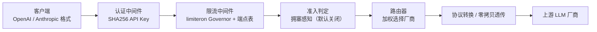
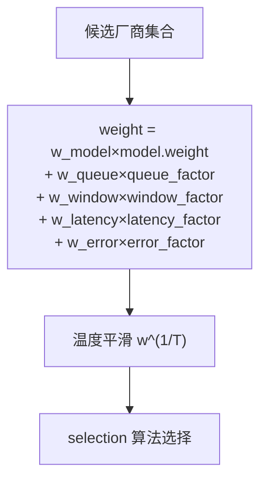
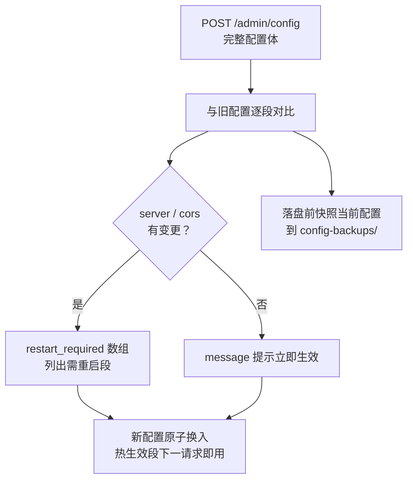
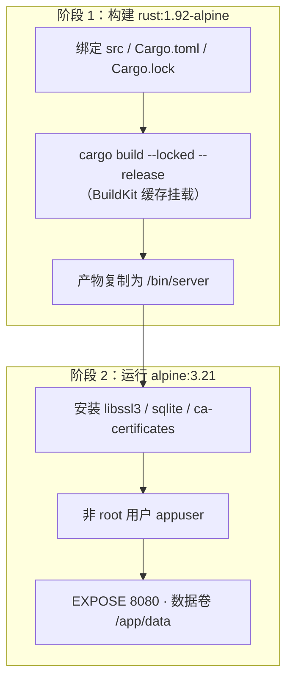

# NexusFlow 用户指南

**NexusFlow** 是一个智能 LLM 路由代理系统：多厂商统一管理、格式转换、智能调度。基于 Rust + Axum 0.8 + sdforge 构建，把多个上游 LLM 供应商抽象为单一接入点，提供加权路由、限流熔断、请求日志、Token 统计等生产级能力。本指南覆盖从编译启动到部署运维的完整操作路径。

> 相关文档：[FAQ](./FAQ.md) · [API 参考](./API_REFERENCE.md) · [README](../README.md)

## 📋 目录

- [快速开始](#-快速开始)
- [认证配置](#-认证配置)
- [厂商与模型配置](#-厂商与模型配置)
- [路由调优 routing](#-路由调优-routing)
- [重试与韧性 retryresilience](#-重试与韧性-retry--resilience)
- [响应缓存 cache](#-响应缓存-cache)
- [入站限流与准入 ratelimitadmission](#-入站限流与准入-ratelimit--admission)
- [定价与成本 pricing](#-定价与成本-pricing)
- [配置热更新操作指南](#-配置热更新操作指南)
- [Docker 部署](#-docker-部署)
- [运维手册](#-运维手册)
- [gRPC 服务器 grpc](#-grpc-服务器-grpc)
- [Rust SDK 一览](#-rust-sdk-一览)
- [延伸阅读](#-延伸阅读)

---

## 🚀 快速开始

### 环境要求

| 项目 | 要求 | 说明 |
|:-----|:-----|:-----|
| Rust | 1.92 | CI 锁定版本（`.github/workflows/ci.yml` 的 `RUST_VERSION: '1.92'`，与 `Dockerfile` 的 `ARG RUST_VERSION=1.92` 一致） |
| 兄弟库 | 7 个，须与本项目同级目录 | `confers` / `dbnexus` / `inklog` / `limiteron` / `oxcache` / `sdforge` / `trait-kit`（均为 path 依赖并经 `[patch.crates-io]` 重定向，见根 `Cargo.toml`） |
| 上游密钥 | 按厂商注入环境变量 | 各 `[[vendors]]` 条目的 `api_key_env` 指定的环境变量（如 `OPENAI_API_KEY`） |

### 编译与启动

```bash
# 默认读取当前目录 config.toml
cargo run --release

# 指定配置文件路径（第一个命令行参数）
cargo run --release -- /path/to/config.toml
```

配置路径参数解析见 `src/main.rs`（`std::env::args().nth(1)`，缺省 `config.toml`）。服务器默认监听 `0.0.0.0:8080`（`[server]` 段默认值，见 `src/config/mod.rs`）。

### 验证服务

```bash
curl http://127.0.0.1:8080/api/v1/health
```

> ⚠️ **注意**：健康检查的注册路径是 **`/api/v1/health`**——`src/api/health.rs` 的 `#[forge(version = "v1")]` 宏会给 `path = "/health"` 自动加 `/api/v1` 版本前缀。裸 `/health` 未注册路由（直接访问返回 404），它只出现在认证与限流的放行白名单里。

正常响应：

```json
{"status": "ok", "version": "0.1.0", "timestamp": "..."}
```

### 一次请求的完整路径



---

## 🔐 认证配置

### 密钥存储形态

API Key 以 **SHA256 hex 摘要** 存储，明文密钥不落盘、不进内存。生成摘要：

```bash
echo -n "your-key" | sha256sum
```

认证时对请求携带的 key 现场计算摘要做常量时间比较（`src/middleware/auth.rs`）。

### [auth] 段

| 字段 | 默认值 | 说明 |
|:-----|:-------|:-----|
| `enabled` | `true`（段存在时） | 认证开关；**整个 `[auth]` 段缺省 = 认证禁用**（`auth: Option<AuthSection>`，`None` 直接放行） |
| `api_keys` | 空 | 合法 key 的 SHA256 hex 摘要列表 |
| `[[auth.keys]]` | 空 | key 档位表（配合 `[admission]` 拥塞准入） |
| `[auth.header]` | `name = "Authorization"` / `prefix = "Bearer"` | 保留段结构，防热更写回时抹段 |

### [[auth.keys]] 档位

| 字段 | 说明 |
|:-----|:-----|
| `hash` | key 的 SHA256 hex 摘要（与 `api_keys` 同形态） |
| `tier` | `dedicated` / `guaranteed` / `elastic` / `spot`，**默认 `elastic`** |

未在 `keys` 中声明的 key（含 `api_keys` 列表全部）一律落 `elastic` 档。档位仅在 `[admission]` 拥塞准入开启时参与优先级判定（见[入站限流与准入](#-入站限流与准入-ratelimit--admission)）。

```toml
[auth]
enabled = true
api_keys = ["<sha256-hex-of-your-key>"]

[[auth.keys]]
hash = "<sha256-hex>"
tier = "dedicated"
```

### 请求头与热读

- 客户端携带 **`Authorization: Bearer <key>`**（优先）或 **`x-api-key: <key>`**（备用），提取逻辑见 `src/middleware/auth.rs:140-168`。
- 认证状态**每请求从热配置现读**：吊销 / 轮换 key、切换 `enabled`，`POST /admin/config` 后立即生效，无需重启。
- 认证豁免路径（`/health`、`/api/v1/health`、`/`、`/readyz`、`/metrics`、`/api-docs`与`/api-docs/*`、`/swagger-ui`与`/swagger-ui/*`，见 `src/middleware/auth.rs:201-210`）无需 key；注意 `/healthz` 与 `/ready` 只在限流侧豁免，**认证仍要求带 key**。

---

## 🏭 厂商与模型配置

### [[vendors]] 全字段

| 字段 | 类型 | 默认值 | 说明 |
|:-----|:-----|:-------|:-----|
| `id` | String | 必填 | 厂商唯一标识；**跨条目去重校验**，重复导致配置加载失败（`src/config/loader.rs`） |
| `name` | String | 必填 | 显示名 |
| `type_` | String | 必填（TOML 键名 `type`） | `"openai"` 或 `"anthropic"` |
| `api_key_env` | String | 必填 | 存放上游密钥的环境变量名 |
| `api_base` | String | `""` | 上游 API 基地址 |
| `enabled` | bool | `true` | 厂商开关 |
| `priority` | u8 | `1` | fallback 优先级，**数值越小优先级越高**（1 = primary） |
| `models` | 数组 | 空 | 模型列表，见下 |
| `rate_limit` | 表 | 必填 | 厂商级配额，三形态，见下 |
| `concurrency` | 表 | 见下 | 并发控制 |
| `timeout_ms` | u64 | `60000` | 出站单次尝试总超时（毫秒），`0` = 不限时 |
| `stream_ttft_ms` | u64 | `60000` | 流式首包（响应头）超时（毫秒），`0` = 不限时 |
| `stream_idle_ms` | u64 | `30000` | 流式相邻 chunk 间 idle 超时（毫秒），`0` = 不限时 |

配置定义见 `src/config/mod.rs`（`VendorConfig`）。

### models 子项

| 字段 | 默认值 | 说明 |
|:-----|:-------|:-----|
| `model_id` | 必填 | 上游真实模型名 |
| `abstract_id` | 无 | 抽象模型名（路由的逻辑标识，可多厂商映射同一抽象名） |
| `weight` | `1.0` | 路由权重（通常 0.0–2.0） |
| `enabled` | `true` | 模型开关 |

### rate_limit 三形态（tagged enum，键 `type`）

| 形态 | 字段 | 说明 |
|:-----|:-----|:-----|
| `time_window` | `start` / `end` | 固定时间段放行 |
| `interval` | `hours`、`sliding`（默认 `false`） | 每 N 小时一个窗口；`sliding = true` 切换滑动窗口（消除固定窗口翻越点的瞬时双花） |
| `token` | `max_tokens`、`window_hours`（默认 `24`）、`sliding`（默认 `false`） | token 配额窗口 |

### concurrency 子项

| 字段 | 默认值 | 说明 |
|:-----|:-------|:-----|
| `requests_per_second` | `1` | 出站令牌桶速率 |
| `max_concurrent_requests` | 无（`None`） | 最大并发在途数（含流式）；缺省用队列容量（100） |
| `token_weighted` | `false` | token 加权并发票据开关（agentic 长会话按预估 token 占票） |
| `token_ticket_min` | `1` | 单请求票据下限 |
| `token_ticket_max` | `16384` | 单请求票据上限（逃逸阀） |
| `token_ticket_default` | `4096` | 请求未声明 `max_tokens` 时的计费兜底 |

> ⚠️ `concurrency` 在 vendor 实例构造期消费，属**需重启生效**段（见[配置热更新](#-配置热更新操作指南)）。

### [global_model] 全局模型

| 字段 | 默认值 | 说明 |
|:-----|:-------|:-----|
| `enabled` | `true` | 全局模型路由开关 |
| `strategy` | `"weighted"` | 策略档：`weighted` / `fallback` / `priority` |

---

## 🎯 路由调优 routing

### 权重公式



默认三维系数 `0.4 / 0.3 / 0.3` 与历史行为逐位一致；`w_latency` / `w_error` 默认 `0`（关闭），显式开启才生效。定义见 `src/config/mod.rs`（`RoutingSection`），消费见 `src/router/router.rs`。

### [routing] 字段与默认值

| 字段 | 默认值 | 说明 |
|:-----|:-------|:-----|
| `w_model` | `0.4` | 配置权重维系数 |
| `w_queue` | `0.3` | 负载维系数（输入由 `load_signal` 决定） |
| `w_window` | `0.3` | Token 预算 / 窗口维系数 |
| `w_latency` | `0.0` | EWMA 延迟因子系数（`0` = 关闭） |
| `w_error` | `0.0` | EWMA 错误率因子系数（`0` = 关闭） |
| `latency_ref_ms` | `1000.0` | 延迟因子参考值：厂商 EWMA 等于该值时因子 0.5 |
| `temperature` | `1.0` | 温度平滑指数；`>1` 压平差距，`<1` 放大差距，必须 `>0` |
| `selection` | `"weighted"` | 选择算法：`weighted`（轮盘赌）/ `power_of_two`（Po2C 实验）/ `linucb`（bandit 档，未接线时回退 weighted）；未知值按 `weighted` |
| `load_signal` | `"queue"` | 负载维输入档：`queue`（队列深度）/ `in_flight`（在途请求数）/ `in_flight_relative`（在途相对化）；单选不叠加，未知值按 `queue` |
| `ewma_tau_ms` | `10000` | Peak-EWMA 时间常数 τ（毫秒） |
| `latency_buffer` | `0.0` | min+buffer 候选集缓冲（`>0` 时先取 EWMA ≤ 最低×(1+buffer) 的集合再均匀随机）；`0` = 关闭 |
| `allow_request_weight` | `false` | `X-Weight` 请求级权重开关（默认忽略该头） |
| `fail_open_when_all_cooling` | `false` | 全候选冷却时回落「忽略状态但 enabled」的候选集（有意冒险，仅建议有兜底容量的部署开启） |
| `retry_after_hint` | `false` | 换路耗尽且全部原因为 Throttled 时返回 `429 + Retry-After` 头 |
| `affinity_mode` | `"hard"` | 会话亲和：`hard`（命中即返回）/ `soft`（命中软化为权重乘子）；未知值按 `hard` |
| `affinity_boost_factor` | `1.0` | soft 模式命中权重乘子基准（权重 ×(1+该值)） |
| `affinity_tenant_scoped` | `false` | 亲和键租户隔离（`affinity:{api_key_hash}:{session_key}`，防跨租户劫持） |
| `sla_v` | `0.0` | SLA/满意度虚拟队列打分强度（`0` = 关闭） |
| `sla_alpha` | `0.95` | 目标服务水平 α（[0,1]） |
| `lps_delta` | `0.0` | LPS 排队论延迟前瞻软约束强度（`0` = 关闭） |
| `lps_deadline_gate` | `false` | LPS 硬约束门控（按 `x-deadline-ms` 头筛可行集） |
| `default_deadline_ms` | `10000.0` | 未携带 deadline 头时的默认截止（毫秒） |
| `ucb_alpha` | `1.0` | LinUCB 探索参数（仅 `selection = "linucb"` 时被咨询） |

### 会话亲和

- 客户端经 **`X-Session-Id`** 头声明会话键；缺失时兜底 `sha256(messages[0] 序列化前 2KB)` 截断 hex（`src/api/routing_hints.rs`）。
- `affinity_mode = "hard"`（默认）时命中绑定厂商必选；`"soft"` 时命中厂商权重乘 `(1 + affinity_boost_factor)` 后与其余候选照常竞争。

### 命名预设

三套开箱即用的系数组合（`RoutingSection::preset`）：

| 预设 | w_model | w_queue | w_window | 特点 |
|:-----|:-------:|:-------:|:--------:|:-----|
| `quality` | 0.7 | 0.2 | 0.1 | 偏模型配置权重 |
| `latency` | 0.2 | 0.2 | 0.2 | 额外开 `w_latency = 0.4`、`latency_ref_ms = 500` |
| `cost` | 0.2 | 0.2 | 0.6 | 偏窗口预算（Token 余额 ≈ 成本预算代理） |

---

## 🛡️ 重试与韧性 retry · resilience

### [retry] 出站重试

| 字段 | 默认值 | 说明 |
|:-----|:-------|:-----|
| `max_retries` | `3` | 单 vendor 内最大重试次数（不含首次调用） |
| `retryable_status_codes` | `[429, 500, 502, 503]` | 触发重试的状态码集合（429 指数退避，5xx 固定间隔） |
| `initial_delay_ms` | `1000` | 首次重试前延迟（毫秒） |
| `factor` | `2.0` | 指数退避乘数 |
| `max_delay_ms` | `16000` | 单次等待上限（毫秒） |
| `jitter` | `0.2` | 退避抖动比例（0.0–1.0） |
| `spread_jitter` | `1.0` | Retry-After / 5xx 固定间隔的同步惊群展宽：延迟 = base + U(0, spread_jitter)×base；`0.0` 回滚旧行为 |
| `max_total_attempts` | `8` | 跨 vendor 总尝试预算（防 vendor 数 × 重试数爆炸） |
| `retry_budget_secs` | `0` | 单请求重试总时间预算（秒）；`0` = 不限时 |
| `amplification_gate` | `false` | 重试放大守门器（失败率逼近临界时收紧总尝试为 1） |

重试策略每请求从热配置现读，热更立即生效。

### [resilience] 韧性覆盖面

| 字段 | 默认值 | 说明 |
|:-----|:-------|:-----|
| `cover_all_paths` | `false` | 熔断 / 重试 / 换路是否覆盖透传与流式路径（关闭时仅转换非流式有换路 fallback） |
| `failure_rate_gate` | `false` | 失败率软降权开关（超阈厂商权重打折不剔除） |
| `failure_rate_min_samples` | `5` | 触发软降权的最小窗口样本数（防小样本误杀） |
| `failure_rate_threshold` | `0.5` | 失败率阈值（(0,1]） |
| `failure_rate_penalty` | `0.1` | 软降权乘子（权重 ×penalty） |

### 熔断器行为

per-vendor 熔断器（limiteron CircuitBreaker）：**连续 5 次失败打开，打开 30 秒后进入 half-open，连续 3 次成功恢复**。慢调用判定线抬高到 60 秒 / 100%（防止 LLM 常态长调用被误判为慢），生产配置单点见 `src/vendor/manager.rs:176-212`。

---

## 💾 响应缓存 cache

精确响应缓存基于 oxcache memory 后端，缓存键形 `resp:{api_key_sha256}:{vendor_id}:{model_id}:{sha256(canonical_body)}`（key 哈希入键做租户隔离）。定义见 `src/config/mod.rs`（`CacheSection`），实现见 `src/api/response_cache.rs`。

### [cache] 字段与默认值

| 字段 | 默认值 | 说明 |
|:-----|:-------|:-----|
| `enabled` | `false` | 默认关闭（TTL 内响应陈旧是产品语义，上线由运维显式打开） |
| `ttl_secs` | `300` | 基础 TTL（秒） |
| `ttl_load_linked` | `false` | TTL 负载联动开关（开启后 TTL 随延迟 / 流量放大） |
| `w_l` | `0.0` | 负载联动延迟项权重 |
| `w_q` | `0.0` | 负载联动流量份额项权重 |
| `beta_max` | `1.5` | 负载放大上限（配置 <1 按 1 处理，只放大不缩短） |
| `l_target` | `1000.0` | 延迟目标（毫秒，ewma_e2e_ms 口径） |
| `q_target` | `0.5` | 流量份额目标（0..1） |
| `[[cache.categories]]` | 空 | 按模型前缀的 TTL 类别乘数表 |
| `ttl_jitter` | `0.0` | TTL 抖动系数（>0 时写入 TTL 按 `ttl×(1±factor)` 对称抖动，同批键过期不齐峰） |
| `null_cache_ttl_secs` | `60` | 空响应负缓存窗口秒数（Null 响应写哨兵，窗口内直接命中不再穿透上游） |

### 缓存门控与跳过

- **只有确定性请求会查/写缓存**：`stream == false` 且 `tools` 为空 且 `temperature == 0`（或缺省）。
- 请求携带 **`X-No-Cache: 1`** 强制回源（不读不写；兼容别名 `X-Skip-Cache`）。
- `[[cache.categories]]` 单条字段：`model_id_prefix`（模型名前缀）+ `multiplier`（TTL 乘数）；无命中的模型乘数 1.0。
- **并发防击穿**：同 key 并发 Miss 只放行一次上游（leader），其余等待回写后复用；leader 失败时 30s 超时后由等待者接管，不永久挂起。
- **空响应负缓存**：上游 Null 结果写哨兵（`null_cache_ttl_secs` 窗口），窗口内直接命中空值不再穿透，过期后允许再穿透。

```toml
[cache]
enabled = true
ttl_secs = 300

[[cache.categories]]
model_id_prefix = "gpt-4o-mini"
multiplier = 2.0
```

---

## 🚦 入站限流与准入 ratelimit · admission

### [rate_limit] 入站限流

限流规则经 `[[rate_limit.rules]]` 声明，Router 构造期消费（**restart-required**，见 `src/api/router_builder.rs`）：

| 字段 | 默认值 | 说明 |
|:-----|:-------|:-----|
| `id` | 必填 | 规则标识（观测 / 日志维度） |
| `path` | 无 | 端点路径前缀（前缀匹配，如 `/v1/chat/completions`）；**缺省 = 全局规则**（注入 limiteron Governor，按租户 `X-User-Id` 维度判定） |
| `per_tenant` | `true` | 按租户（调用方 API key 摘要）分桶；`false` 退化为规则级单桶 |
| `window_secs` | 必填 | 滑动窗口时长（秒，`0` 按 1s 兜底） |
| `max_requests` | 必填 | 窗口内最大请求数 |

```toml
[[rate_limit.rules]]
id = "chat-cap"
path = "/v1/chat/completions"
per_tenant = true
window_secs = 60
max_requests = 30

[[rate_limit.rules]]
id = "global-cap"
window_secs = 1
max_requests = 100
```

行为要点：

- `rules` 为空（缺省）= limiteron Governor 内置默认兜底规则，无端点表。
- 超限返回 `429 + Retry-After`（取窗口重置剩余秒数）；限流器内部故障放行（fail-open）。
- 限流豁免路径（`is_quota_exempt_path` 十条：`/health`、`/healthz`、`/ready`、`/api/v1/health`、`/readyz`、`/metrics`、`/api-docs`与`/api-docs/*`、`/swagger-ui`与`/swagger-ui/*`，见 `src/api/router_builder.rs:50-58`）。
- 端点表条目有硬上限（1024），auth 关闭时达到上限后新租户退化到共享桶，内存有界。

### [admission] 拥塞感知优先级准入

网关并发占用率（Σ 在途 / Σ 并发上限）达到阈值时，新请求按档位优先级与「当前在途最小档」比较，低者直接 `429 + Retry-After`（不排队）。判定在限流之后、handler 之前（`src/middleware/admission.rs`）。

| 字段 | 默认值 | 说明 |
|:-----|:-------|:-----|
| `enabled` | `false` | 默认完全关闭（判定旁路）；热读开关，热更立即生效 |
| `congestion_threshold` | `0.9` | 拥塞阈值（占用率 ≥ 该值视为拥塞） |
| `alpha_slo` | `2.0` | SLO 缺口系数（预留，当前无数据源） |
| `alpha_burst` | `1.0` | burst EWMA（到达速率）压制系数 |
| `alpha_debt` | `4.0` | debt EWMA（被 shed 频度）压制系数 |

准入优先级基准来自 **`[[auth.keys]]` 的 `tier` 档位**（`dedicated` > `guaranteed` > `elastic` > `spot`，见 `src/config/mod.rs` 的 `AuthTier`），未声明的 key 落 `elastic` 档。

---

## 💰 定价与成本 pricing

### [[pricing]] 定价表

| 字段 | 说明 |
|:-----|:-----|
| `vendor_id` | 厂商 ID（须与 `[[vendors]].id` 匹配） |
| `model_id` | 模型 ID |
| `input_per_1k_tokens` | 输入单价（USD / 1k tokens） |
| `output_per_1k_tokens` | 输出单价（USD / 1k tokens） |

成本公式：`(prompt/1000)×input + (completion/1000)×output`，按 `(vendor_id, model_id)` 精确匹配查找（`src/vendor/cost.rs`）。

### 已知边界（如实声明）

- **未配置 `[[pricing]]` 或 (vendor, model) 不匹配时成本按 `0.0` 计**，不会阻塞响应。
- 定价热更立即生效（定价表支持运行时动态更新）。
- 成本当前只进**内存 `CostTracker`** 累积：请求日志表 `request_logs.cost_usd` 恒为 `None`（`src/api/openai.rs` / `src/api/anthropic.rs` 构造日志条目时固定填 `None`），且**没有 `/admin/cost` 查询端点**——跨重启的成本持久化查询属已知未实现能力。

---

## 🔄 配置热更新操作指南

### 操作入口

| 端点 | 说明 |
|:-----|:-----|
| `GET /admin/config` | 读取当前生效配置 |
| `POST /admin/config` | **全量覆盖**更新（body 为完整 Config JSON/TOML 结构，不是增量 patch） |
| `POST /admin/models/global` | 原子 RMW 更新全局模型策略（路径 id 约定为 `global`） |

RMW（读-改-写）端点在 `ConfigManager` 写锁内完成读-改-校验-落盘，并发互斥不丢更新（`src/api/admin.rs`）。

### 热生效段 vs 需重启段

| 类别 | 段 | 生效方式 |
|:-----|:---|:---------|
| 热生效 | `auth`（每请求热读）、`retry`（每请求热读）、`routing`（每次路由热读）、`cache`、`resilience`、`admission`、`pricing`、`global_model` | `POST /admin/config` 后下一请求即用新值 |
| 需重启 | `server` / `cors`（建站期被 sdforge 固化）、`rate_limit`（Router 构造期消费）、vendor `concurrency`（vendor 实例构造期消费）、`database`（启动期建池）、`docs`（文档路由建站期挂载）、`vendors`（实例拓扑） | 修改后须重启进程 |

> ⚠️ `POST /admin/config` 的响应含 **`restart_required` 数组**；该数组当前**只检测 `server` 与 `cors` 两段**（`src/api/admin.rs:176-206`）。`rate_limit` / `concurrency` / `database` 的重启要求在代码注释中声明，不会出现在数组里——改这些段后请自行安排重启。



### 自动快照与回滚锚点

- 每次更新落盘前，把当前配置快照到 **`config-backups/`**，**保留最近 10 份**（超出自动清理）。
- 快照经 Redacted 序列化，`auth.api_keys` 路径打码（双保险——存储本身已是 SHA256 摘要）。见 `src/config/manager.rs`。

### 全量写回语义（重要）

`persist` 以 `toml::to_string_pretty` **全量写回 config.toml**：所有段必须进入 `Config` 结构体，**未进结构体的自定义段会在 TOML 反序列化时被丢弃**，首次热更写回后即从磁盘消失（`src/config/mod.rs` 的 `Config` 字段文档注释）。不要在 config.toml 里放 NexusFlow 不认识的自定义段。

### 文件监听热重载

除 `POST /admin/config` 外，网关启动时若配置来自文件，会旁挂文件监听（去抖 500ms，监听父目录以兼容原子 rename 写盘）：

- **热生效段**：`retry` / `routing` / `cache` / `resilience` / `admission` / `auth` / `pricing` / `model_catalog`——文件改动后下一请求即用新值（只切内存，不落盘；与 admin 写盘内容一致时跳过，不成环）。
- **结构变更拒绝**：`vendors`（实例拓扑）、`server`、`database`、`grpc`、`cors`、`rate_limit`、`docs` 改动触发 `ReloadRejected`——旧快照继续服务，失败计数 + 日志留痕，改后须重启。
- `docs` 段改动同样拒绝（路由建站期固化，见上表需重启段）。

---

## 🐳 Docker 部署

### 镜像构建

Docker 相关文件位于 `docker/` 目录：`docker/Dockerfile`（构建定义）与 `docker/docker-compose.yml`（部署编排）；`.dockerignore` 留在仓库根——构建上下文是仓库根，忽略规则按上下文根解析。构建命令见 [README](../README.md#-docker-部署)。

两阶段构建：`rust:1.92-alpine`（编译）→ `alpine:3.21`（运行），运行态仅含 libssl3 / sqlite / ca-certificates，以非 root 用户 `appuser`（UID/GID 10001）运行，`EXPOSE 8080`，数据目录 `/app/data`。



### docker-compose 要点

| 项 | 值 |
|:---|:---|
| 服务名 / 镜像 | `app` / `nexusflow:latest` |
| 端口 | `8080:8080` |
| 数据卷 | `nexusflow_data:/app/data`（SQLite 持久化） |
| 资源限制 | `cpus: '2.00'` / `memory: 512M`（预留 `0.50` / `128M`） |
| 重启策略 | `unless-stopped` |
| 密钥注入 | 环境变量（如 `OPENAI_API_KEY=${OPENAI_API_KEY}`） |

### ✅ 健康检查路径

`Dockerfile` 的 `HEALTHCHECK` 与 `docker-compose.yml` 的 `healthcheck` 均已对齐实际注册路径 **`/api/v1/health`**（裸 `/health` 未注册路由，仅存在于 auth 与限流白名单中）。自建部署如需自定义探针，保持探测该路径即可：

```yaml
healthcheck:
  test: ["CMD", "wget", "--no-verbose", "--tries=1", "--spider", "http://localhost:8080/api/v1/health"]
  interval: 30s
  timeout: 10s
  retries: 3
  start_period: 10s
```

就绪与指标：`/readyz` 聚合 DB 池/`oxcache`/vendor 三项真实检查（全绿 200，任一失败 503），`/metrics` 为 Prometheus 文本（RED 维度）。两者均免认证免限流——**仅建议内网抓取**，公网绑定即信息披露。

---

## 📟 运维手册

### 管理端点一览

| 端点 | 说明 |
|:-----|:-----|
| `GET /admin/logs?start_time=&end_time=&vendor=&model=&limit=` | 请求日志查询（默认 `limit=100`，上限 1000——超限夹断）。⚠️ **`end_time` 已知不生效**：`LogFilter` 有该字段但查询 SQL 未实现对应分支（`src/database/repository.rs:280-313`） |
| `GET /admin/logs/search?vendor=<关键词>&limit=` | 关键词搜索：**`vendor` 参数即搜索关键词**（历史设计，对 `messages` / `error_message` 做 LIKE 匹配，`src/api/admin.rs:54`） |
| `GET /admin/stats/tokens?vendor=` | 小时级 Token 用量统计（`token_usage` 预聚合表） |
| `GET /admin/metrics` | 全局指标快照：请求计数、错误率、平均延迟、各厂商细分，含 `dropped_logs`（日志通道背压丢弃计数） |
| `GET /admin/vendors` | 全部厂商状态与队列长度 |
| `GET /admin/vendors/{id}/status` | 单厂商状态 |
| `POST /admin/vendors/{id}/reset` | **no-op**：limiteron Governor 自动管理限流状态（令牌自动 refill），端点仅为 API 兼容保留（`src/api/admin.rs:112-123`） |

### 日志语言

管理端点与错误消息支持中英双语，由环境变量 **`NEXUSFLOW_LANG=en|zh`** 控制；未设置时按 `LC_ALL` → `LC_MESSAGES` → `LANG` → 系统区域设置检测，无法识别回退 `en`（`src/i18n/locale.rs`）。

### 故障排查速查

| 现象 | 处置 |
|:-----|:-----|
| 容器 unhealthy | 检查 healthcheck 是否指向 `/api/v1/health`（见 Docker 一节） |
| 配置改了没生效 | 对照热生效段表；`rate_limit` / `concurrency` / `database` 需重启 |
| 成本统计恒 0 | 核对 `[[pricing]]` 的 (vendor_id, model_id) 是否与实际路由完全一致 |
| 更多怪癖 | 见 [FAQ](./FAQ.md) |

---

## 🌐 gRPC 服务器 grpc

`grpc` feature（独立门控，**不进** `full`——sdforge 的 grpc 编译期需要 `protoc`）提供 gRPC 服务器，与 HTTP 同进程共存：

```toml
# config.toml
[grpc]
enabled = true        # 默认 false，显式启用
host = "0.0.0.0"
port = 50051          # gRPC 惯例端口
timeout_seconds = 30  # per-call 超时，0 = 不限
max_connections = 1000
# http2_keepalive_interval_secs = 30
# http2_keepalive_timeout_secs = 10
```

| 项 | 说明 |
|:---|:-----|
| 启用方式 | `cargo build --features grpc`（或在 `full` 之上追加）；本段缺席或 `enabled = false` 时完全不监听，行为与历史版本逐位一致 |
| 服务面 | sdforge `sdforge.v1.SdForgeService` 门面：`GetInfo`（免认证）/ `Call` / `CallStream`（JSON over gRPC，`#[forge(grpc_method = "...")]` 声明的 handler 经 inventory 自动注册） |
| 认证 | Call/CallStream 逐调用校验 `[auth]` 段 SHA256 摘要（`x-api-key` metadata 或 `authorization: Bearer <key>`，常量时间比较）；`[auth]` 缺段或禁用时放行。**与 HTTP 的差异**：gRPC 无 `/health` 式 method 白名单（GetInfo 免认证是 sdforge 门面现状，其余一律要求 key） |
| 优雅停机 | Ctrl+C/SIGTERM 一次触发：HTTP 与 gRPC 并行排空 in-flight（gRPC 排空上限 30s），完成后统一 flush 日志管道 |
| TLS | 不经 sdforge 终结（明文监听），与 `[server]` 同策略——由外部反代承担 |
| 热更新 | `[grpc]` 段为**建站期消费**（固化于服务器构造），更新后需重启进程 |

**gRPC 客户端调用示例**（任意 tonic 客户端，以 sdforge 生成的门面 client 为例）：

```rust
use sdforge::grpc::sdforge_v1::{CallRequest, sd_forge_service_client::SdForgeServiceClient};

let mut client = SdForgeServiceClient::connect("http://127.0.0.1:50051").await?;
let mut request = tonic::Request::new(CallRequest {
    method: "nexusflow.health".into(),   // 任意 #[forge(grpc_method)] 注册的方法名
    parameters: Default::default(),
    data: r#"{"prompt":"hi"}"#.into(),   // JSON 载荷经门面分发到 handler
});
request.metadata_mut().insert("x-api-key", "<your-key>".parse()?);
let response = client.call(request).await?;   // CallResponse.data 为 handler JSON 输出
```

> 嵌入式用法：`build_app` 后经 `ServerHandle::take_grpc_server()` 取出 `GrpcServer`，自行 `tokio::spawn(server.serve(signal))`——装配不等于启动。

---

## 🧰 Rust SDK 一览

SDK 已并入主 crate 的 `src/sdk` 模块（`sdk` feature 门控，默认 `full` 已含），通过 Rust 接口与已部署网关交互（HTTP 客户端，非进程内直连）：

| 项 | 内容 |
|:---|:-----|
| 启用方式 | `nexusflow = { features = ["sdk"] }`（`reqwest` + `eventsource-stream` 随该 feature 引入） |
| 模块 | `chat` / `embed` / `stream` / `client`（`NexusFlowClient` 及 Builder）/ `config`（`RequestConfig`）/ `admin` / `error` |
| 类型导出 | `ChatMessage`（多模态 `ChatContent::Parts` / tool_calls）/ `ChatRequest`（tools / tool_choice / vendor_extensions / penalties）/ `ChatResponse`（结构化 finish_reason + 含 cache_read 的 usage + tool_calls）/ `EmbedRequest` / `EmbedResponse` / `ChatStream`（tool_calls 增量片段 + usage 尾帧）/ 目录 CRUD（`ModelCatalogInfo` / `ModelCatalogUpsert`）等 |
| 示例 | 见 [README「作为库依赖」](../README.md#-作为库依赖) |

> **SDK 对齐说明**（SDK ↔ 网关零失配，路径/形状以路由表为准）：admin 面
> `models()` 走 `GET /admin/models`（模型能力目录；旧 `GET /v1/models`
> 网关未注册已废弃）、`health()` 走 `GET /api/v1/health`（旧
> `admin/health` 不存在）、`vendors()` 返回运行面状态
> `{id,status,queue_length,key_pool}`（非配置面 `{name,enabled}`）；
> 新增 `upsert_model` / `delete_model`（目录 CRUD）。chat 响应**无
> vendor 字段**（网关不注入，已移除恒空字段）；`finish_reason` 为结构化
> 四变体枚举 + 自定义词透传。

> `NexusFlowSdkError` 的 `Network` 变体与 `ChatStream::from_bytes_stream` 在 `sdk` feature 下恒可用。超时模型：非流式请求（chat / embed）总超时缺省 30s（`NexusFlowClientBuilder::timeout`），可被 `RequestConfig.timeout` 逐请求覆盖；`chat_stream` 流式**不设总超时**（SSE 长流不被切断），连接停滞由 read_timeout（缺省 30s，按读重置）看护。

---

## 🎯 延伸阅读

| 文档 | 说明 |
|:-----|:-----|
| [FAQ](./FAQ.md) | 常见问题与真实怪癖解答 |
| [API 参考](./API_REFERENCE.md) | 端点与请求/响应格式 |
| [架构文档](./ARCHITECTURE.md) | 内部机制与模块设计 |
| [安全文档](./SECURITY.md) | 安全策略 |
| [README](../README.md) | 项目总览与特性清单 |
